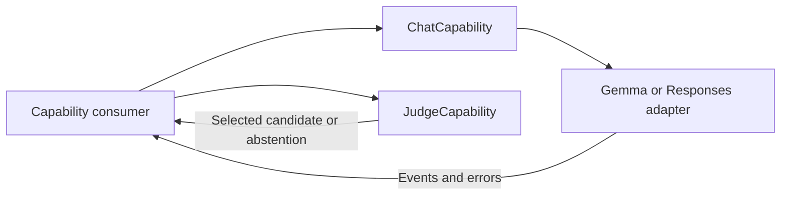

# Language Capability Contracts

## Summary

Provider-neutral conversation generation and candidate-based judgment, independent of application decisions.

## Ownership and boundaries

Language owns request/result contracts. LLM adapters own provider encoding/tokenization; Consumers own prompts, tasks, callable selection and observation continuation. No Signal routing, effect execution or UI exists here.

## External relationships and data flow

The diagram shows runtime calls and data flow, not compilation dependencies.

## Interfaces

LLM defines context-bearing ChatRequest, messages/images/native function data, ChatEvent and optional caller-owned timing. Native calls are inert model data until an authorized consumer resolves them. Judgment defines unique candidates and bounded optional scores without selecting application actions.

Adapters advertise native-call/image support explicitly and reject unsupported payloads before native work. Caller-owned history is authoritative. Decisions/continuations use new requests; the capability does not retain application task state.

✅ Conversation and judgment contracts are implemented.

❌ A concrete judgment provider is not implemented.

## Related design

[Parent design](../README.md) · [JEV](JEV/README.md) · [LLM](LLM/README.md)
