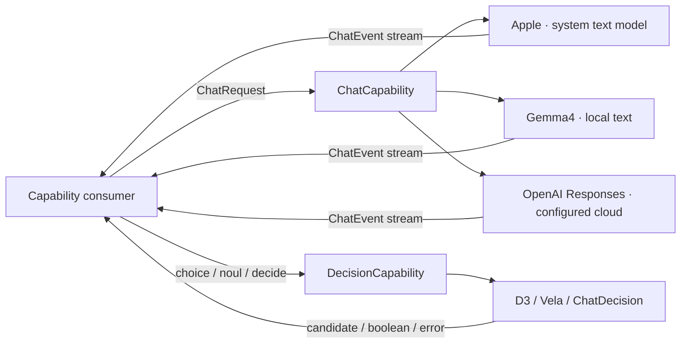

# Language Capability Contracts

## Responsibilities

Language owns provider-neutral conversation and candidate-selection interfaces. Chat consumers supply message history, prompts, tools and optional attachments. Decision consumers supply a question, current text and ordered candidates. The calling Agent owns continuation and interprets model output.

## Data flow

## Interfaces

[LLM](LLM/README.md) defines messages, images, native function declarations and results, text and usage events, dispatch timing and caller-owned transport observations. Providers publish capability constraints before native work. The local [Gemma4](LLM/Gemma4/README.md) fits an inference copy to its effective window. [OpenAI Responses](LLM/OpenAI/README.md) supports the configured cloud wire protocol and required tool choice.

[JEV](JEV/README.md) owns choice/noul/decide contracts, generic ChatDecision, and D3/Vela native implementations in ModelKitD3. Candidate selection and boolean decisions have separate typed requests and results. The caller interprets it and owns routing, interruption and fallback.

[ModelKit](../README.md)

[Apple](LLM/Apple/README.md) provides optional on-device text chat through FoundationModels, with system availability and request-local sessions. Its standalone ModelKitAppleLLM target depends only on the ModelKit contracts.

Multi-question `decide` shares text and context across ordered choice/noul questions and returns typed answers by question ID; lifecycle and failure semantics are defined in [JEV](JEV/README.md).
