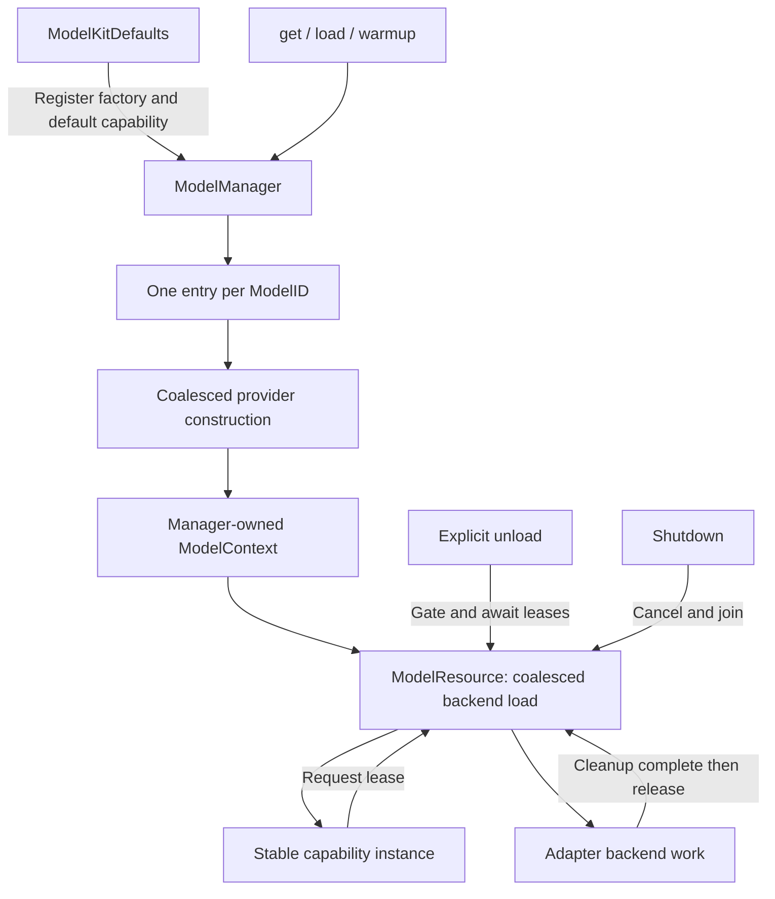
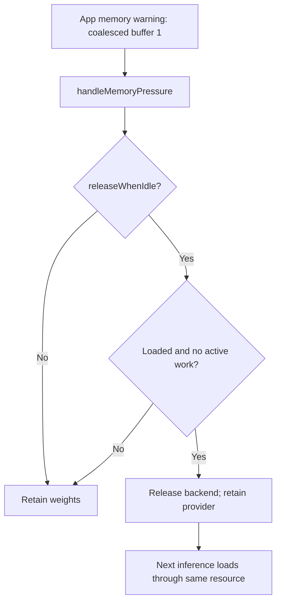
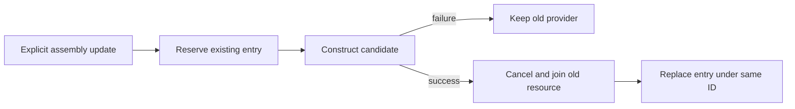
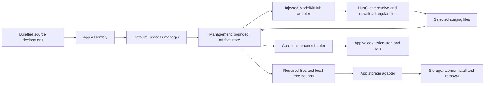

# ModelKitRuntime — Shared Model Container

Purpose: provide internal Defaults registration and App-facing capability retrieval/model lifecycle through one shared container. Design goals: shared identity, bounded concurrency, explicit errors and safe cleanup. This target depends only on ModelKit; concrete adapters are registered by ModelKitDefaults, never imported here.

## Public API and ownership

```swift
let manager = try await ModelKitDefaults.manager(resources: root)
let chat = try await manager.get(.chat)
// Inject chat into a consumer that only imports ModelKit.
try await manager.unload(.chat)
// The same chat object can load again on its next request.
```

Production uses one process-wide manager owned by Defaults. Construction and registration require ModelAssembly SPI, used only by Defaults and isolated tests. `get` preserves provider identity; `load: false` creates only the lightweight provider. Default get, load and warmup load resources. Unload drops weights, not the capability object. Shutdown is terminal and must only be invoked by the application lifecycle owner, never by an individual consumer.

- ModelManager owns registrations, construction tasks, contexts and lifecycle decisions.
- ModelRegistration declares a stable ModelID, exact capability set, explicit memory policy and a context-bound factory. Different versions/backends/configurations require different IDs. Duplicate registration is rejected; no hot replacement.
- ModelContext owns at most one ModelResource. Adapters receive its handle and perform request-local inference, cancellation and lease release. Consumers never receive this context.
- System speech registers a lightweight resource for operation admission/cleanup; it does not claim to own Apple's voice weights.

## Algorithms and bounds



| Resource | Bound / overflow behavior |
| --- | --- |
| Model registrations | 32; reject excess |
| Concurrent factories | 4; reject new construction when full |
| Construction waiters | 32 per model; reject excess |
| Concurrent weight loaders | 4 across this manager; reject excess, no queue |
| Weight-load waiters | 32 per resource; reject excess |
| Active inference leases | Exactly 1 per model, including system speech |
| Unload | One transition per entry; repeated unload rejects |
| Shutdown | One shared task; repeated calls join it |

1. Validate ID/capability and reserve a construction waiter before suspension. Concurrent get calls share one factory task; failure cleans its context and permits a fresh factory attempt.
2. Share one load task per resource. A cancelled waiter does not cancel other callers' load; it receives cancellation when shared work settles. Factory/load implementations must be finite and cooperative. Failed weight loading retains the lightweight provider and can retry.
3. Every inference reserves a lease before loading. No inference backlog exists; busy requests fail. Streaming leases last until producer/backend cleanup, not merely until the session handle is returned or cancellation is requested.
4. Unload rejects new get/load at the entry, gates resource admission and waits for existing leases to drain. It does not cancel those sessions. Existing capability handles follow the resource gate and reuse the provider after unloading. Already admitted work may finish; no automatic replay.
5. Shutdown is terminal: close manager admission, cancel construction/loads/active sessions and join cleanup. Old resource-backed handles reject subsequent work. Non-cooperative backend calls can delay shutdown; the API does not claim forced GPU interruption.

No cancellation callback runs while holding a mutex. Resource load generations prevent late waiters from restoring an unloaded model or deleting a later retry. Different registered IDs deliberately remain distinct; duplicate artifact files under different IDs are not automatically deduplicated.

## Status

- ✅ Unified registration, typed get, deferred get, load, warmup, unload, status and shutdown.
- ✅ Shared provider identity and backend loading; retained handles survive unload; cancelled loads/streams have explicit cleanup.
- ✅ Lifecycle tests cover identity, retry, concurrent construction, unload barriers, shutdown and capacity.
- ❌ Timed idle eviction, measured cross-model memory budgets, priorities and waiting inference queues.
- ❌ Physical-device retry stability requires device acceptance; compilation is not that evidence.

## Memory policy and status

Registration defaults to retain. releaseWhenIdle opts a model into handleMemoryPressure(): the manager examines at most 32 entries, gates one entry at a time, and atomically releases only a loaded resource with no leases, load or teardown in progress. Busy/loading/unconstructed resources are skipped without waiting, cancellation or deferred eviction. Existing capability handles reload on their next request; provider identity is retained. This is event-driven idle eviction, not a periodic timer or a guarantee of a particular number of freed bytes.

ModelKitDefaults selects releaseWhenIdle for Nemotron, Gemma 4 E2B and MOSS synthesis. App’s memory-warning stream retains one pending event and coalesces repeated warnings; warnings carry no user data or device commands. Silero and system speech use retain. ModelManager does not depend on UIKit, MLX or OS notification APIs.

ModelState is residency only. A provider without managed resources reports unmanaged. availability(id, for:) obtains a lightweight provider and checks its capability availability without loading weights; it can be unavailable even when residency is unmanaged. Availability is a snapshot and inference can still fail later.

ModelContext construction, seal, residency and lifecycle operations, and ModelLoadGate are ModelManagement SPI. Only ModelKitRuntime and isolated test fixtures import it. Adapters receive ModelContext and can create their single resource using the ordinary public API; consumers receive capabilities only. SPI enforces the normal import boundary, not a security boundary against deliberate SPI imports.



Weight size alone is not a reliable runtime memory budget.

## Default capability acquisition

register(registration, defaults:) binds selected capabilities atomically to a model ID. Selected defaults must be supported by that registration and unbound; collisions reject the whole registration without changing either table. There are at most six default bindings, one per capability kind. Explicit ID registrations can coexist for diagnostics without becoming defaults.

get(.chat, load:) resolves the default ID and follows the same construction/resource path as get(id, as:, load:). load, warmup, unload, status and availability also accept a capability. Missing defaults fail explicitly; there is no model selection fallback or live replacement. The Defaults target owns production mappings while this target has no adapter dependency.

✅ Default and explicit acquisition share the same provider and lifecycle; registration failures preserve existing defaults.
❌ Automatic fallback and dynamic default replacement.

✅ Typed `.pose` acquisition and availability use the existing factory, lifecycle and memory policy paths. The capability binding count is now six.

## Assembly replacement

✅ ModelAssembly SPI replace constructs a candidate before retiring the old provider. It rejects overlapping replacement, validates identical capabilities, closes old resource-backed handles, cancels/joins active work and keeps default IDs and other registrations. Construction failure retains the old provider; manager shutdown includes pending candidates. No replacement queue. Consumers retaining handles must resolve the new binding; App supplies a capability forwarding handle. ❌ Arbitrary automatic model switching is not provided.



## Local model resources — current contract

Purpose: manage explicitly downloaded model artifacts independently from model residency. Design goals: compact bundled metadata, safe all-reference deletion, bounded operations and an independent Management target.

- ✅ `ModelRegistration.swift` owns optional provider artifact associations, schema-v2 source/required-file values, download/status and injected downloader/storage protocols.
- ✅ `ModelArtifactStore.swift` owns two active package slots, eight FIFO pending requests (overflow rejects), persistent request generations, cancellation/join, required-file validation and atomic publication through App-injected Storage. `ModelManager` fences every referencing resource during stop/drain/unload/delete; retained handles cannot reload until maintenance ends.
- ✅ `Backends/HuggingFace/HuggingFaceArtifactDownloader.swift` is the concrete ModelKitHub adapter using swift-huggingface 0.9.0. Runtime depends only on ModelKit; the adapter depends on Runtime contracts and HuggingFace. App injects it through Defaults.
- ✅ Schema v2 declares `source.kind`, HF `repoId`, optional source `revision` (default main), `allowPatterns`, optional `stripPrefix`; ordinary ZIP sources declare a URL and optional archive SHA256. No bundled per-file URLs, sizes or hashes. Production graph exports retain their tested source revision. License identity/compatibility and key `requiredFiles` remain metadata. Parsing bounds: 1 MiB, 32 packages, 128 selection patterns, 4096 required files; malformed/traversing declarations reject.
- ✅ `estimatedBytes` is a storage/display estimate, not an integrity assertion. Hub resolves remote metadata and size-weighted progress. Installation checks a symlink-free tree (16384 entries, 32 GiB maximum) plus required files. SDK checks do not replace an independent static hash trust anchor. Ordinary ZIPs retain an optional archive trust anchor, safe path checks and 64 MiB compressed/256 MiB expanded limits.
- ✅ Storage remains generic. App bridges `LocalFileStore` and a bounded transfer document, writes a local `.installation.json` receipt containing actual installed paths/sizes, and publishes `installed/<directory>` atomically. Startup validates receipt identity and actual file sizes; Settings shows receipt-based installed size. Deletion removes the installed tree; Hub has no separate permanent cache. The exact former filesystem-alias receipt defect is repaired only after complete identity/path/size validation. Other malformed/older receipts show a per-package failure with explicit deletion available; they are not silently reset.
- ✅ Official HF, hf-mirror.com and custom HTTPS domains/cellular policy are persisted by Settings and applied to new downloads. HF uses stable native background sessions with up to three active file tasks per package. ZIP uses the existing background transport and original URL. Leaving Settings does not cancel process-owned work.
- ✅ Relaunch restores persisted requests. Interrupted HF staging and generations are retained for OS task reattachment and completed-file reuse; completion is gated by generation and cancellation. ZIP OS task reassociation remains available. Explicit cancellation removes staging and joins work before deletion.
- ✅ HF native background transfer and available system resume-data reuse are implemented. ❌ Physical-phone lifecycle/large-file acceptance and guaranteed server resume remain outstanding.
- ❌ Batch acquisition, general orphan-stage collection, derived Core ML compilation size accounting, full Xcode/iPhone/network/mirror acceptance remain outstanding. Startup/history/settings stay available without weights; install never starts inference automatically.



Workflow: read source metadata → admit explicit request → SDK downloads selected regular files → strip prefix/bookkeeping → validate required files/local tree → write actual receipt and publish → refresh availability. Delete closes resource admission → App stops related work → drain/unload → cancel/join transfers → remove files → reopen admission. Provider registration, capability binding and inference remain separate from artifact provisioning.

Validation (2026-10-03): ModelKitHub builds; 41 isolated shared tests pass (33 Runtime, 2 Storage, 1 Settings workflow, 5 UI state). Boundary/provisioning/format/project checks pass; Defaults and App storage/settings adapter type checks pass. Full check.sh stops at missing Metal compiler; build-ios.sh requires full Xcode. Real HF/mirror/iPhone acceptance is unverified.

✅ 下载取消会等待任务清理；已取消任务的底层 URLSession 错误不会被显示为下载失败。安装完成后到达的取消是无操作，保留安装状态与文件。❌ 真实网络取消时序仍需设备验证。

Validation update (2026-10-03): with DEVELOPER_DIR pointing to full Xcode 27, check.sh and all four build-ios.sh schemes pass. Latest MobileHarness Debug device build succeeds, installs and launches on the paired iPhone 17 Pro. The packaged Models directory contains metadata only (104 KiB). Live download/progress/cancellation and mirror acceptance remain pending user testing.

✅ Receipt-validated settled files determine installed status. Completion task-index write failures preserve installed state and report transferIndex; old failed cache states cannot override a valid installation. Successful publication clears old errors; failed removal remains visible separately. ❌ Phone records remain unavailable; the later host probe reproduces the reported 100%-then-failure behavior through invalid aliased receipt paths.

Validation refinement (2026-10-03): the official production YOLO ZIP passes native extraction; the actual App storage adapter reproduced shifted receipt paths from /var versus /private/var enumeration. Normalized path derivation fixes publication/receipt validation. A host probe verifies installed status, 3261955 installed bytes, no pending transfer record, exact legacy-path repair and rejection of altered files. ❌ Physical iPhone confirmation remains pending connectivity.


✅ Installed receipt revision mismatches remain observable as incompatible resources; Settings requires explicit deletion before downloading the replacement. Nemotron now points to one shared macOS/iOS Core ML source.


✅ HF failure now preserves the transfer generation and staging; explicit retry reuses it, relaunch reattaches background tasks, and explicit cancel/delete joins work and discards staging. Two active/eight pending admission remains unchanged. Network failures retain numeric error codes. ❌ Server resume and phone lifecycle acceptance remain conditional/pending.
