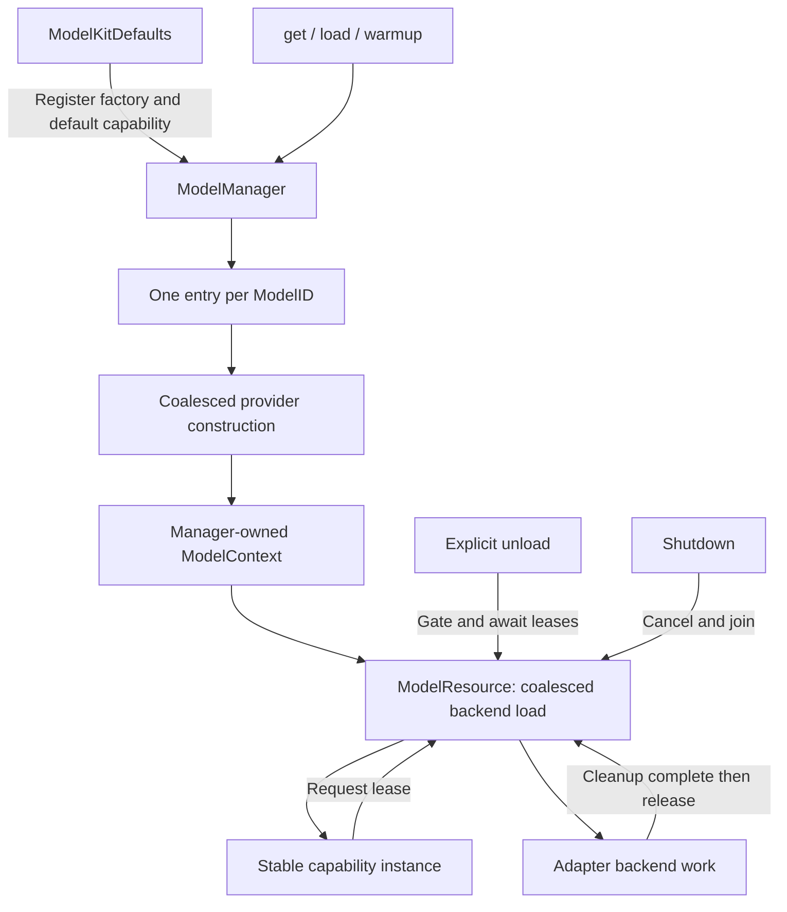
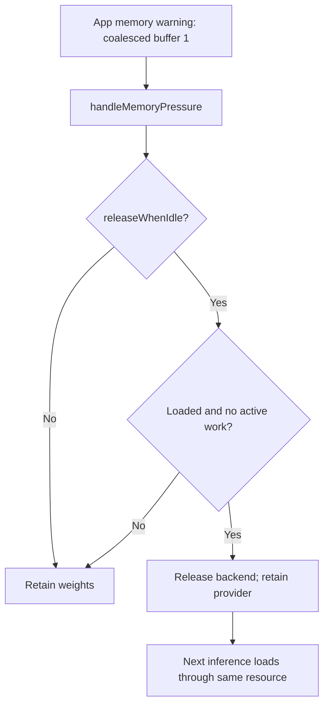

# ModelKitRuntime — Shared Model Container

Purpose: give App composition one IoC entry point for model registration, capability retrieval and weight lifecycle. Design goals: shared identity, bounded concurrency, explicit errors and safe cleanup. This target depends only on ModelKit; concrete adapters are registered by ModelKitDefaults, never imported here.

## Public API and ownership

```swift
let manager = try await ModelKitDefaults.manager(resources: root)
let chat = try await manager.get(.chat)
// Inject chat into a consumer that only imports ModelKit.
try await manager.unload(.chat)
// The same chat object can load again on its next request.
```

Production uses one process-wide manager owned by Defaults. Construction and registration require ModelAssembly SPI, used only by Defaults and isolated tests. `get` preserves provider identity; `load: false` creates only the lightweight provider. Default get, load and warmup load resources. Unload drops weights, not the capability object. Shutdown is terminal and must only be invoked by the application lifecycle owner, never by an individual consumer.

- ModelManager owns registrations, construction tasks, contexts and lifecycle decisions.
- ModelRegistration declares a stable ModelID, exact capability set, explicit memory policy and a context-bound factory. Different versions/backends/configurations require different IDs. Duplicate registration is rejected; no hot replacement.
- ModelContext owns at most one ModelResource. Adapters receive its handle and perform request-local inference, cancellation and lease release. Consumers never receive this context.
- System speech registers a lightweight resource for operation admission/cleanup; it does not claim to own Apple's voice weights.

## Algorithms and bounds



| Resource | Bound / overflow behavior |
| --- | --- |
| Model registrations | 32; reject excess |
| Concurrent factories | 4; reject new construction when full |
| Construction waiters | 32 per model; reject excess |
| Concurrent weight loaders | 4 across this manager; reject excess, no queue |
| Weight-load waiters | 32 per resource; reject excess |
| Active inference leases | Exactly 1 per model, including system speech |
| Unload | One transition per entry; repeated unload rejects |
| Shutdown | One shared task; repeated calls join it |

1. Validate ID/capability and reserve a construction waiter before suspension. Concurrent get calls share one factory task; failure cleans its context and permits a fresh factory attempt.
2. Share one load task per resource. A cancelled waiter does not cancel other callers' load; it receives cancellation when shared work settles. Factory/load implementations must be finite and cooperative. Failed weight loading retains the lightweight provider and can retry.
3. Every inference reserves a lease before loading. No inference backlog exists; busy requests fail. Streaming leases last until producer/backend cleanup, not merely until the session handle is returned or cancellation is requested.
4. Unload rejects new get/load at the entry, gates resource admission and waits for existing leases to drain. It does not cancel those sessions. Existing capability handles follow the resource gate and reuse the provider after unloading. Already admitted work may finish; no automatic replay.
5. Shutdown is terminal: close manager admission, cancel construction/loads/active sessions and join cleanup. Old resource-backed handles reject subsequent work. Non-cooperative backend calls can delay shutdown; the API does not claim forced GPU interruption.

No cancellation callback runs while holding a mutex. Resource load generations prevent late waiters from restoring an unloaded model or deleting a later retry. Different registered IDs deliberately remain distinct; duplicate artifact files under different IDs are not automatically deduplicated.

## Status

- ✅ Unified registration, typed get, deferred get, load, warmup, unload, status and shutdown.
- ✅ Shared provider identity and backend loading; retained handles survive unload; cancelled loads/streams have explicit cleanup.
- ✅ Lifecycle tests cover identity, retry, concurrent construction, unload barriers, shutdown and capacity.
- ❌ Timed idle eviction, measured cross-model memory budgets, priorities, waiting inference queues and hot replacement.
- ❌ Physical-device retry stability requires device acceptance; compilation is not that evidence.

## Memory policy and status

Registration defaults to retain. releaseWhenIdle opts a model into handleMemoryPressure(): the manager examines at most 32 entries, gates one entry at a time, and atomically releases only a loaded resource with no leases, load or teardown in progress. Busy/loading/unconstructed resources are skipped without waiting, cancellation or deferred eviction. Existing capability handles reload on their next request; provider identity is retained. This is event-driven idle eviction, not a periodic timer or a guarantee of a particular number of freed bytes.

ModelKitDefaults selects releaseWhenIdle for Nemotron, Qwen and diagnostic Kokoro. App’s memory-warning stream retains one pending event and coalesces repeated warnings; warnings carry no user data or device commands. Silero and system speech use retain. ModelManager does not depend on UIKit, MLX or OS notification APIs.

ModelState is residency only. A provider without managed resources reports unmanaged. availability(id, for:) obtains a lightweight provider and checks its capability availability without loading weights; it can be unavailable even when residency is unmanaged. Availability is a snapshot and inference can still fail later.

ModelContext construction, seal, residency and lifecycle operations, and ModelLoadGate are ModelManagement SPI. Only ModelKitRuntime and isolated test fixtures import it. Adapters receive ModelContext and can create their single resource using the ordinary public API; consumers receive capabilities only. SPI enforces the normal import boundary, not a security boundary against deliberate SPI imports.



Weight size alone is not a reliable runtime memory budget.

## Default capability acquisition

register(registration, defaults:) binds selected capabilities atomically to a model ID. Selected defaults must be supported by that registration and unbound; collisions reject the whole registration without changing either table. There are at most six default bindings, one per capability kind. Explicit ID registrations can coexist for diagnostics without becoming defaults.

get(.chat, load:) resolves the default ID and follows the same construction/resource path as get(id, as:, load:). load, warmup, unload, status and availability also accept a capability. Missing defaults fail explicitly; there is no model selection fallback or live replacement. The Defaults target owns production mappings while this target has no adapter dependency.

✅ Default and explicit acquisition share the same provider and lifecycle; registration failures preserve existing defaults.
❌ Automatic fallback and dynamic default replacement.

✅ Typed `.pose` acquisition and availability use the existing factory, lifecycle and memory policy paths. The capability binding count is now six.
