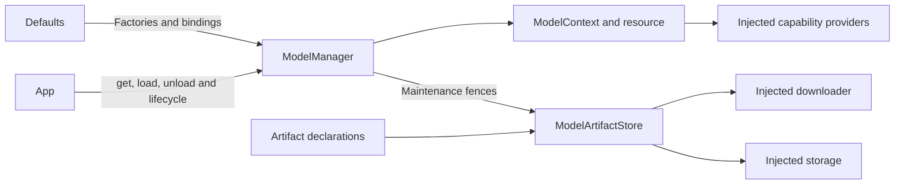

# Model Manager and Artifact Lifecycle

## Summary

Stable capability provider identity, bounded construction/residency and explicit safe artifact acquisition/removal.

## Ownership and boundaries

The ModelKitRuntime target depends only on ModelKit. Defaults uses ModelAssembly SPI for production registration/replacement. App injects downloader/storage/native quiescence; Management imports no concrete backend or Storage.

## External relationships and data flow

Runtime arrows show data or capability calls; dashed arrows show injection.

## Public lifecycle

get by capability or ModelID preserves provider identity. Deferred get constructs only the lightweight provider; default get/load/warmup loads resources. Unload releases weights and retained handles reload later. Availability checks lightweight capability state, independently of residency. Shutdown is a terminal application-owner operation.

| Boundary | Limit / policy |
| --- | --- |
| Registrations / default bindings | 32 / six; atomic collision rejection |
| Concurrent factories / loaders | Four each; no excess queue |
| Construction / load waiters | 32 per model/resource |
| Active inference | Exactly one per model |
| Unload / replacement | One transition per entry; overlap rejects |
| Shutdown | One shared joined task |

Concurrent gets coalesce construction. Factory failure cleans its context and permits explicit future acquisition; failed load retains provider for explicit retry. Cancelled waiters do not cancel shared work. Unload gates and drains without cancelling admitted sessions; shutdown cancels/joins construction/load/inference, including pending replacement candidates. Generations prevent late load restoring retired resources.

Explicit SPI replacement constructs candidate before retiring old resource, validates identical capabilities and cancels/joins old handles. Candidate failure retains old provider. Consumers must resolve the new binding. releaseWhenIdle memory pressure skips busy/loading/unconstructed entries and drops idle weights atomically, without timed eviction or byte promises.

## Artifact contracts and operations

ModelRegistration associates providers with artifact IDs. Schema v2 declares HF repository/revision/patterns/stripPrefix or HTTPS ZIP URL/optional archive SHA-256 plus license/compatibility/required files. Bounds: 1 MiB catalog, 32 packages, 128 patterns and 4096 required files. Malformed/traversing sources reject; estimatedBytes is display/storage estimate, not integrity evidence.

ModelArtifactStore owns two active package slots and eight FIFO pending requests; overflow rejects. Persist generations before admission, validate a symlink-free installed tree (16,384 entries/32 GiB) and required files, then atomically publish through injected storage with actual path/size receipt. ZIP bounds are 64 MiB compressed/256 MiB expanded with safe extraction and optional archive trust anchor. No duplicate permanent SDK cache exists.

Valid settled receipts determine installed state. Identity/revision/path/actual size failures remain observable, with explicit delete available. A valid published installation survives later transfer-index write failure as a bookkeeping warning. Cancel after installation is a no-op; explicit active cancel joins and discards staging. HF transient failure retains compatible generation/completed files for explicit retry/relaunch; network codes remain explicit.

## Maintenance and background separation

Delete gates every referencing resource before App quiescence, drains/unloads, joins transfer cancellation, removes files, then reopens admission. Retained handles cannot reload mid-delete. Installing never starts inference. Background native transfer/OS reattachment belongs to the injected downloader; Manager retains package state independently of pages. Force-quit/server resume behavior remains conditional rather than guaranteed.

✅ Shared providers, bounded lifecycle/replace and receipt-based artifact management are implemented.

❌ Timed eviction, global inference scheduling, general orphan-stage collection and batch acquisition are not implemented.

## Related design

[Parent design](../README.md)
