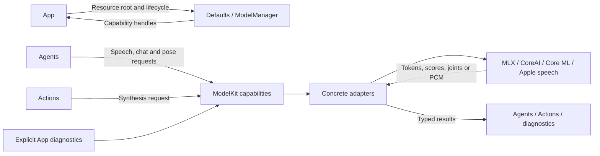
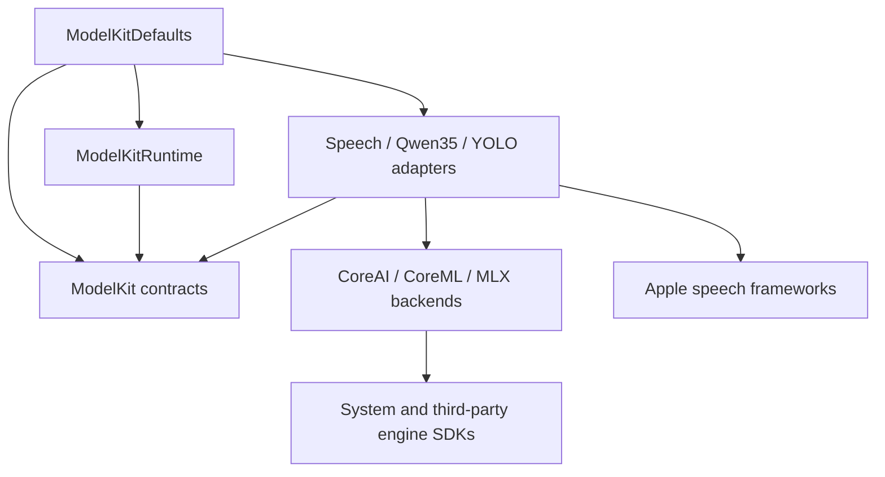
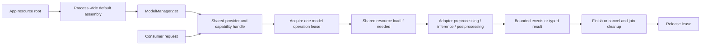

# ModelKit — Model Capabilities and Runtime

Processes supplied data through typed model capabilities. The goal is to keep recognition, generation and pose inference independent of Agent policy, UI and device I/O. Consumers receive capability protocols; internal assembly selects concrete models.

The physical directory contains several Swift targets. Base ModelKit has no project-target dependencies. ModelKitRuntime depends only on ModelKit; adapters and backends compile separately. Root Package.swift owns all targets and root Tests owns their tests.

## Directory structure

```text
ModelKit/
├── Core/                     # Capability, media, bounded sessions and resource admission
├── Defaults/                 # ModelKitDefaults: provider assembly and default bindings
├── Management/               # ModelKitRuntime: ModelManager and registration contracts
├── Language/
│   ├── LLM/                  # ChatCapability and separate Qwen35 adapter
│   └── JEV/                  # JudgeCapability contract; no production provider
├── Speech/
│   ├── ASR/                  # Recognition contract; Apple and Nemotron adapters
│   ├── TTS/                  # Synthesis contract; Apple and Kokoro adapters
│   ├── VAD/                  # Voice activity contract and Silero adapter
│   └── Shared/Apple/         # Apple speech PCM helpers
├── Vision/                   # PoseCapability and separate YOLO adapter
├── Backends/                 # Separate CoreAI, CoreML and MLX execution targets
└── README.md                 # Capability boundary and status
```

## Upstream and downstream

Arrows show requests and results. Neither Gateway nor PlatformKit calls into the model layer directly.



## Internal structure and data flow

Dependency arrows below mean imports. Backends use engine-specific data; adapters translate to capability contracts.





### Ownership and limits

- ModelKitDefaults owns fixed registrations and default bindings. Production uses one process-wide manager; construction/registration require ModelAssembly SPI for internal assembly and isolated tests.
- ModelManager retains provider identity. `get` acquires a typed capability; deferred acquisition need not load weights. Unload releases resources without replacing the handle. Shutdown is terminal.
- Each model permits one active operation. Overlap fails with `inputBusy`; there is no waiting inference queue or cross-model scheduler. A lease ends after cleanup, not merely after cancellation is requested.
- Core owns bounded AudioFrame/ImageFrame data and single-consumer InferenceSession streams. Default stream limits are 64 events and 4096 estimated bytes per event; adapters can set explicit alternatives. Oversize or overflow fails rather than dropping model output.
- ModelManager defaults allow 32 registrations, four concurrent factories/loaders and 32 construction/load waiters per model/resource; excess work is rejected. Unload waits for active work; shutdown cancels and joins it.
- Session cancellation cannot retract delivered output. Adapters must cooperate and retain admission until backend cleanup completes. Device capture and playback stay in PlatformKit.

Detailed contracts: [Core](Core/README.md), [Management](Management/README.md), [Defaults](Defaults/README.md) and [Backends](Backends/README.md). Keep adapter-specific algorithms and bounds in their own READMEs.

## Feature status

| Capability | Current implementation |
| --- | --- |
| Speech recognition | ✅ Nemotron streaming ASR in the physical App; Apple adapter available separately |
| Voice activity | ✅ Silero with per-session state |
| Chat | ✅ Qwen3.5-2B 4-bit MLX or explicitly configured OpenAI-compatible cloud, text-only |
| Speech synthesis | ✅ Kokoro Core ML Mandarin/English TTS in conversation and diagnostics; Apple adapter remains separately testable |
| Pose | ✅ YOLO26n-Pose INT8 with end-to-end output through PoseCapability |
| Judgment | ✅ Protocol; ❌ production provider |
| Other capabilities | ❌ VLM input, embeddings and general video sessions |

- ✅ Shared provider identity, coalesced loading, explicit unload/shutdown, memory-warning handling and release-when-idle policy.
- ✅ Independent contract, adapter and lifecycle tests; optional real-model tests are separate from device acceptance.
- ❌ Timed eviction, measured cross-model memory/thermal budgets and native model Tool-call events.

The physical App requires iOS 27 and matching local artifacts. Simulator local ASR/chat report unavailable; explicitly configured cloud chat is supported. No automatic model or network fallback is provided. Independent SDK distribution is outside the current project scope.

## Issue record

| Status | Issue / next step |
| --- | --- |
| Open | Validate sustained voice/pose coexistence, retry stability, pose accuracy and thermal behavior on iPhone. |
| Open | Non-cooperative backend calls can delay cancellation/shutdown; generic forced interruption is unavailable. |

## Extension rules

Add typed capability contracts only for real use cases. Put concrete SDKs in separate adapters and bind them in Defaults. Keep business state, permissions, device I/O and Agent contracts outside base ModelKit. New streams require byte estimates, bounds and cleanup semantics; unsupported capabilities must fail explicitly. Preserve the single source tree and test boundaries in root Package.swift.

✅ Optional `ModelKitOpenAI` supplies third-party cloud ChatCapability with configurable endpoint/key/model and bounded SSE. Defaults accepts `cloudChat:` explicitly; absent configuration retains local behavior. See [adapter](Language/LLM/OpenAI/README.md). ❌ Cloud speech/vision and live-provider acceptance remain pending.
