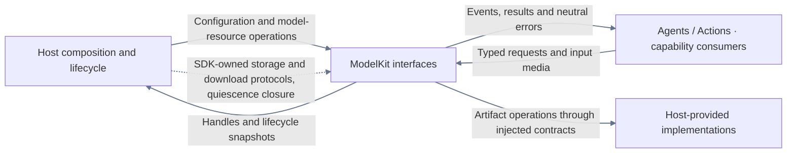
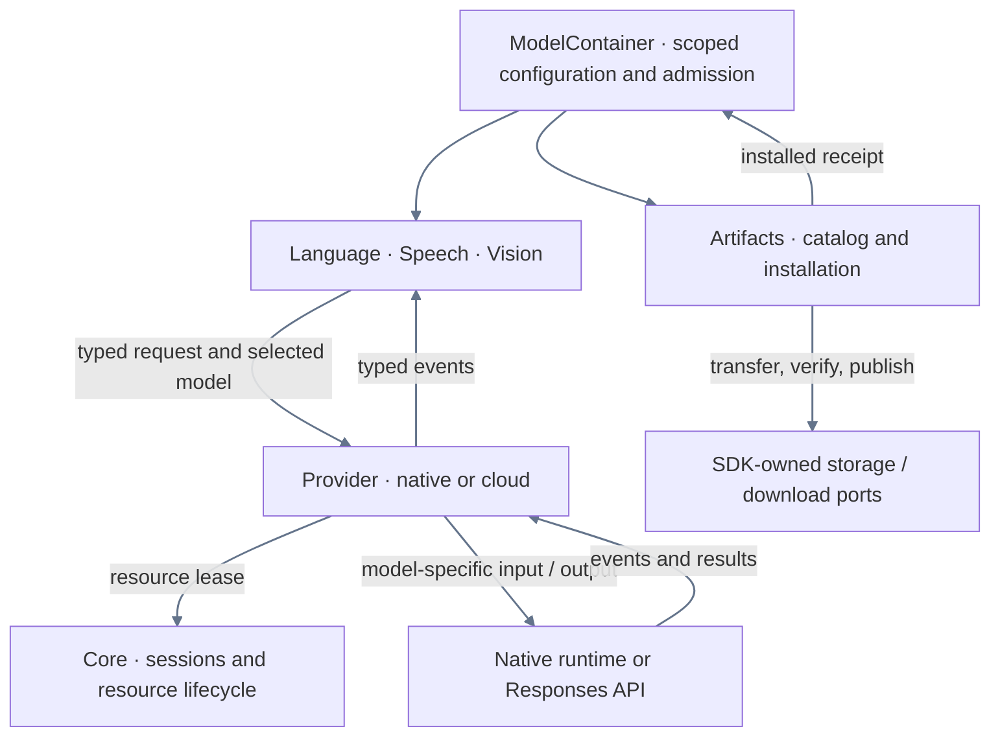

# ModelKit — Independent Inference SDK

## Purpose and boundaries

ModelKit supplies typed Language/Speech/Vision inference, model execution and model/artifact lifecycle. Core owns neutral values and concurrency mechanisms; capability domains own request/result contracts; concrete providers own algorithms and native integration; Management owns registration, residency, artifacts and default assembly.

The SDK depends on its own targets, approved third-party products and system frameworks. It has no dependency on another capability or business module. Consumers own application tasks, history selection, device actions, capture/playback and presentation. Storage, download and quiescence implementations enter through ModelKit-owned protocols or closures.

## External relationships and data flow

Solid arrows show runtime calls or returned data; dashed arrows show injection. App configures the root. Agents use inference, and Actions uses model resources, configuration and diagnostic capabilities. Host-provided protocol implementations do not create a reverse compilation dependency.

## Source ownership

| Directory | Responsibilities and compilation |
| --- | --- |
| ModelContainer.swift / ModelFailure.swift | Root entry in ModelKitDefaults / independent error contract in ModelKit |
| Support/Core | Neutral media, opaque requestID/scopeID, streams, resource leases, admission and worker cancellation; part of ModelKit |
| Language, Speech, Vision contracts | Typed capability requests/results; part of ModelKit |
| Support/Backends/CoreAI | Generic stateless graph/tensor runtime; ModelKitCoreAI |
| Support/Backends/CoreML | Generic named tensor runtime; ModelKitCoreML |
| Support/Management | Generic registration/lifecycle/artifacts in ModelKitRuntime; model registration and selection in ModelKitDefaults; disjoint explicit source lists |
| Support/Management/HuggingFace | Injected download adapter; ModelKitHub |
| Support/Speech/Apple | PCMCodec shared by Apple ASR/TTS in ModelKitAppleSpeech |
| Language/LLM/Gemma4, OpenAI | Concrete chat algorithms/protocol adapters |
| Speech/ASR, TTS, VAD provider directories | Concrete speech algorithms/native services |
| Vision/YOLO | YOLO image layout, graph execution, tensor reading and pose decoding |

Support is a source ownership group; each compiled target has its own boundary. Core plus capability-domain contracts form the base ModelKit target. Concrete providers own their tokenizer, prompts, recurrent/cache state and model-specific input/output rules.

## Internal inference and artifact flows

## Compilation dependencies

Every arrow means the left target depends directly on the right target. The production targets are shown; external frameworks/products are listed separately below. The simulator variant omits the ModelKitDefaults → ModelKitGemma4 dependency.

```mermaid
flowchart TD
 ModelKitDefaults[ModelKitDefaults]
 ModelKitRuntime[ModelKitRuntime]
 ModelKitHub[ModelKitHub]
 ModelKit[ModelKit: Core and capability contracts]
 ModelKitCoreAI[ModelKitCoreAI]
 ModelKitD3[ModelKitD3]
 ModelKitCoreML[ModelKitCoreML]
 ModelKitGemma4[ModelKitGemma4]
 ModelKitOpenAI[ModelKitOpenAI]
 ModelKitAppleSpeech[ModelKitAppleSpeech: Apple ASR, TTS and PCM]
 ModelKitNemotron[ModelKitNemotron]
 ModelKitMossNano[ModelKitMossNano]
 ModelKitKokoro[ModelKitKokoro]
 ModelKitSilero[ModelKitSilero]
 ModelKitEnergy[ModelKitEnergy]
 ModelKitYOLOPose[ModelKitYOLOPose]
 ModelKitDefaults --> ModelKit
 ModelKitDefaults --> ModelKitRuntime
 ModelKitDefaults -->|device / macOS| ModelKitGemma4
 ModelKitDefaults --> ModelKitD3
 ModelKitDefaults --> ModelKitOpenAI
 ModelKitDefaults --> ModelKitAppleSpeech
 ModelKitDefaults --> ModelKitNemotron
 ModelKitDefaults --> ModelKitMossNano
 ModelKitDefaults --> ModelKitSilero
 ModelKitDefaults --> ModelKitEnergy
 ModelKitDefaults --> ModelKitYOLOPose
 ModelKitRuntime --> ModelKit
 ModelKitHub --> ModelKitRuntime
 ModelKitGemma4 --> ModelKit
 ModelKitD3 --> ModelKit
 ModelKitD3 --> ModelKitCoreAI
 ModelKitOpenAI --> ModelKit
 ModelKitAppleSpeech --> ModelKit
 ModelKitNemotron --> ModelKit
 ModelKitMossNano --> ModelKit
 ModelKitKokoro --> ModelKit
 ModelKitSilero --> ModelKit
 ModelKitSilero --> ModelKitCoreML
 ModelKitEnergy --> ModelKit
 ModelKitYOLOPose --> ModelKit
 ModelKitYOLOPose --> ModelKitCoreML
    linkStyle default stroke:#64748b,stroke-width:1.5px
```

| Target | Third-party products |
| --- | --- |
| ModelKitGemma4 | CoreAILM from coreai-models and Tokenizers from swift-transformers |
| ModelKitD3 | Tokenizers from swift-transformers |
| ModelKitNemotron, ModelKitKokoro | FluidAudio; each provider owns its integration |
| ModelKitHub | HuggingFace from swift-huggingface |

Other external dependencies are native concurrency, media, inference, filesystem and network frameworks. Runtime uses only ModelKit; concrete providers never depend on Runtime, Defaults or sibling providers. Defaults alone combines providers. Source/import allowlists, product/package ownership, target/product dependency closure and source confinement are enforced by [boundary checks](../../scripts/README.md).

## Default capability bindings

The existing speech selector accepts a host-provided locale reader for automatic Apple recognition requests. English and Simplified Chinese use managed `en-US` and `zh-CN` Apple resources respectively. A session retains the lease it started with. Nemotron automatic language selection and synthesis locale handling remain independent from the application preference.

| Capability | Selection |
| --- | --- |
| Chat | Gemma 4 E2B QAT on supported hardware, or explicitly configured Responses cloud |
| Recognition | Enabled, installed and available Nemotron; otherwise Apple SpeechAnalyzer |
| Synthesis | Enabled, installed and available MOSS Nano; otherwise Apple PCM TTS |
| Voice activity | Installed and available Silero; otherwise Energy, independent of ASR preference |
| Pose | YOLO26n-Pose |
| Decision | D3 Edge when its local artifact and platform are available. Agents selects and executes the optional cloud fallback. |

Custom ASR/TTS switches default off and are independent. Kokoro is an explicitly provisioned optional provider without Defaults registration. Selection occurs before admission; failure during active inference never switches provider. Local inference never initiates artifact downloads. The simulator local-chat binding reports unavailable; the Gemma package's native framework requirements still apply at compilation.

## Lifecycle, streams and failures

App owns one ModelContainer with four stable child ports. Each root owns an independent manager and speech selection. Consumers acquire stable typed handles; acquisition, resource residency and capability availability are distinct. Management owns registration/construction state and injects validated loading limits; Core owns resource residency and lease mechanics. One active inference per resource rejects overlap. Loading coalesces bounded waiters; unload drains active leases, shutdown cancels/joins and is terminal. Memory-pressure releaseWhenIdle evicts eligible idle resources.

InferenceSession has one consumer and explicit event-count/byte limits. Core's default is 64 events/4096 estimated bytes per event; each provider declares its own bounds. Gemma uses 4096 events/4096 bytes; OpenAI uses 128 events with producer backpressure and no single-event byte ceiling. Normal completion drains accepted events; failure/cancellation suppresses buffered delivery. InferenceTaskControl owns one worker's cancellation state; providers join cleanup and release leases after native work exits. OpenAI separately owns HTTP cancellation.

Artifacts have an independent schema-v2 catalog, bounded transfer state, validated installed receipts, safe publication/deletion and resource maintenance fences. The host supplies persistence/download adapters. Configuration, admission, native execution and cleanup failures remain observable; consumers choose recovery and presentation.

## Coverage and platform constraints

SDK products use the repository’s [Package.swift](../../Package.swift). Concrete providers publish their platform and input constraints. The simulator build reports Gemma unavailable.

## Related design

[Parent design](../README.md) · [Support](Support/README.md) · [Core](Support/Core/README.md) · [Backends](Support/Backends/README.md) · [Management](Support/Management/README.md) · [Language](Language/README.md) · [Speech](Speech/README.md) · [Vision](Vision/README.md)

## Cloud thinking modes

The Responses adapter maps minimum and enabled modes to provider-specific wire fields. Minimum uses a supported low reasoning level for models that require reasoning. See [the adapter contract](Language/LLM/OpenAI/README.md#thinking-request-policy).

## Streaming TTS latency

Apple TTS retains one native synthesizer per capability, fences request cleanup and emits its first bounded PCM portion immediately. See [Apple TTS](Speech/TTS/Apple/README.md).

## Storage 文件作用域接入

模型制品适配器由 App 注入 Files；后台回调复用同一制品服务。制品绑定停止时关闭接纳、取消并加入下载并保留清理错误，释放配置后允许在新 Files 作用域重新绑定，不停止无关模型实例。App 只转交接口与调度启停。

## 分类异常诊断

LLM 中立失败诊断向消费者提供原因/协议阶段及安全标识；具体 Provider 在校验点记录，ModelKit 不决定 Agent 的恢复或用户提示。见 [Chat](Language/LLM/README.md)。

## 基础能力审查

制品下载一次读取／解码恢复计划，按 ID/revision/endpoint 选择复用；旧暂存迁移和完整文件复用保留。ModelLanguageContainer 每次操作解析当前绑定；不存在进程级 manager 或共享语音配置。ModelKitRuntime 不包含 App 源码或其他项目模块依赖。

## Root and child ports

| 子能力 | 对外协议／内容 |
| --- | --- |
| language | ModelLanguageProviding：聊天、本地 Decision、当前绑定配置及统一资源控制 |
| speech | ModelSpeechProviding：识别／合成／VAD，选择配置及按语音类别的资源控制 |
| vision | ModelVisionProviding：单帧姿态、可用性及统一资源控制 |
| artifacts | ModelArtifactsManaging：准备、库存、下载、取消及带宿主静默屏障的删除 |

语言／视觉共享 ModelResourceControlling 的 load、warmup、unload、status；语音按类别提供同名操作，状态对应所选后端、卸载覆盖同类本地与系统后端。子能力不暴露注册、manager 或根关闭权限；首次准备和后台恢复共用一个实例级准备任务。查询元信息不加载权重。关闭推理不终止后台制品传输；根 stop 先加入推理，再关闭制品，最后终止 manager，Storage 随后关闭。取消与生命周期拒绝不升级为故障；真实调用失败及流失败由所属子能力通过注入的中立回调上报给宿主。

[Gemma4](Language/LLM/Gemma4/README.md) owns context fitting and local engine timing.

模型根生命周期和配置拒绝完整报告原始 Error；生命周期拒绝和取消由宿主区分记录／广播，不丢弃底层错误信息。

根目录 ModelFailure.swift 由基础 ModelKit 目标拥有；根start／setForeground／stop类型化抛错，ModelScope报告统一结构。模型推理／流的既有领域错误契约保留，完整底层对象放在报告的underlying；制品及装配清理均使用同一复合结构。

语言／语音／视觉 warmup 统一提供 reportLoading 回调，只报告实际资源加载等待，不承载 UI／Signal 或业务展示。

## Artifact observation

The artifact capability admits up to 16 revision observers. Each stream retains the newest revision. Native progress coalesces synchronously, cancellation detaches observers, and close ends all streams.

## Reflexive state reads

The root and four child ports expose module-local ModelStateSnapshot through stateSnapshot() async throws. Root and capability snapshots return local assembly/preferences/instrumentation and resource path indices only. stateReaders() binds existing resource identities through ModelManager.resourceIDs without sampling phase/lease data or constructing providers. Each selected resource reads its own status/lease directly. No read calls prepare, provider resolution, artifact restoration, load or file probing. Actual lifecycle/cleanup failures remain local health; retained operation failure counts remain Runtime.

The scope's assembled flag means a manager was successfully published by preparation; an unobserved pending/completed assembly task is not treated as a published resource fact. Stopped is the admission fence; cleanupJoined separately confirms joined shutdown.

Registration/resource phases, inference lease/activity indicators, preparation waiters and artifact transfer/deletion/failure counts are Runtime. Speech backend-routing preferences are Runtime configuration, even when a user-facing settings workflow changes them. Editable UI drafts remain owned by UI. Engineering failures are health evidence, not an automatic assertion that a business resource is unavailable.

ModelState Runtime values and resource-child phases use the declared raw-value vocabulary with finite descriptor values, independently of domain preferences and inference results.

Retained artifact-operation failure counts remain Runtime; they do not establish current ModelKit health. Explicit root lifecycle/cleanup failure remains independently reported.

ModelPreparationRequirement and ModelPreparationStep expose generic language/recognition/synthesis/voiceActivity/vision preparation. ModelContainer.preparationSteps preserves requested order, deduplicates requirements and binds the same root capabilities. ModelKit interprets ready/unmanaged as ready and forwards actual loading reports; callers choose required capabilities and activation time. No UI, Agent or AppLifecycle dependency is introduced.

ModelLanguageProviding.chatModel(configuration:) 返回固定配置的轻量 ChatModel（能力句柄与可选模型名称），不占推理槽位，不要求调用方关闭或重开。ModelLanguageContainer.chat(request, using:) 直接指定配置，nil 为本地；普通 chat(request) 捕获当前默认配置。默认配置改变不替换在途实例。云端按不可变配置通过同根 ModelManager 复用客户端，沿用注册资源容量而不设置两个请求槽位；同客户端请求并行，各自取消/完成。根停止统一加入客户端与资源。

本地 Chat 共用根下 SerialChat：一项运行，默认最多八项等待，ModelContainer 的 maximumPendingLocalChats 初始化参数可配置非负容量；满时明确 inputBusy。接纳返回 queued session，获得执行占用后为 running；等待取消释放名额，运行取消加入 Provider 原生清理后才推进 FIFO。暂停/关闭取消并加入等待和运行。结束后保留的句柄不占队列。其他后端保持各自默认互斥资源策略。模型、并发和资源回收归 SDK，Agent 不管理模型租约。

## Decision 能力

language.decision 是稳定子端口，使用独立 D3 资源，不占用主 Chat 的串行队列。ModelKitD3 依赖基础契约、CoreAI 图执行和 Tokenizers，默认注册 d3-edge；模型管理只提供选择结果及资源生命周期。云端分类由调用方通过不可变 ChatModel 请求，ChatToolChoice.required 只约束一次命名工具选择，不执行工具。

Chat 的可选 onDispatch 回调报告实际 HTTP/本地推理开始边界，供上层原子持久化请求；详见 [LLM](Language/LLM/README.md)。
