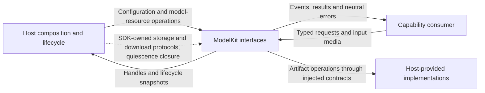

# ModelKit — Independent Inference SDK

✅ 根目录 ModelContainer.swift 为容器入口（仍编译于 ModelKitDefaults），ModelFailure.swift 为独立错误定义（仍编译于基础 ModelKit）。Support/Management 保留注册／制品／默认工厂，Support/Core 保留资源与并发机制；不新增目标，不改变公开类型。

✅ 已实现：本地Gemma当前排查版本移除推理副本中的所有system，以实际tokenizer拟合最近最多5条对话消息和生成预算。使用后端有效窗口，当前iOS上限1024；当前输入不改写，无法容纳时明确拒绝。云端、Agent原请求及持久历史不变。

✅ ModelContainer 是 App 管理的实例根，提供四个同根子能力。构造不产生模型／设备副作用；start 只注册工厂并准备制品元数据，setForeground 开放推理。实例私有配置与 manager 不跨根共享。

## Purpose and boundaries

ModelKit supplies typed Language/Speech/Vision inference, model execution and model/artifact lifecycle. Core owns neutral values and concurrency mechanisms; capability domains own request/result contracts; concrete providers own algorithms and native integration; Management owns registration, residency, artifacts and default assembly.

The SDK depends on its own targets, approved third-party products and system frameworks. It has no dependency on another capability or business module. Consumers own application tasks, history selection, device actions, capture/playback and presentation. Storage, download and quiescence implementations enter through ModelKit-owned protocols or closures.

## External relationships and data flow

Solid arrows show runtime calls or returned data; dashed arrows show injection. Current App and Agent consumers act as SDK clients. Host-provided protocol implementations do not create a reverse compilation dependency.

## Source ownership

| Directory | Responsibilities and compilation |
| --- | --- |
| ModelContainer.swift / ModelFailure.swift | Root entry in ModelKitDefaults / independent error contract in ModelKit |
| Support/Core | Neutral media, opaque requestID/scopeID, streams, resource leases, admission and worker cancellation; part of ModelKit |
| Language, Speech, Vision contracts | Typed capability requests/results; part of ModelKit |
| Support/Backends/CoreAI | Generic stateless graph/tensor runtime; ModelKitCoreAI |
| Support/Backends/CoreML | Generic named tensor runtime; ModelKitCoreML |
| Support/Management | Generic registration/lifecycle/artifacts in ModelKitRuntime; model registration and selection in ModelKitDefaults; disjoint explicit source lists |
| Support/Management/HuggingFace | Injected download adapter; ModelKitHub |
| Support/Speech/Apple | PCMCodec shared by Apple ASR/TTS in ModelKitAppleSpeech |
| Language/LLM/Gemma4, OpenAI | Concrete chat algorithms/protocol adapters |
| Speech/ASR, TTS, VAD provider directories | Concrete speech algorithms/native services |
| Vision/YOLO | YOLO image layout, graph execution, tensor reading and pose decoding |

Support is a source ownership group; each compiled target has its own boundary. Core plus capability-domain contracts form the base ModelKit target. Concrete providers own their tokenizer, prompts, recurrent/cache state and model-specific input/output rules.

## Compilation dependencies

Every arrow means the left target depends directly on the right target. All 15 production targets are shown; external frameworks/products are listed separately below. ModelKitCoreAI is available independently of the current provider integrations.

```mermaid
flowchart TD
 ModelKitDefaults[ModelKitDefaults]
 ModelKitRuntime[ModelKitRuntime]
 ModelKitHub[ModelKitHub]
 ModelKit[ModelKit: Core and capability contracts]
 ModelKitCoreAI[ModelKitCoreAI]
 ModelKitCoreML[ModelKitCoreML]
 ModelKitGemma4[ModelKitGemma4]
 ModelKitOpenAI[ModelKitOpenAI]
 ModelKitAppleSpeech[ModelKitAppleSpeech: Apple ASR, TTS and PCM]
 ModelKitNemotron[ModelKitNemotron]
 ModelKitMossNano[ModelKitMossNano]
 ModelKitKokoro[ModelKitKokoro]
 ModelKitSilero[ModelKitSilero]
 ModelKitEnergy[ModelKitEnergy]
 ModelKitYOLOPose[ModelKitYOLOPose]
 ModelKitDefaults --> ModelKit
 ModelKitDefaults --> ModelKitRuntime
 ModelKitDefaults --> ModelKitGemma4
 ModelKitDefaults --> ModelKitOpenAI
 ModelKitDefaults --> ModelKitAppleSpeech
 ModelKitDefaults --> ModelKitNemotron
 ModelKitDefaults --> ModelKitMossNano
 ModelKitDefaults --> ModelKitSilero
 ModelKitDefaults --> ModelKitEnergy
 ModelKitDefaults --> ModelKitYOLOPose
 ModelKitRuntime --> ModelKit
 ModelKitHub --> ModelKitRuntime
 ModelKitGemma4 --> ModelKit
 ModelKitOpenAI --> ModelKit
 ModelKitAppleSpeech --> ModelKit
 ModelKitNemotron --> ModelKit
 ModelKitMossNano --> ModelKit
 ModelKitKokoro --> ModelKit
 ModelKitSilero --> ModelKit
 ModelKitSilero --> ModelKitCoreML
 ModelKitEnergy --> ModelKit
 ModelKitYOLOPose --> ModelKit
 ModelKitYOLOPose --> ModelKitCoreML
```

| Target | Third-party products |
| --- | --- |
| ModelKitGemma4 | CoreAILM from coreai-models; Tokenizers from swift-transformers |
| ModelKitNemotron, ModelKitKokoro | FluidAudio; each provider owns its integration |
| ModelKitHub | HuggingFace from swift-huggingface |

Other external dependencies are native concurrency, media, inference, filesystem and network frameworks. Runtime uses only ModelKit; concrete providers never depend on Runtime, Defaults or sibling providers. Defaults alone combines providers. Source/import allowlists, product/package ownership, target/product dependency closure and source confinement are enforced by [boundary checks](../../scripts/README.md).

## Default capability bindings

| Capability | Selection |
| --- | --- |
| Chat | Gemma 4 E2B QAT on supported hardware, or explicitly configured Responses cloud |
| Recognition | Enabled, installed and available Nemotron; otherwise Apple SpeechAnalyzer |
| Synthesis | Enabled, installed and available MOSS Nano; otherwise Apple PCM TTS |
| Voice activity | Installed and available Silero; otherwise Energy, independent of ASR preference |
| Pose | YOLO26n-Pose |
| Judgment | Contract only; no default provider |

Custom ASR/TTS switches default off and are independent. Kokoro is an explicitly provisioned optional provider without Defaults registration. Selection occurs before admission; failure during active inference never switches provider. Local inference never initiates artifact downloads. The simulator local-chat binding reports unavailable; the Gemma package's native framework requirements still apply at compilation.

## Lifecycle, streams and failures

App owns one ModelContainer with four stable child ports. Each root owns an independent manager and speech selection. Consumers acquire stable typed handles; acquisition, resource residency and capability availability are distinct. Management owns registration/construction state and injects validated loading limits; Core owns resource residency and lease mechanics. One active inference per resource rejects overlap. Loading coalesces bounded waiters; unload drains active leases, shutdown cancels/joins and is terminal. Memory-pressure releaseWhenIdle evicts eligible idle resources.

InferenceSession has one consumer and explicit event-count/byte limits. Core's default is 64 events/4096 estimated bytes per event; each provider declares its own bounds. Gemma uses 4096 events/4096 bytes; OpenAI uses 128 events/65,568 bytes with producer backpressure. Normal completion drains accepted events; failure/cancellation suppresses buffered delivery. InferenceTaskControl owns one worker's cancellation state; providers join cleanup and release leases after native work exits. OpenAI separately owns HTTP cancellation.

Artifacts have an independent schema-v2 catalog, bounded transfer state, validated installed receipts, safe publication/deletion and resource maintenance fences. The host supplies persistence/download adapters. Configuration, admission, native execution and cleanup failures remain observable; consumers choose recovery and presentation.

## Coverage and platform constraints

Typed contracts, concrete providers, independent runtime/assembly targets, shared PCM conversion and explicit bounded lifecycles are implemented. SDK products use the root repository Package.swift; no separate publishing package exists.

## Related design

[Parent design](../README.md) · [Support](Support/README.md) · [Core](Support/Core/README.md) · [Backends](Support/Backends/README.md) · [Management](Support/Management/README.md) · [Language](Language/README.md) · [Speech](Speech/README.md) · [Vision](Vision/README.md)

## Cloud non-thinking requests

the OpenAI adapter owns provider/model-specific non-thinking request options for all SDK consumers, including title generation. Alibaba Cloud endpoint identity and OpenAI model identity determine legal wire fields; mandatory-thinking models fail explicitly instead of using a lower reasoning fallback. The base ChatRequest and module interfaces remain unchanged. See [the adapter contract](Language/LLM/OpenAI/README.md#non-thinking-request-policy).

## Streaming TTS latency

Apple TTS retains one native synthesizer per capability, fence request cleanup, and emit the first bounded PCM portion without coalescing delay. Provider ownership and neutral text-to-PCM interface remain unchanged.

## 待实现

- Production judgment, embeddings, general video sessions and cross-model fairness/thermal scheduling are not implemented. Gemma requires CoreAI on supported OS/hardware; its third-party CoreAIShared dependency currently cannot resolve CoreAI in the simulator SDK. Runtime/device acceptance evidence belongs in docs.

## Storage 文件作用域接入

✅ 模型制品适配器由 App 注入 Files；后台回调复用同一制品服务。制品绑定停止时关闭接纳、取消并加入下载并保留清理错误，释放配置后允许在新 Files 作用域重新绑定，不停止无关模型实例。App 只转交接口与调度启停。

✅ ChatTokenUsage 提供可选 cachedInput/cacheWriteInput；具体 provider 解码，消费者透传。Gemma4 当前排查版本在推理副本中移除全部system，不改写原请求，不将系统数据降级为user。

## 分类异常诊断

✅ LLM 中立失败诊断向消费者提供原因/协议阶段及安全标识；具体 Provider 在校验点记录，ModelKit 不决定 Agent 的恢复或用户提示。见 [Chat](Language/LLM/README.md)。

## 基础能力审查

✅ 制品下载一次读取／解码恢复计划，按 ID/revision/endpoint 选择复用；旧暂存迁移和完整文件复用保留。ModelLanguageContainer 每次操作解析当前绑定；不存在进程级 manager 或共享语音配置。ModelKitRuntime 不包含 App 源码或其他项目模块依赖。

## Root and child ports

| 子能力 | 对外协议／内容 |
| --- | --- |
| language | ModelLanguageProviding：聊天、当前绑定配置及统一资源控制 |
| speech | ModelSpeechProviding：识别／合成／VAD，选择配置及按语音类别的资源控制 |
| vision | ModelVisionProviding：单帧姿态、可用性及统一资源控制 |
| artifacts | ModelArtifactsManaging：准备、库存、下载、取消及带宿主静默屏障的删除 |

语言／视觉共享 ModelResourceControlling 的 load、warmup、unload、status；语音按类别提供同名操作，状态对应所选后端、卸载覆盖同类本地与系统后端。子能力不暴露注册、manager 或根关闭权限；首次准备和后台恢复共用一个实例级准备任务。查询元信息不加载权重。关闭推理不终止后台制品传输；根 stop 先加入推理，再关闭制品，最后终止 manager，Storage 随后关闭。取消与生命周期拒绝不升级为故障；真实调用失败及流失败由所属子能力上报中立回调，Gateway 负责广播。

✅ 本地Gemma在ModelKit内按后端有效窗口适配，当前iOS缓存安全限制比4096更小；接口及算法见 [Gemma4](Language/LLM/Gemma4/README.md)。

✅ 按用户要求，本地Gemma排查版本移除所有system，仅保留有界对话输入；云端及通用请求不变，详见Gemma4目录契约。

✅ 已实现：Gemma使用Apple系统OSLog signpost提供不含消息正文的本地性能事件，源码边界检查允许该系统模块；不引入项目依赖或第三方包。

✅ 已实现：模型根生命周期和配置拒绝完整报告原始 Error；生命周期拒绝和取消由宿主区分记录／广播，不丢弃底层错误信息。

✅ 根目录 ModelFailure.swift 由基础 ModelKit 目标拥有；根start／setForeground／stop类型化抛错，ModelScope报告统一结构。模型推理／流的既有领域错误契约保留，完整底层对象放在报告的underlying；制品及装配清理均使用同一复合结构。

✅ 已实现：语言／语音／视觉 warmup 统一提供 reportLoading 回调，只报告实际资源加载等待，不承载 UI／Signal 或业务展示。

## Artifact observation

The artifact capability exposes independent bounded newest-one revision observation. Changes wake consumers without JSON fingerprints or business polling. Native progress reports synchronously coalesce; cancellation detaches observers and shutdown ends streams.

## Direct container contract

Artifact revision observers are independently bounded to 16 newest-one streams. Native progress coalesces synchronously, changes wake consumers without JSON polling, and close ends observation. Current cross-module ownership is defined by the [overall design](../README.md).
