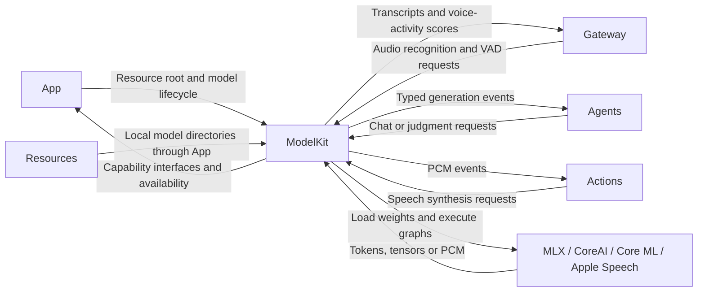
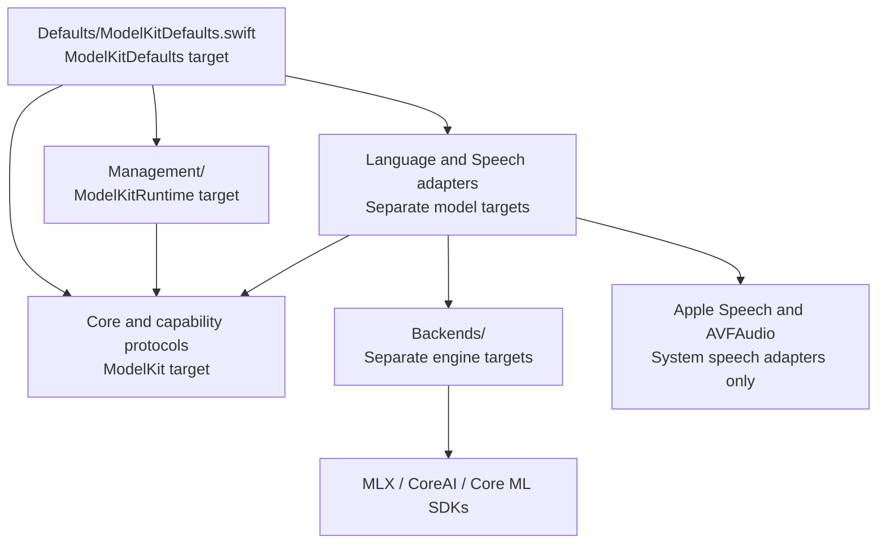
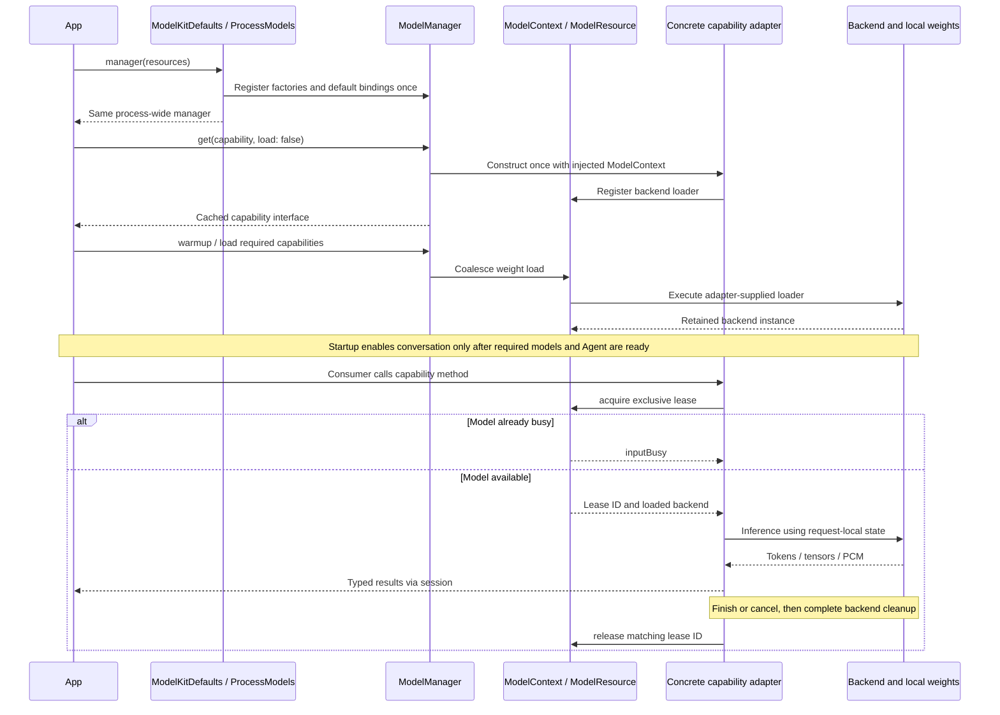

# ModelKit — Independent Model Capability SDK

ModelKit supplies recognition, generation, and judgment capabilities without choosing business goals or directly controlling devices. Architecture section 33 defines the target model-management and inference responsibilities; section 37 describes the logical layout. Consumers receive capability protocols while concrete models and backends remain replaceable.

The device composition currently uses Nemotron streaming ASR, Silero VAD, Qwen3.5-2B MLX chat, and Apple system TTS. It requires iOS 27 and matching h18p artifacts, with no automatic device fallback. The simulator supports UI debugging; ASR and chat are explicitly unavailable. Models load and warm up before recording. Kokoro is a separate English TTS validation adapter.

## External relationships: upstream and downstream

These edges show requests and returned data, not imports from ModelKit into its consumers. Adapter backends are internal to this physical directory and are omitted from the module-level diagram.



## Dependencies and API boundary

The base `ModelKit` target has no project-internal dependencies. It uses Foundation, Synchronization, and the Swift standard library. It must not import or reference AgentCore, Agents, Gateway, ToolRuntime, PlatformKit, UI, or their business types.

[ModelKitRuntime](Management/README.md) is a separate target/product for shared model registration, capability binding and lifecycle management. Ordinary consumers import ModelKit and receive capability protocols, never ModelID, managers, weight paths, backend identity, or concrete model configuration. Target dependency declarations must enforce this separation; Swift cannot prevent a developer from importing another module already added as a dependency.

Concrete model SDKs and configuration belong to separate adapter targets. ModelKitDefaults constructs and registers adapters; changing providers must not require business-code changes. Capabilities may be Sendable structs, actors, or other conforming types; each capability need not allocate a separate model instance.

## Directory and compilation ownership

| Location | Responsibility |
| --- | --- |
| `Core/` | Capability/session contracts, model resource admission, and minimal inference admission |
| `Defaults/` | Fixed model assembly, capability defaults and backend configuration |
| `Management/` | Separate ModelKitRuntime target: registration, typed acquisition and lifecycle management |
| `Core/AudioFrame.swift` | Validated PCM transport; Core also owns future shared image/video data contracts |
| `Language/LLM/`, `Language/JEV/` | Chat and judgment protocols |
| [Qwen3.5](Language/LLM/Qwen35/README.md) | Current text-only MLX ChatCapability adapter |
| `Speech/ASR/`, `Speech/TTS/`, `Speech/VAD/` | Recognition, synthesis, and voice-activity contracts and adapters |
| [Apple speech](Speech/Shared/Apple/README.md) | Separate ModelKitAppleSpeech target with shared PCM conversion |
| [Nemotron](Speech/ASR/Nemotron/README.md) | Streaming ASR, preprocessing, RNN-T decoding, and capability adapter |
| [Silero](Speech/VAD/Silero/README.md) | Core ML VAD with request-local recurrent state |
| [Kokoro](Speech/TTS/Kokoro/README.md) | Independent CoreAI TTS validation adapter |
| `Backends/CoreAI/`, `Backends/CoreML/`, `Backends/MLX/` | Backend execution and tensor bridging in separate targets |
| `Backends/MLX/` | Local-only MLX language backend and tokenizer bridge |

Root Package.swift excludes management, concrete adapters, and backends from the base target. ModelKitRuntime compiles only Management. ModelKitNemotron depends on ModelKit and ModelKitCoreAI; ModelKitSilero depends on ModelKit and ModelKitCoreML. Independent targets preserve SDK boundaries even though their files share one physical parent directory.


## Internal relationships: dependencies and execution

### Source and target dependencies

Arrows below mean **depends on / imports**, not runtime message direction. Directory names are physical organization; Swift targets enforce the compilation boundary. The base ModelKit target contains Core and capability protocols. Management cannot import Defaults, concrete adapters or backends.



CoreAI and CoreML backends exchange their own tensor types; the MLX backend exchanges language turns and tokens. Backends do not import the ModelKit capability layer. Adapters translate between capability data and backend data. Defaults is the only production assembly layer that imports both management and concrete adapters.

### Key files and ownership

| File or group | Owns / collaborates with |
| --- | --- |
| [ModelKitDefaults.swift](Defaults/ModelKitDefaults.swift) | ProcessModels retains one shared assembly task; fixed factories map capabilities to concrete adapters and resource paths. |
| [ModelRegistration.swift](Management/ModelRegistration.swift) | ModelID, capability kinds, provider factory, supplied interfaces and memory policy. No weights or execution state. |
| [ModelManager.swift](Management/ModelManager.swift) | Default bindings, one cached provider per ID, shared construction tasks and lifecycle coordination through ModelContext. CapabilityKey selects a typed interface. |
| [ModelResource.swift](Core/ModelResource.swift) | ModelContext owns one resource; ModelResource retains loaded backend state, coalesces loads and owns one active lease with a cancellation callback. ModelLoadGate bounds concurrent weight loaders. |
| [InferenceSession.swift](Core/InferenceSession.swift) | Bounded producer/consumer event stream, terminal state and cancellation notification. Does not load models or decide when backend cleanup is complete. |
| [OperationAdmission.swift](Core/OperationAdmission.swift) | Exclusive asynchronous operation guard used by Nemotron streaming work; separate from the whole-session resource lease. |
| [Capability.swift](Core/Capability.swift), [AudioFrame.swift](Core/AudioFrame.swift) | Availability, errors, correlation metadata and validated PCM data shared across capability boundaries. |
| Chat / recognition / synthesis / VAD / judge capability files | Typed requests, results and protocols. Recognition adds ordered audio input; VAD uses process/finish/reset/cancel calls. Judge has no production provider. |

### Loading and inference flow

Runtime arrows describe calls and returned data. Capability retrieval, resource loading and inference are distinct operations: obtaining a deferred handle does not load weights, and obtaining a loaded handle does not reserve an inference slot.



The App participant also represents an injected capability consumer such as an Agent or Gateway during inference. Chat and TTS stream output events; ASR accepts ordered PCM frames and emits transcripts; VAD returns scores directly. Resource acquire reloads evicted weights if needed. Busy requests are rejected without a waiting inference queue. Cancellation requests cleanup; it does not release the lease immediately. Stale lease IDs cannot release or replace a newer operation.

### Concrete adapter data paths

| Capability | Internal path | Returned data |
| --- | --- | --- |
| Chat | Qwen35Chat.swift → MLXLanguageEngine.swift → tokenizer and MLX model | ChatEvent text deltas and completion |
| Recognition | NemotronASR.swift → NemotronModel.swift; NemotronMelStream.swift extracts features, GraphModel.swift executes CoreAI graphs, NemotronTokenizer.swift decodes tokens | TranscriptionEvent partial/final text |
| Voice activity | SileroVAD.swift → CoreMLGraph.swift | VoiceActivityScore values with sample ranges |
| System synthesis | AppleSpeechSynthesis.swift → AVSpeechSynthesizer → PCMCodec.swift → SynthesisPCMAccumulator.swift | Bounded SynthesisEvent PCM chunks |
| Diagnostic synthesis | KokoroSpeechSynthesis.swift → KokoroInput.swift / KokoroG2P.swift → KokoroModel.swift → CoreAI GraphModel.swift | SynthesisEvent PCM chunks |
| Optional Apple recognition | AppleSpeechRecognition.swift → PCMCodec.swift → Apple Speech | TranscriptionEvent; not registered as the default |

✅ Shared assembly, typed acquisition, exclusive resource leases, bounded event delivery and the concrete paths above are implemented. ❌ Judge inference, cross-model scheduling and automatic preemption are not implemented. Detailed queue bounds and cleanup algorithms belong to [Core](Core/README.md), [Management](Management/README.md) and each adapter README.

## Capability interfaces

All capabilities conform to `Capability: Sendable` and expose asynchronous `availability`, returning available or unavailable with a reason. Availability does not expose model identity and is only a snapshot; later calls can still fail.

| Protocol | Method | Input | Result |
| --- | --- | --- | --- |
| VoiceActivityCapability | detectVoiceActivity(format:) | PCM format | VoiceActivitySession: process / finish / reset / cancel |
| ChatCapability | chat(_:) | Messages, output-token budget, temperature, context | InferenceSession of ChatEvent |
| SpeechRecognitionCapability | transcribe(_:) | Locale, PCM format, context | SpeechRecognitionSession |
| SpeechSynthesisCapability | synthesize(_:) | Text, locale, context | InferenceSession of SynthesisEvent |
| JudgeCapability | judge(_:) | Text, unique nonempty candidate labels, context | InferenceSession of JudgeResult |

InferenceContext contains requestID and conversationID. Each call should have its own requestID; turns may share a conversationID. Context is correlation metadata, not automatic deduplication or SDK-managed chat history.

ChatMessage supports system/user/assistant roles. ChatEvent supports text deltas and stop/length-limit completion. Native Tool Calls, image messages, and arbitrary JSON output are not yet supported. Future extensions need explicit Sendable types, not `Any` or business-layer ToolCall types.

JudgeResult validates membership in the candidate set and a finite optional score in 0...1; abstention is supported. Scores are not calibrated probabilities. ModelKit does not use them to select Agents or execute actions. A judgment adapter should emit one valid result and finish.

### Model ownership

`ModelKitDefaults.manager(resources:)` returns one process-wide manager. Concurrent callers share assembly; conflicting resource roots fail. Defaults owns concrete model registration and backend configuration. ModelManager owns provider identity, capability bindings and resource lifecycle.

- Construction and registration require `ModelAssembly` SPI; production consumers receive capabilities.
- `ModelContext` construction and lifecycle controls use `ModelManagement` SPI. ModelManager's load, warmup, unload and shutdown methods remain public for the application lifecycle owner.
- Each model admits one active operation and rejects overlap with inputBusy. Cancellation releases admission only after cleanup. Different models have independent admission.
- Memory-pressure eviction releases eligible idle weights while retaining capability objects. See [Management](Management/README.md) for bounds and lifecycle algorithms, and [Defaults](Defaults/README.md) for fixed model mappings and shared initialization.

### Invocation and composition

Consumers see the capability interface only:

```swift
import ModelKit

func answer(using chat: any ChatCapability, text: String) async throws -> String {
    let request = ChatRequest(messages: [ChatMessage(role: .user, content: text)])
    let session = try await chat.chat(request)
    defer { session.cancel() }

    var result = ""
    for try await event in session.events {
        if case .text(let delta) = event { result += delta }
    }
    return result
}
```

Inject only the individual capability protocols each consumer needs.

The composition root obtains interfaces through `ModelManager.get(.chat)`. One provider may implement several capabilities, or each capability may use a different provider. See root ModelKitRuntimeTests/CompositionTests.swift for registration examples; factories and concrete configuration must not enter business constructors.

## Output streams and cancellation

`InferenceSession<Event>` is a retained per-request handle: context correlates the request, events supplies output, and cancel terminates that request. Every invocation gets a separate session; a provider must not use global cancellation that interrupts unrelated calls.

Adapters use `InferenceSession.make(context:limits:estimatedBytes:onTermination:)`, emit ordered events with yield, then finish or fail. These are adapter primitives, not concrete model lifecycle APIs.

| Operation | Current behavior |
| --- | --- |
| Normal completion | Buffered events drain after finish, then iteration returns nil; later writes fail |
| Failure | The next read throws; buffered stale events are not delivered |
| Cancellation | Reads throw CancellationError and later writes fail; unread events after finish are also cancelled |
| Consumer Task cancellation | next checks cancellation and terminates the session; pending reads are awakened |
| Early loop exit | Explicitly cancel, preferably with defer; break alone does not guarantee upstream release |
| Handle release | Session deinit requests cancellation; do not retain only events and discard the session |
| Multiple consumers | The first iterator claims consumption; other readers throw multipleConsumers |
| Termination callback | Runs once for producer completion/failure/cancellation; later cancellation does not repeat cleanup |

Cancellation cannot retract events already delivered. The callback requests adapter cleanup but does not prove GPU work, system services, or asynchronous tasks have stopped. Adapters must cooperate and wait for actual termination before reusing state or releasing execution capacity.

Short state transitions use Mutex; continuations and user callbacks are invoked outside the lock. onTermination is synchronous, nonblocking, and callable from any execution context: signal cleanup there, without inference or blocking waits. Serialize production per request and clean up on success, failure, and cancellation.

### Capacity policy

StreamLimits defaults to 64 events and 4096 estimated bytes per event. Their product bounds estimated payload, excluding object allocation and internal SDK memory.

The implementation uses bufferingOldest with explicit failure: overflow throws bufferOverflow, terminates the session, and notifies the adapter. Oversized events throw eventTooLarge. Producer-waiting backpressure is not implemented; never describe this as an unlimited pausable stream or silently drop tokens.

ChatEvent, TranscriptionEvent, and SynthesisEvent supply estimatedBytes. Use those estimates rather than zero. Split large text or audio into bounded chunks and choose capacity explicitly; 16 events of 64 KiB can be an initial TTS budget subject to device measurement.

## Audio and recognition lifecycle

AudioFrame carries interleaved signedInt16 or float32 PCM in local Apple-platform byte order. It validates sample rates of 8–192 kHz, 1–8 channels, nonempty frame-aligned data of at most 1 MiB, and finite nonnegative timestamps. These are transport limits, not a promise that every provider supports all formats.

SpeechRecognitionSession requires a fixed format, strictly increasing sequence numbers, and nondecreasing timestamps. Only one input operation may be active; overlapping send/finishInput throws inputBusy rather than creating an unbounded queue. That error does not cancel previously accepted input; format, sequence, or underlying-send failures terminate the output session.

send waits for adapter acceptance. Adapters must not return and silently enqueue unbounded audio. Real-time platform callbacks must not block awaiting send; the capture layer needs a bounded bridge. finishInput closes input while allowing final transcription; cancel terminates the session. ModelKit does not own the microphone.

TranscriptionEvent includes segmentID, revision, text, and isFinal. Producers ensure increasing revisions and a unique final event per segment. The SDK does not merge partials or deduplicate finals; consumers update previews using those fields and submit final text as appropriate. Do not trigger irreversible business actions from every partial.

Nemotron supports partial and final transcripts. Consumers must not assume every ASR implementation streams partial text.

VAD uses request/response backpressure: process accepts at most 16,000 samples and returns at most 64 VoiceActivityScore values covering continuous input sample ranges. There is no separate asynchronous output queue. Thresholds, pre-roll, and minimum speech/silence durations belong to input segmentation policy; adapters own recurrent model state and support reset/finish/cancel. ModelKitRuntime offers an independent voiceActivity binding.

TTS returns PCM without playing it or requesting permissions. PlatformKit and App adapters own playback, routing, interruption, and device permissions.

## Extension standards

1. Define capability protocols with typed requests/results and no model identity. Reuse contracts only for actual shared behavior; avoid a universal infer method.
2. Put models and SDK backends in separate adapter targets depending on ModelKit. The Defaults assembly configures model identity, artifacts, and backends.
3. Registered factories must match the interfaces they supply. Unsupported devices, languages, or features fail explicitly; never silently return fake data or switch to network processing.
4. Isolate history, KV cache, input queues, streams, and cancellation per request. Sharing read-only resources must not share mutable conversation state.
5. New events need payload estimates, termination semantics, and cancellation policies. Every queue needs a capacity and overflow policy.
6. Compose business workflows outside the SDK. Do not add routing, Agent lifecycle, tool execution, UI, or device actions to the base module.
7. Data crossing concurrency boundaries must be Sendable. Do not bypass checks with unchecked conformance or mutable platform buffers.
8. Keep test doubles in Tests using public protocols. Reuse contract tests for real adapters and add corresponding device validation.
9. Update this README when interfaces, directories, behavior, or examples change. Record future work as incomplete instead of presenting proposed types as current capabilities.

## Implementation status and validation

- ✅ Typed capability protocols, validated audio, bounded single-consumer sessions, cancellation, and minimal inference admission.
- ✅ Shared model registration, coalesced loading, exclusive leases and unload waiting.
- ✅ ModelKitTests covers ordering, completion/failure/cancellation, limits, ownership, ASR input constraints, and validation without real weights or device permissions.
- ✅ ModelKitRuntimeTests covers isolated provider substitution, composition, concurrent factory deduplication, retry, duplicate registration, and invalid binding.
- ✅ Shared ModelManager owns registration, provider identity, coalesced weight loads, typed get, unload and shutdown. Adapters use injected ModelResource handles; no adapter creates its own manager.
- ❌ Priority/aging, waiting inference queues, timed idle eviction and measured cross-model memory/thermal budgeting.
- ❌ VLM, computer vision, embeddings, general background artifact installation, and native tool-call model events.

The voice loop does not imply completion of every model milestone. See the [Roadmap](../../docs/Roadmap.md) and [voice validation scope](../../docs/Voice.md). Run root `./scripts/check.sh` and `./scripts/build-ios.sh`; clearly distinguish contract tests, compilation, and real-device acceptance.

## Maintenance

Keep directory ownership, public contracts, behavior, and examples current. ✅ means implemented; ❌ means incomplete. Do not add placeholder models or adapters. Model weights remain outside version control; download profiles and local model directories are under Resources/Models. The original design source is retained in docs/Technical_Design.docx; the current authority is [MobileHarness/README.md](../README.md).


## Project build and test ownership

The root Package.swift declares all ModelKit, management, adapter and backend targets. ModelKit remains an internal foundation module of this project; it has no nested package or dependency back to the HarnessKit product. The base SDK target depends only on system foundations. Third-party products attach only to backend targets. iOS 18/macOS 15 remain the base package floor; native CoreAI availability and the App's OS 27 deployment requirement are separate constraints.

All tests live under root Tests. Qwen35Tests checks model/tokenizer contracts without Agent dependencies. AgentModelEvaluationTests imports Agents and AgentCore explicitly for application prompt evaluations. No production or test source lives inside ModelKit that imports business modules.

- ✅ Management owns registration, acquisition and lifecycle; Backends owns engine execution.
- ✅ Every source directory has an English README with ownership and implementation status.
- ✅ scripts/check-modelkit-boundaries.py verifies production imports and target dependencies as part of check.sh.
- ❌ A separately distributed SDK is outside this project's scope.

