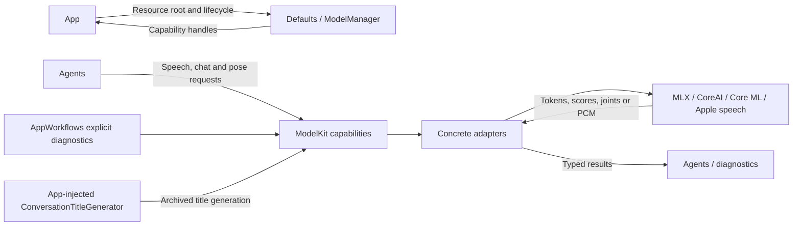
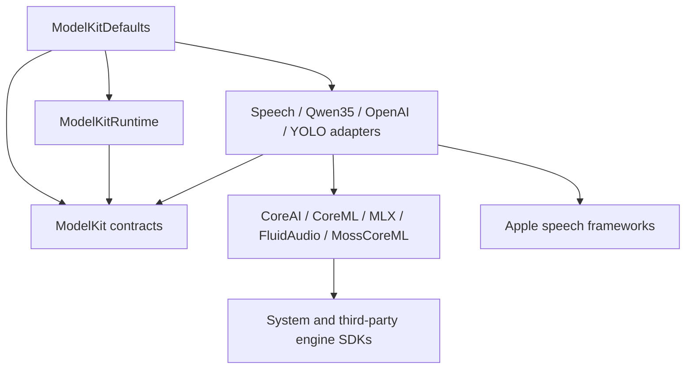

# ModelKit — Model Capabilities and Runtime

Processes supplied data through typed model capabilities. The goal is to keep recognition, generation and pose inference independent of Agent policy, UI and device I/O. Consumers receive capability protocols; internal assembly selects concrete models.

The physical directory contains several Swift targets. Base ModelKit depends only on the independent Types value module. ModelKitRuntime depends only on ModelKit; adapters and backends compile separately. Root Package.swift owns all targets and the source targets share one root build map.

## Directory structure

```text
ModelKit/
├── Core/                     # Capability, media, bounded sessions and resource admission
├── Defaults/                 # ModelKitDefaults: provider assembly and default bindings
├── Management/               # ModelKitRuntime: ModelManager and registration contracts
├── Language/
│   ├── LLM/                  # ChatCapability; separate Qwen35 and OpenAI adapters
│   └── JEV/                  # JudgeCapability contract; no production provider
├── Speech/
│   ├── ASR/                  # Recognition contract; Apple and Nemotron adapters
│   ├── TTS/                  # Synthesis contract; Apple, MOSS and Kokoro adapters
│   ├── VAD/                  # Voice activity contract and Silero adapter
│   └── Shared/Apple/         # Apple speech PCM helpers
├── Vision/                   # PoseCapability and separate YOLO adapter
├── Backends/                 # Separate CoreAI, CoreML, MLX, FluidAudio and MossCoreML targets
└── README.md                 # Capability boundary
```

## Upstream and downstream

Arrows show inference requests and results. Neither Gateway nor PlatformKit calls into the model layer directly. StorageAudio and ModelKit independently consume Types PCM values; StorageAudio has no model dependency.



## Internal structure and data flow

Dependency arrows below mean imports. Backends use engine-specific data; adapters translate to capability contracts.




### Ownership and limits

- ModelKitDefaults owns fixed registrations and default bindings. Production uses one process-wide manager; construction/registration require ModelAssembly SPI for internal assembly and isolated tests.
- ModelManager retains provider identity. `get` acquires a typed capability; deferred acquisition need not load weights. Unload releases resources without replacing the handle. Shutdown is terminal.
- Each model permits one active operation. Overlap fails with `inputBusy`; there is no waiting inference queue or cross-model scheduler. A lease ends after cleanup, not merely after cancellation is requested.
- Types/Audio owns AudioFrame values, re-exported through Core with ModelKit validation compatibility. Core owns ImageFrame/native image values and single-consumer InferenceSession streams. Default stream limits are 64 events and 4096 estimated bytes per event; adapters can set explicit alternatives. Cloud/local LLM adapters use no event-count cap, with generation/response bounds retained. Other streams remain bounded; oversize or bounded-stream overflow fails rather than dropping model output.
- ModelManager defaults allow 32 registrations, four concurrent factories/loaders and 32 construction/load waiters per model/resource; excess work is rejected. Unload waits for active work; shutdown cancels and joins it.
- Session cancellation cannot retract delivered output. Adapters must cooperate and retain admission until backend cleanup completes. Device capture and playback stay in PlatformKit.

Detailed contracts: [Core](Core/README.md), [Management](Management/README.md), [Defaults](Defaults/README.md) and [Backends](Backends/README.md). Keep adapter-specific algorithms and bounds in their own READMEs.

## Capability selection

| Capability | Current implementation |
| --- | --- |
| Speech recognition | ✅ Nemotron streaming ASR in the physical App; Apple adapter available separately |
| Voice activity | ✅ Silero with per-session state |
| Chat | ✅ Qwen3.5-2B 4-bit MLX or explicitly configured OpenAI-compatible cloud, text-only |
| Speech synthesis | ✅ MOSS-TTS-Nano Core ML Mandarin/English TTS (beta) in conversation and diagnostics; Apple and Kokoro are separate optional adapters |
| Pose | ✅ YOLO26n-Pose INT8 with end-to-end output through PoseCapability |
| Judgment | ✅ Protocol; ❌ production provider |
| Other capabilities | ❌ VLM input, embeddings and general video sessions |

- ✅ Shared provider identity, coalesced loading, explicit unload/shutdown, memory-warning handling and release-when-idle policy.
- ❌ Timed eviction, measured cross-model memory/thermal budgets and native model Tool-call events.

The physical App requires iOS 27 and matching local artifacts. Simulator local ASR/chat report unavailable; explicitly configured cloud chat is supported. No automatic model or network fallback is provided.

## Adapter boundaries

ModelKitOpenAI exposes explicitly configured endpoint/key/model chat over bounded SSE. Absent cloud configuration selects the local binding; cloud speech/vision is not provided. ModelKitMossNano owns the synthesis adapter and ModelKitMossCoreML owns its backend. Defaults selects MOSS; Kokoro is an optional target outside the aggregate App product.

Concrete SDK dependencies live in separate adapters/backends. Base ModelKit owns no Agent permissions, device I/O or business state. Streams define byte estimates, admission and cleanup; unsupported capabilities fail explicitly. Non-cooperative backend calls can delay cancellation/shutdown; no generic forced interruption is provided.
