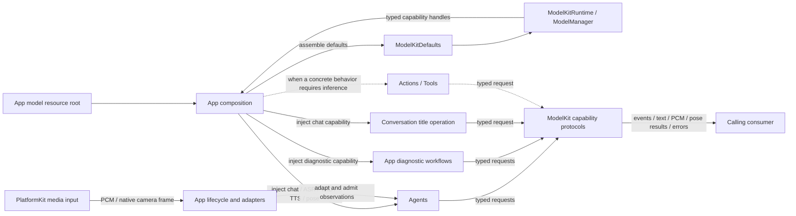
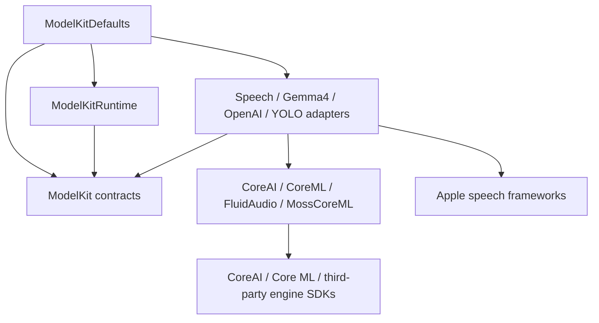

# ModelKit — Model Capabilities and Runtime

Processes supplied data through typed model capabilities. The goal is to keep recognition, generation and pose inference independent of Agent policy, UI and device I/O. Consumers receive capability protocols; internal assembly selects concrete models.

The physical directory contains several Swift targets. Base ModelKit has no project or third-party target dependencies and owns its public input/output values. ModelKitRuntime depends only on ModelKit; adapters and backends compile separately. Root Package.swift owns all targets and the source targets share one root build map.

## Directory structure

```text
ModelKit/
├── Core/                     # Capability, media, bounded sessions and resource admission
├── Defaults/                 # ModelKitDefaults: provider assembly and default bindings
├── Management/               # ModelKitRuntime: ModelManager and registration contracts
├── Language/
│   ├── LLM/                  # ChatCapability; separate Gemma4 and OpenAI adapters
│   └── JEV/                  # JudgeCapability contract; no production provider
├── Speech/
│   ├── ASR/                  # Recognition contract; Apple and Nemotron adapters
│   ├── TTS/                  # Synthesis contract; Apple, MOSS and Kokoro adapters
│   ├── VAD/                  # Voice activity contract, Silero and energy adapters
│   └── Shared/Apple/         # Apple speech PCM helpers
├── Vision/                   # PoseCapability and separate YOLO adapter
├── Backends/                 # Separate CoreAI, CoreML, FluidAudio and MossCoreML targets
└── README.md                 # Capability boundary
```

## External upstream and downstream

App is the composition and lifetime owner. It supplies the model resource root to `ModelKitDefaults`, obtains the process-wide `ModelManager`, resolves typed capability handles and injects only the capabilities required by each consumer. Consumers call capability protocols directly; Gateway does not proxy model work. PlatformKit has no ModelKit dependency: App packages captured media for Agent transport; the calling Agent adapts that transport into ModelKit inputs.

Solid arrows below are implemented relationships. Dashed arrows are allowed injection points that currently have no concrete dependency.



The current `Agents` target consumes ModelKit; diagnostic workflows and title generation receive capabilities through App. Current Actions and Tools do not import ModelKit, although the architecture permits a narrowly injected capability for a concrete behavior. UI, Gateway and PlatformKit do not depend on ModelKit. ModelKit and StorageAudio own distinct PCM values; SpeechSynthesis converts model output into the storage contract. Neither SDK depends on the other or on Types.

## Internal targets and processing flow

Dependency arrows below point from a target to what it imports. Base `ModelKit` contains value/session contracts and capability protocols. Runtime management, default assembly, adapters and engine backends remain separate targets so consumers never acquire concrete engines.



One process-wide manager preserves provider identity and resource ownership. Capability acquisition may construct a provider but does not necessarily load weights. The provider acquires its model resource before inference; one active operation is allowed per model. Streaming output uses an `InferenceSession`, while single-result capabilities return typed values through the same cleanup boundary.

```mermaid
flowchart LR
    Root[Resource root] --> Defaults[Default registrations]
    Defaults --> Manager[Process-wide ModelManager]
    Manager -->|get by capability or model ID| Provider[Shared capability provider]
    Consumer[Injected consumer] -->|typed request| Provider
    Provider --> Admission{Model operation free?}
    Admission -->|No| Busy[inputBusy]
    Admission -->|Yes| Lease[Reserve one operation lease]
    Lease --> Load[Load or reuse shared resource]
    Load --> Adapter[Preprocess and invoke adapter]
    Adapter --> Backend[Engine-specific backend]
    Backend --> Output[Bounded events or typed result]
    Output --> Consumer
    Consumer -->|finish or cancel| Cleanup[Join backend cleanup]
    Cleanup --> Release[Release matching lease]
    Release --> Policy{Memory policy / lifecycle command}
    Policy -->|retain| Ready[Keep resource ready]
    Policy -->|unload, pressure or shutdown| Teardown[Release resource]
```



### Ownership and limits

- ModelKitDefaults owns fixed registrations and default bindings. Production uses one process-wide manager; construction/registration require ModelAssembly SPI for internal assembly and isolated tests.
- ModelManager retains provider identity. `get` acquires a typed capability; deferred acquisition need not load weights. Unload releases resources without replacing the handle. Shutdown is terminal.
- Each model permits one active operation. Overlap fails with `inputBusy`; there is no waiting inference queue or cross-model scheduler. A lease ends after cleanup, not merely after cancellation is requested.
- ModelKit/Core owns AudioFormat and AudioFrame, including validation and CapabilityError; no application values are re-exported. Core owns ImageFrame/native image values and single-consumer InferenceSession streams. Default stream limits are 64 events and 4096 estimated bytes per event; adapters can set explicit alternatives. Cloud/local LLM adapters use no event-count cap, with generation/response bounds retained. Other streams remain bounded; oversize or bounded-stream overflow fails rather than dropping model output.
- ModelManager defaults allow 32 registrations, four concurrent factories/loaders and 32 construction/load waiters per model/resource; excess work is rejected. Unload waits for active work; shutdown cancels and joins it.
- Session cancellation cannot retract delivered output. Adapters must cooperate and retain admission until backend cleanup completes. Device capture and playback stay in PlatformKit.

Detailed contracts: [Core](Core/README.md), [Management](Management/README.md), [Defaults](Defaults/README.md) and [Backends](Backends/README.md). Keep adapter-specific algorithms and bounds in their own READMEs.

## Capability selection

| Capability | Current implementation |
| --- | --- |
| Speech recognition | ✅ Installed available Nemotron or modern Apple SpeechAnalyzer; Settings can force Apple |
| Voice activity | ✅ Installed available Silero or adaptive energy activity, with per-session state |
| Chat | ✅ Gemma 4 E2B QAT CoreAI or explicitly configured OpenAI-compatible cloud, text and native Tool calls |
| Speech synthesis | ✅ Installed available MOSS Nano or Apple PCM TTS, shared by conversation/diagnostics; Kokoro is historical test-only |
| Pose | ✅ YOLO26n-Pose INT8 with end-to-end output through PoseCapability |
| Judgment | ✅ Protocol; ❌ production provider |
| Other capabilities | ❌ VLM input, embeddings and general video sessions |

- ✅ Shared provider identity, coalesced loading, explicit unload/shutdown, memory-warning handling and release-when-idle policy.
- ❌ Timed eviction, measured cross-model memory/thermal budgets and local native Tool-call events.

The physical App requires iOS 27. Speech defaults select enabled installed available local models or Apple ASR/TTS and energy VAD. Settings can force system speech while preserving downloaded artifacts. Simulator local chat reports unavailable; explicitly configured cloud chat is supported. Gemma 4 E2B/YOLO still require their own artifacts. No active-inference or network/cloud fallback is provided.

## Adapter boundaries

ModelKitOpenAI exposes explicitly configured endpoint/key/model chat over bounded SSE. Absent cloud configuration selects the local binding; cloud speech/vision is not provided. ModelKitMossNano owns the synthesis adapter and ModelKitMossCoreML owns its backend. Defaults selects MOSS; Kokoro is an optional target outside the aggregate App product.

Concrete SDK dependencies live in separate adapters/backends. Base ModelKit owns no Agent permissions, device I/O or business state. Streams define byte estimates, admission and cleanup; unsupported capabilities fail explicitly. Non-cooperative backend calls can delay cancellation/shutdown; no generic forced interruption is provided.

✅ Cloud native Tool declarations and complete call events pass through ChatCapability; CurrentChatCapability forwards the current provider support flag. Local Gemma 4 E2B reports no native Tool support and rejects requests carrying tools. See [technical flow](Language/LLM/OpenAI/README.md).

## Local model resources — current contract

✅ Management implements schema-v2 source metadata, bounded installation/removal and Core maintenance barriers in ModelKitRuntime (ModelKit-only dependency). Concrete HF download calls belong to the independent ModelKitHub backend target; App injects it and Storage through Defaults. SDK resolution replaces bundled per-file links/hashes. App writes actual installation receipts; inference reads sandbox files. Capability/default ownership is unchanged.

✅ HF uses native background sessions and restores persisted staging/completed files. ❌ Full iPhone/server-resume acceptance remains pending (ADR 0108). See [Management](Management/README.md#local-model-resources--current-contract) and [ADR0105](../../docs/adr/0105-local-model-resource-management.md).


✅ Independent custom recognition/synthesis switches default off; enabled recognition requires the Nemotron installation, enabled synthesis requires MOSS. Apple recognition uses SpeechTranscriber+SpeechDetector together; Silero or Energy provides external silence scores independently of the ASR choice because native detector normal events were unavailable in the real probe.

✅ Errors and availability expose typed outcomes plus neutral technical diagnostics. Consumers own localization and recovery guidance. Chinese warm-up utterances are model input fixtures, not display text. ❌ SDK diagnostics must not prescribe App settings or UI workflows.
