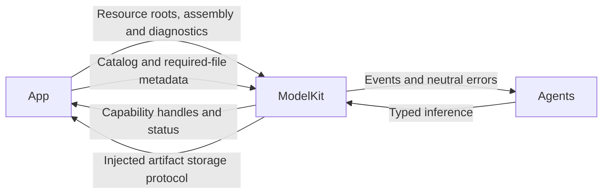
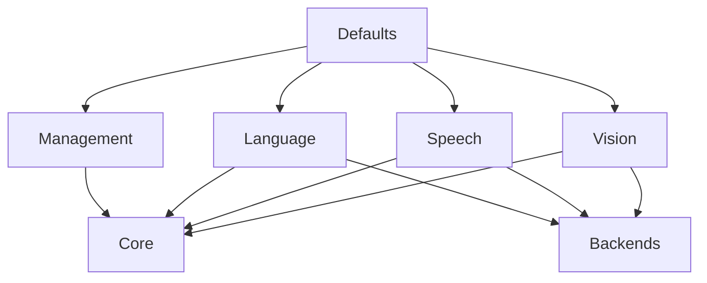

# ModelKit — Independent Inference Capabilities

## Summary

Typed model requests/results and independent provider, residency, assembly and artifact-management targets.

## Ownership and boundaries

Base ModelKit has no project dependencies or Agent/UI/device/business policy. Consumers receive capabilities; Defaults chooses providers, Management owns model/artifact lifetime and backends own concrete execution. Calling Agents adapt transported native media; adapters own model-specific preprocessing.

## External relationships and data flow

Runtime arrows show data or capability calls; dashed arrows show injection.

## Internal structure

## Capability and ownership map

| Capability | Implemented provider |
| --- | --- |
| Chat | Local Gemma 4 E2B QAT or explicitly configured Responses cloud |
| Recognition | Enabled installed available Nemotron, otherwise Apple SpeechAnalyzer |
| Synthesis | Enabled installed available MOSS Nano, otherwise Apple PCM TTS |
| Voice activity | Installed available Silero, otherwise Energy, independent of ASR switch |
| Pose | YOLO26n-Pose end-to-end Core ML |
| Judgment | Validated candidate contract; no production provider |

Custom ASR/TTS switches default off and are independent. Kokoro is isolated test-only, not registered by Defaults. Configured cloud supports images/native function data; local Gemma rejects both. ModelKit never dispatches model calls or selects Agent continuation. No fallback occurs after active inference failure.

## Runtime contracts

Defaults owns one process manager; consumers acquire typed stable handles. Acquisition/residency/availability are distinct. One inference lease per model rejects overlap without waiting. Loading coalesces bounded waiters; unload drains without replacing handle, shutdown cancels/joins and is terminal. releaseWhenIdle reacts to memory pressure without timers or deferred cancellation.

InferenceSession is single-consumer with explicit event-byte/count policies. Default is 64 events/4096 bytes; adapter bounds differ. OpenAI uses 128 events and suspends production on a full queue; wire/request and per-event bounds remain independent. Gemma currently has 4096 events of 4096 bytes. Cancel/failure suppress buffered delivery; normal finish drains. Native kernels may delay joined cleanup.

Artifacts are separate from residency: schema-v2 sources, bounded downloads, receipts, safe publication/deletion and maintenance fences. App supplies storage/backend adapters; ModelKit does not import Storage. Inference never downloads silently.

✅ Independent contracts/targets, managed provider identity and bounded explicit artifact lifecycle are implemented.

❌ Production judgment, embeddings, general video sessions and cross-model fairness/thermal scheduling are not implemented.

## Related design

[Parent design](../README.md) · [Backends](Backends/README.md) · [Core](Core/README.md) · [Defaults](Defaults/README.md) · [Language](Language/README.md) · [Management](Management/README.md) · [Speech](Speech/README.md) · [Vision](Vision/README.md)
