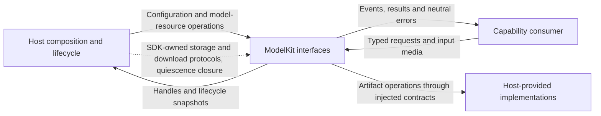

# ModelKit — Independent Inference SDK

## Purpose and boundaries

ModelKit supplies typed Language/Speech/Vision inference, model execution and model/artifact lifecycle. Core owns neutral values and concurrency mechanisms; capability domains own request/result contracts; concrete providers own algorithms and native integration; Management owns registration, residency, artifacts and default assembly.

The entire SDK depends only on its own targets, approved third-party products and system frameworks. It has no dependency on another project module. Consumers own application tasks, history selection, device actions, capture/playback and presentation. Storage, download and quiescence implementations enter through ModelKit-owned protocols or closures.

## External relationships and data flow

Solid arrows show runtime calls or returned data; dashed arrows show injection. Current App and Agent consumers act as SDK clients. Host-provided protocol implementations do not create a reverse compilation dependency.

## Source ownership

| Directory | Responsibilities and compilation |
| --- | --- |
| Support/Core | Neutral media, opaque requestID/scopeID, streams, resource leases, admission and worker cancellation; part of ModelKit |
| Language, Speech, Vision contracts | Typed capability requests/results; part of ModelKit |
| Support/Backends/CoreAI | Generic stateless graph/tensor runtime; ModelKitCoreAI |
| Support/Backends/CoreML | Generic named tensor runtime; ModelKitCoreML |
| Support/Management | Generic registration/lifecycle/artifacts in ModelKitRuntime; model registration and selection in ModelKitDefaults; disjoint explicit source lists |
| Support/Management/HuggingFace | Injected download adapter; ModelKitHub |
| Support/Speech/Apple | PCMCodec shared by Apple ASR/TTS in ModelKitAppleSpeech |
| Language/LLM/Gemma4, OpenAI | Concrete chat algorithms/protocol adapters |
| Speech/ASR, TTS, VAD provider directories | Concrete speech algorithms/native services |
| Vision/YOLO | YOLO image layout, graph execution, tensor reading and pose decoding |

Support is a source ownership group; each compiled target has its own boundary. Core plus capability-domain contracts form the base ModelKit target. Concrete providers own their tokenizer, prompts, recurrent/cache state and model-specific input/output rules.

## Compilation dependencies

Every arrow means the left target depends directly on the right target. All 15 production targets are shown; external frameworks/products are listed separately below. ModelKitCoreAI is available independently of the current provider integrations.

```mermaid
flowchart TD
 ModelKitDefaults[ModelKitDefaults]
 ModelKitRuntime[ModelKitRuntime]
 ModelKitHub[ModelKitHub]
 ModelKit[ModelKit: Core and capability contracts]
 ModelKitCoreAI[ModelKitCoreAI]
 ModelKitCoreML[ModelKitCoreML]
 ModelKitGemma4[ModelKitGemma4]
 ModelKitOpenAI[ModelKitOpenAI]
 ModelKitAppleSpeech[ModelKitAppleSpeech: Apple ASR, TTS and PCM]
 ModelKitNemotron[ModelKitNemotron]
 ModelKitMossNano[ModelKitMossNano]
 ModelKitKokoro[ModelKitKokoro]
 ModelKitSilero[ModelKitSilero]
 ModelKitEnergy[ModelKitEnergy]
 ModelKitYOLOPose[ModelKitYOLOPose]
 ModelKitDefaults --> ModelKit
 ModelKitDefaults --> ModelKitRuntime
 ModelKitDefaults --> ModelKitGemma4
 ModelKitDefaults --> ModelKitOpenAI
 ModelKitDefaults --> ModelKitAppleSpeech
 ModelKitDefaults --> ModelKitNemotron
 ModelKitDefaults --> ModelKitMossNano
 ModelKitDefaults --> ModelKitSilero
 ModelKitDefaults --> ModelKitEnergy
 ModelKitDefaults --> ModelKitYOLOPose
 ModelKitRuntime --> ModelKit
 ModelKitHub --> ModelKitRuntime
 ModelKitGemma4 --> ModelKit
 ModelKitOpenAI --> ModelKit
 ModelKitAppleSpeech --> ModelKit
 ModelKitNemotron --> ModelKit
 ModelKitMossNano --> ModelKit
 ModelKitKokoro --> ModelKit
 ModelKitSilero --> ModelKit
 ModelKitSilero --> ModelKitCoreML
 ModelKitEnergy --> ModelKit
 ModelKitYOLOPose --> ModelKit
 ModelKitYOLOPose --> ModelKitCoreML
```

| Target | Third-party products |
| --- | --- |
| ModelKitGemma4 | CoreAILM from coreai-models; Tokenizers from swift-transformers |
| ModelKitNemotron, ModelKitKokoro | FluidAudio; each provider owns its integration |
| ModelKitHub | HuggingFace from swift-huggingface |

Other external dependencies are native concurrency, media, inference, filesystem and network frameworks. Runtime uses only ModelKit; concrete providers never depend on Runtime, Defaults or sibling providers. Defaults alone combines providers. Source/import allowlists, product/package ownership, target/product dependency closure and source confinement are enforced by [boundary checks](../../scripts/README.md).

## Default capability bindings

| Capability | Selection |
| --- | --- |
| Chat | Gemma 4 E2B QAT on supported hardware, or explicitly configured Responses cloud |
| Recognition | Enabled, installed and available Nemotron; otherwise Apple SpeechAnalyzer |
| Synthesis | Enabled, installed and available MOSS Nano; otherwise Apple PCM TTS |
| Voice activity | Installed and available Silero; otherwise Energy, independent of ASR preference |
| Pose | YOLO26n-Pose |
| Judgment | Contract only; no default provider |

Custom ASR/TTS switches default off and are independent. Kokoro is an explicitly provisioned optional provider without Defaults registration. Selection occurs before admission; failure during active inference never switches provider. Local inference never initiates artifact downloads. The simulator local-chat binding reports unavailable; the Gemma package's native framework requirements still apply at compilation.

## Lifecycle, streams and failures

Defaults owns one process manager. Consumers acquire stable typed handles; acquisition, resource residency and capability availability are distinct. Management owns registration/construction state and injects validated loading limits; Core owns resource residency and lease mechanics. One active inference per resource rejects overlap. Loading coalesces bounded waiters; unload drains active leases, shutdown cancels/joins and is terminal. Memory-pressure releaseWhenIdle evicts eligible idle resources.

InferenceSession has one consumer and explicit event-count/byte limits. Core's default is 64 events/4096 estimated bytes per event; each provider declares its own bounds. Gemma uses 4096 events/4096 bytes; OpenAI uses 128 events/65,568 bytes with producer backpressure. Normal completion drains accepted events; failure/cancellation suppresses buffered delivery. InferenceTaskControl owns one worker's cancellation state; providers join cleanup and release leases after native work exits. OpenAI separately owns HTTP cancellation.

Artifacts have an independent schema-v2 catalog, bounded transfer state, validated installed receipts, safe publication/deletion and resource maintenance fences. The host supplies persistence/download adapters. Configuration, admission, native execution and cleanup failures remain observable; consumers choose recovery and presentation.

## Coverage and platform constraints

✅ Typed contracts, concrete providers, independent runtime/assembly targets, shared PCM conversion and explicit bounded lifecycles are implemented. SDK products use the root repository Package.swift; no separate publishing package exists.

❌ Production judgment, embeddings, general video sessions and cross-model fairness/thermal scheduling are not implemented. Gemma requires CoreAI on supported OS/hardware; its third-party CoreAIShared dependency currently cannot resolve CoreAI in the simulator SDK. Runtime/device acceptance evidence belongs in docs.

## Related design

[Parent design](../README.md) · [Support](Support/README.md) · [Core](Support/Core/README.md) · [Backends](Support/Backends/README.md) · [Management](Support/Management/README.md) · [Language](Language/README.md) · [Speech](Speech/README.md) · [Vision](Vision/README.md)

## Cloud non-thinking requests

✅ Implemented: the OpenAI adapter owns provider/model-specific non-thinking request options for all SDK consumers, including title generation. Alibaba Cloud endpoint identity and OpenAI model identity determine legal wire fields; mandatory-thinking models fail explicitly instead of using a lower reasoning fallback. The base ChatRequest and module interfaces remain unchanged. See [the adapter contract](Language/LLM/OpenAI/README.md#non-thinking-request-policy).

## Streaming TTS latency

✅ Apple TTS retains one native synthesizer per capability, fence request cleanup, and emit the first bounded PCM portion without coalescing delay. Provider ownership and neutral text-to-PCM interface remain unchanged.
