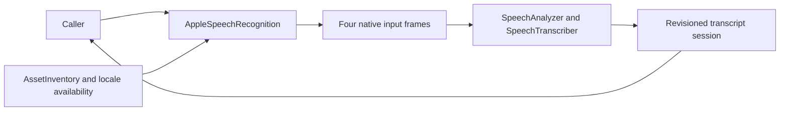

# Apple SpeechAnalyzer Recognition

## Summary

Modern native recognition with transcriber/detector, required locale assets and request-local ordered PCM.

The default adapter locale is `en-US`. The host's speech selection supplies `zh-CN` for Simplified Chinese and selects before acquiring a model lease. Active analyzer sessions retain their initial locale until completion or cancellation.

## Ownership and boundaries

Depends on ModelKit/system Speech frameworks. The host owns permissions/capture; the capability consumer owns silence endpoint policy. Every request owns analyzer/transcriber/detector/conversion under an exclusive ModelResource lease.

## External relationships and data flow

The diagram shows runtime calls and data flow, not compilation dependencies.

## Native processing and limits

Validate supported locale/assets/hardware explicitly; asset preparation may require network. Ordered 16 kHz mono Float32 is converted to native preferred format. Four input frames of ≤one MiB buffer; serialized producer suspends until native consumption, with cancellation waking sends and no PCM drops. Per input ≤16,000 samples; total ≤300 seconds.

Output retains 128 events of ≤65,600 estimated bytes, 2048 time-range fragments and 64 KiB aggregate text. Native revisions replace overlapping ranges in one capability segment. finishInput drains analyzer/results and emits aggregate final; finalization waits for native completion/error or cancellation. Cancel/error/shutdown stops analyzer before releasing admission. Framework-internal buffer size is opaque.

SpeechDetector shares analyzer/input/converter with reportResults=false. Normal activity events are not exposed as VoiceActivityCapability; external VAD remains the endpoint source. Recognition uses SpeechAnalyzer; active failures propagate without switching provider.

## Related design

[Parent design](../README.md)
