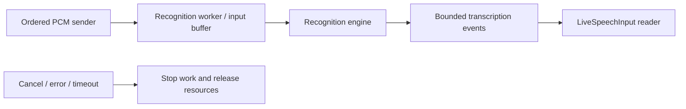

# Apple Speech Recognition

Purpose: document the implemented concurrency contracts and their limits. Design goal: explicit ownership, bounded work and observable termination.

## Queue and asynchronous processing contract

The adapter allows one active recognition worker and rejects further requests; it has no application input FIFO. Awaited send converts a frame and appends it to Apple's recognition request. Framework-internal buffering is opaque and is not claimed to have the repository's explicit queue bounds. Recognition callbacks produce revisioned partial/final events through a 128-event stream, at most 16,384 estimated bytes per event. Overflow fails the session. finishInput calls endAudio; a final callback closes output. A 25 s deadline fails stalled work. Termination removes the worker, cancels its timer and cancels failed/interrupted recognition. Native buffering backpressure is not implemented here.

✅ The algorithm above describes the current implementation.

Maintenance: update this contract when changing producers, consumers, limits, ordering, cancellation or completion semantics.

❌ Explicit control of framework-internal audio buffering and waiting request admission.

## Active worker ownership

✅ One optional (request ID, worker) record represents active work. Termination stops and clears only the matching worker, then releases that request's resource lease. A delayed callback cannot stop a newer worker or release its admission. Cleanup remains on MainActor; no request queue is maintained.

## Managed lifecycle

✅ The factory receives ModelContext from the shared ModelManager. The adapter registers its resource and retains only a managed handle. Load/unload decisions belong to the manager; request completion releases usage without unloading. Shutdown cancellation is connected to the active session; resource release follows worker cleanup. Consumers keep their capability interface across weight unload/reload.

✅ Overlap fails with inputBusy. Cancellation stops the worker before releasing its exclusive model lease; no request queue or automatic preemption is provided.
