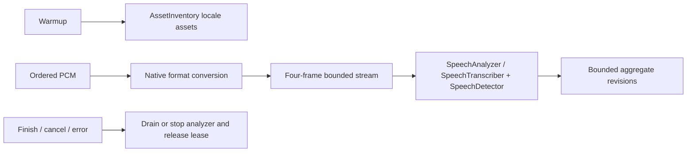

# Apple speech recognition

Purpose: provide on-device recognition through the public iOS/macOS 26+ SpeechAnalyzer and SpeechTranscriber APIs. Design goals: managed exclusive admission, ordered bounded PCM, observable cancellation and no microphone or conversation policy ownership.

✅ Availability checks device and locale support. Explicit warmup obtains missing system language assets through AssetInventory; no HF download source or app model receipt is involved. Apple's assets may require an initial network download.

✅ Every request owns a fresh transcriber, medium-sensitivity SpeechDetector and shared analyzer under a ModelResource lease. Ordered 16 kHz mono Float32 input is converted to the analyzer's preferred native format. At most four native input frames (maximum 1 MiB each) are buffered; a single ordered producer suspends until the analyzer receives a frame. Cancellation wakes blocked sends. No captured PCM is dropped. Each packet is at most 16,000 samples, total input at most 300 seconds. Output has 128 events, at most 65,600 estimated bytes/event; at most 2,048 time-range fragments and 64 KiB aggregate text are retained. Framework-internal buffering is opaque.

✅ Native revisions replace overlapping time ranges in a single capability segment. finishInput drains the analyzer/result stream and emits one aggregate final event; a 25-second finalization deadline fails stalled work. Cancel/error/shutdown stop the analyzer before releasing admission. Overlap fails with inputBusy; there is no request queue.

❌ Unsupported locales/hardware, guaranteed system asset download time and control over native internal buffering. No legacy SFSpeechRecognizer or cloud fallback is used. App owns microphone permission/capture and Agents owns silence endpoint policy.

Sources: [Apple SpeechAnalyzer session](https://developer.apple.com/videos/play/wwdc2025/277/), [AssetInventory](https://developer.apple.com/documentation/speech/assetinventory).

✅ Native ASR and VAD use the same SpeechAnalyzer/input/converter, with reportResults=false. Apple documents detector results as currently supporting VAD error handling only; a real Chinese-plus-two-second-silence probe with reportResults=true returned no activity events. Public SDK fields alone do not establish usable endpoint callbacks. Silero or Energy remains outside this adapter for Agent silence timing, independently of the ASR preference. No fake VoiceActivityCapability or unsupported native endpoint claims are introduced.

✅ The final combined-module integration test recognizes the Chinese fixture under dense 137-sample input plus trailing silence and permits session reuse. ❌ Native detector quality/power and physical-phone end-to-end behavior still need acceptance.

Source: [SpeechDetector](https://developer.apple.com/documentation/speech/speechdetector).
