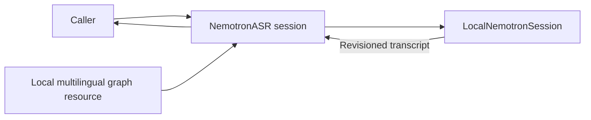

# Multilingual Nemotron Streaming Recognition

## Summary

Shared macOS/iOS multilingual 2240 ms Core ML export behind SpeechRecognitionCapability.

## Ownership and boundaries

Depends on ModelKit/ModelKitFluidAudio. Shared immutable graphs are resource-owned; recurrent state is per session. Settings/Management provisions artifacts; inference never downloads or uses device-specific CoreAI speech graphs.

## External relationships and data flow

Runtime arrows show data or capability calls; dashed arrows show injection.

## Format and bounds

Catalog pins multilingual/2240ms revision 1a41b75758b0337ff67db7d5408280aaaf23074e and strips that prefix. Five compiled graphs plus metadata/tokenizer are required. cpuAndNeuralEngine uses native mel/fused decoder_joint. Validate exact 2240 ms/16 kHz mono/vocabulary metadata; locale must match prompt_dictionary or auto.

One model lease and one send/finish operation reject overlap without queuing. Per packet ≤16,000 finite samples; total ≤300 seconds; decoded tokens ≤16,384 and text ≤65,536 bytes. SDK owns chunk framing. Output is 128 events of ≤65,600 bytes; overflow fails. Revisions share a segment; finish emits final. The model window is not end-to-end latency.

Cancel joins the active SDK call, clears session and releases lease without final event. Warmup executes silence through the same backend; no provider fallback occurs.

✅ Exact local-export validation and bounded multilingual streaming are implemented.

## Related design

[Parent design](../README.md)
