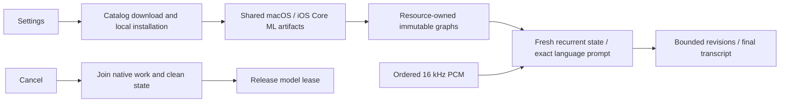

# Nemotron multilingual streaming ASR

Purpose: implement SpeechRecognitionCapability through ModelKitFluidAudio and Core ML. Design goals: shared immutable graphs, isolated recurrent session state, bounded input/output and cancellation that drains native work before releasing the model lease.

- ✅ One macOS/iOS resource layout: installed/Nemotron contains only multilingual/2240ms from FluidInference/Nemotron-3.5-ASR-Streaming-Multilingual-0.6b-CoreML. The catalog pins revision 1a41b75758b0337ff67db7d5408280aaaf23074e and strips that prefix. Five compiled graph directories plus metadata/tokenizer comprise 22 files (664,846,846 bytes). Settings manages acquisition; inference never downloads.
- ✅ Core ML uses cpuAndNeuralEngine. FluidAudio preloads shared graphs, creates fresh state for each session, uses its native mel frontend and fused decoder_joint. No CoreAI, h18p check, bundled mel filter or separate Mac export remains in this adapter. Apple Silicon simulator availability uses local resource validation.
- ✅ Exact metadata validation selects 2240 ms chunks, 16 kHz mono Float32 and the multilingual vocabulary. Locale must match prompt_dictionary or auto; unsupported labels fail without fallback.
- ✅ One model lease and one send/finish operation; overlap immediately fails inputBusy with no waiting queue. Each packet accepts at most 16,000 finite samples; total input is capped at 300 seconds, decoded tokens at 16,384 and text at 65,536 UTF-8 bytes. Native chunk framing is SDK-owned. Results use 128 bounded events with a 65,600-byte event limit; overflow fails the session.
- ✅ Transcript revisions share a segment ID; finish emits one final transcript. Cancellation joins an active SDK call, cleans session state, then releases the lease; no final event is emitted on cancellation. Warmup executes silence through the same backend.
- ❌ Physical-device multilingual quality, sustained memory/thermal acceptance and measured streaming latency remain pending. A 2240 ms model window is not an end-to-end latency guarantee.

Tests/NemotronTests validates strict metadata, input and lease contracts. scripts/test-nemotron.sh opts into real local Core ML packet-parity, cancellation and synthetic English/Chinese inference. Existing CoreAI records in docs/Nemotron-Validation.md are historical evidence and do not establish this export's acceptance.

✅ 2026-10-03 Mac real-weight validation passed: all 22 files verified, three packet sizes produce identical English transcripts, Chinese auto recognition includes 语音识别, and cancel/unload/reload completes. See docs/Nemotron-Validation.md; phone acceptance remains outstanding.
