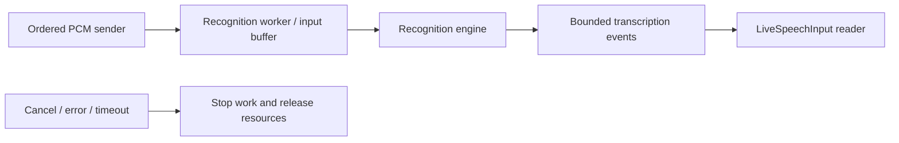

# Nemotron Streaming ASR

Purpose: implement SpeechRecognitionCapability in ModelKitNemotron using ModelKitCoreAI. Design goals: incremental recognition, bounded state and safe session cleanup independent of microphone, VAD and business routing.

## Artifacts and implementation

- ✅ Models/Nemotron contains the fixed iOS export; Models/Nemotron-macos is for Mac tests. The development download profile pins the revision. Backend SDKs load files directly; there is no runtime download or model fallback.
- ✅ OS 27 on supported Apple Silicon; iOS exports require h18p, Mac uses the macos export. Simulator reports unavailable. OpenMDW-1.1 model license and BSD-3-Clause source license are separate.
- ✅ Six graphs and per-session recurrent state in NemotronModel; continuous preemphasis/DFT/Slaney log-mel in NemotronMelStream; bounded Metaspace decoding in NemotronTokenizer. The 128×257 mel filter resource ships with the target.
- ✅ CoreAI bridging stays in Backends/CoreAI; source adaptation follows CoreAIKit 19f16d453e6f2d4e73ea33fa2ed600dc6e21628c.

## Inference and managed lifetime

16 kHz mono Float32 PCM; no implicit resampling. The first encoder chunk has 25 mel frames, subsequent chunks 32; state includes convolution history, a 56-frame KV window and LSTM state. Four encoded frames are produced per chunk. Transcript revisions share one segmentID, with one final result on finish and no final on cancellation.

One session per injected ModelResource. Session limits are 300 s, 16,384 tokens and 64 KiB text; final padding is limited to eight chunks. App's shared ModelManager owns load/warmup/unload. Cancellation joins active graph work before releasing usage; unload waits without forcibly interrupting a GPU kernel. Warmup exercises fixed silence. Model identity and concrete tensors do not reach consumers.

Language hints use exact prompt-dictionary labels or auto; label availability is not a quality guarantee. scripts/test-nemotron.sh enables opt-in real-weight packet-parity and synthetic English/Chinese tests. Mac fixture agreement is not iPhone accuracy or WER acceptance.

- ❌ Complete multilingual and sustained-device acceptance, automatic eviction and memory/thermal budgeting.

## Queue and asynchronous processing contract

LiveSpeechInput sends ordered PCM and consumes transcription events independently. OperationAdmission admits one send/finish operation; overlap fails with inputBusy. Each send accepts at most 16,000 samples. The incremental mel frontend carries preemphasis/sample history, produces 25 mel frames for the first encoder chunk and 32 thereafter, and removes consumed samples/frames. These are framing buffers, not pending inference requests; the frontend relies on caller input limits rather than an independent work-queue capacity.

Results use a 128-event stream with a 65,600-byte estimated event limit; transcript text is capped at 65,536 UTF-8 bytes. Revisions update the current segment, with final output on finish. Overflow/oversized output fails the session. Termination closes the bridge, cancels the recognition session and releases its model lease. No drop-oldest recognition policy or queued concurrent inference is provided.

✅ The algorithm above describes the current implementation.

Maintenance: update this contract when changing producers, consumers, limits, ordering, cancellation or completion semantics.

✅ OperationAdmission guards ASR operations with immediate busy rejection and no waiting queue. The shared manager may release idle weights on memory pressure; active session leases prevent eviction.
