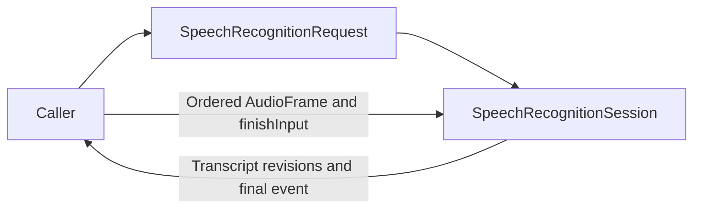

# Streaming Recognition Contract

## Summary

Ordered PCM send/finish sessions and context-bearing revisioned transcript events.

## Ownership and boundaries

SpeechRecognitionCapability opens request-local recognition; caller owns native capture, resampling and utterance endpoint policy. Providers own locale/admission/output bounds and joined native cleanup.

## External relationships and data flow

The diagram shows runtime calls and data flow, not compilation dependencies.

## Session semantics

Recognition input retains AudioFormat/InferenceContext and requested locale. Send preserves sequence/format and provider limits; finishInput closes input and drains final result; cancel stops/join-cleans without inventing a final transcript. Events carry segment/revision/context for consumers to reject stale updates. One provider operation rejects overlap; there is no shared request backlog here.

Defaults selects enabled installed available Nemotron, otherwise modern Apple. Apple includes its native detector but external Silero/Energy supplies acoustic scores for caller-owned endpoint timing. No active-failure system/cloud fallback exists.

✅ Streaming transcript contract and two providers are implemented.

## Outstanding work

No additional implementation work is declared for this streaming contract. Provider-specific native behavior and acceptance work are documented below.

## Related design

[Parent design](../README.md) · [Apple](Apple/README.md) · [Nemotron](Nemotron/README.md)
