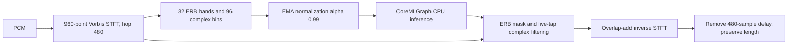

# DeepFilterNet3

`ModelKitDeepFilterNet3` depends on ModelKit contracts/resource management and the CoreML graph backend. `DeepFilterNet3(context:artifacts:)` loads `DeepFilterNet3.mlmodelc` and `auxiliary.npz` through a managed resource. Availability checks installation; loading and inference surface actual artifact/runtime failures. The actor admits one request, rejects overlap and holds its resource lease until native work finishes. Resource shutdown and caller cancellation cancel the task; cancellation checks bracket DSP and synchronous Core ML prediction. No unbounded queue is used.

Inputs are `feat_erb [1,1,T,32]` and `feat_spec [1,2,T,96]`; outputs are `erb_mask [1,1,T,32]` and `df_coefs [1,5,T,96,2]`. The graph owns feature lookahead, while DSP uses two-frame deep-filter lookahead with zero padding. Analysis is scaled by 1/960; inverse DFT is unscaled. Each request resets normalization and overlap state; 960 tail zeros preserve non-hop-aligned lengths; very short inputs are padded to at least three frames for graph lookahead. Five-second input yields at most 502 frames and keeps each tensor below the shared allocation bound.

Auxiliary files are bounded to 256 KiB and parsed as stored ZIP/ZIP64 with float32 little-endian NPY v1 arrays. Names, shapes, finite values, lengths and normalization state are validated; Fortran-order inverse filterbank is transposed to row-major. Unsupported encoding/archive variants fail instead of producing approximate constants.

DSP is adapted from [speech-swift](https://github.com/soniqo/speech-swift/tree/b1287a6c963a38b0d4133c656725b2de7ea6bebf/Sources/SpeechEnhancement), Apache-2.0, Copyright 2025 Ivan Digital. Modifications remove MLX dependencies and unused helpers and make DFT setup failure throwing. [License](../../../../../docs/licenses/Speech-Swift-Apache-2.0.txt). Artifact revision is pinned in [catalog](../../../Support/Management/model-catalog.json). Model weights are not shipped in source control.
