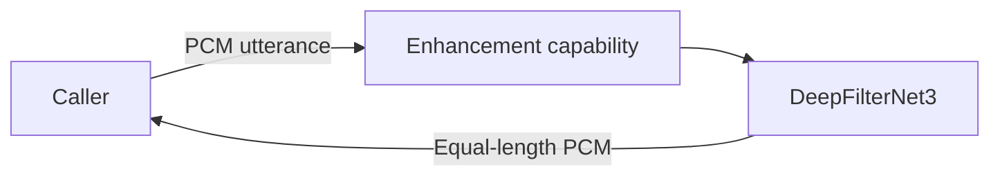

# Speech enhancement

`SpeechEnhancementCapability.enhance(_:)` consumes a complete PCM utterance and returns enhanced PCM with unchanged format, sample count, sequence and timestamp. The contract accepts 48 kHz mono Float32, at most 240000 samples (five seconds). Callers own resampling, capture, segmentation and playback. This is noise suppression without a playback reference, not acoustic echo cancellation.

[DeepFilterNet3](DeepFilterNet3/README.md) implements the contract. Each call starts fresh DSP/model state. Overlapping calls reject with `inputBusy`; there is no pending inference queue. Invalid/nonfinite audio, missing artifacts and prediction failures propagate. Cancellation joins native inference and releases its lease before returning.

The published graph has internal recurrent state that resets per prediction and exposes no state tensors. This interface therefore makes no continuous streaming or real-time latency guarantee. The home preparation checks DeepFilterNet3 when selected; SpeechPerception opts into windowed processing through its persisted setting.

## Windowed adapter

`WindowedSpeechEnhancement` wraps a capability for continuous ordered PCM delivery. It retains up to 15360 history samples and fewer than 19200 pending samples between calls, accepts at most 8192 new samples per call (peak pending 27392), emits 15360-sample hops and crossfades 1920 samples with complementary linear weights. Another 1920 samples provide future context. One model input is at most 34560 samples (720 ms); first emission requires 400 ms. Context reduces but does not eliminate the export's recurrent-state reset at each call.

The actor admits one operation and rejects overlap. Sequence must increase; timestamps must match cumulative sample positions within one 48 kHz sample. Output timestamps/sequence follow emitted PCM, not inference completion. `finish()` returns the retained final tail once; reset discards buffered audio and invalidates in-flight results without accepting another call until that work exits. Failure closes the stream until explicit reset. Caller cancellation propagates through the capability; no raw PCM fallback is fabricated. The adapter allocates no detached per-packet tasks.
