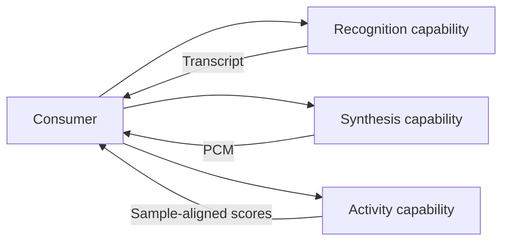
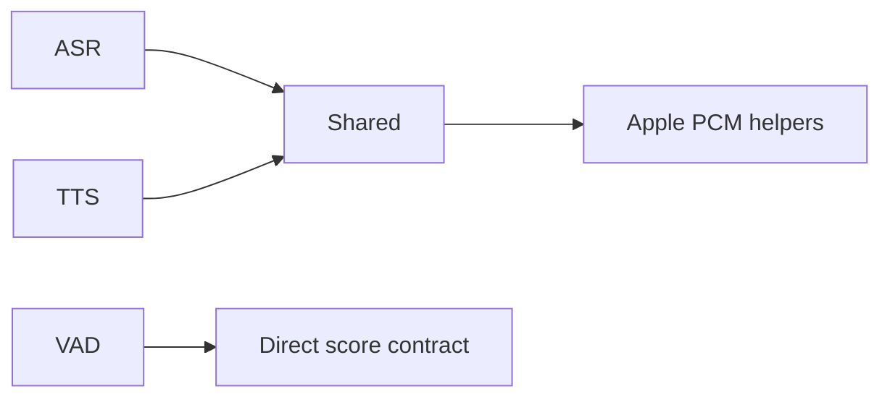

# Speech Capability Group

## Summary

Independent ASR, TTS and voice-activity contracts/adapters with managed operation state.

## Ownership and boundaries

Consumers own microphone/playback/utterance endpoint policy. Speech adapters produce transcript, activity scores or PCM and do not route Signals or decide conversations.

## External relationships and data flow

Runtime arrows show data or capability calls; dashed arrows show injection.

## Internal structure

## Composition

ASR provides Nemotron/Apple; TTS provides MOSS/Apple plus isolated Kokoro; VAD provides Silero/Energy; Shared/Apple supplies codec helpers. Custom ASR/TTS preference is independent; VAD selection is independent of ASR. Missing/unavailable local speech selects system capability before admission, never after failed active inference.

Apple's transcriber/detector share analyzer state; normal detector activity callbacks are not assumed usable, so Agent silence timing still uses separate VAD. Local graph resources are provisioned through Management, never during inference.

✅ Independent managed speech capabilities and shared codec adaptation are implemented.

## Related design

[Parent design](../README.md) · [ASR](ASR/README.md) · [Shared](Shared/README.md) · [TTS](TTS/README.md) · [VAD](VAD/README.md)
