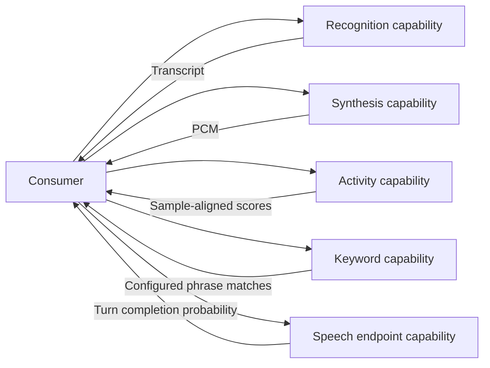
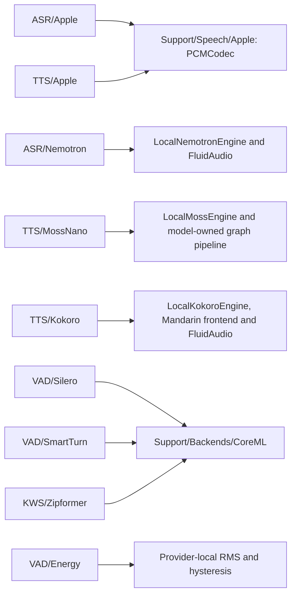

# Speech Capability Group

## Summary

Independent ASR, TTS and voice-activity contracts/adapters with managed operation state.

## Ownership and boundaries

Consumers own microphone/playback/utterance endpoint policy. Speech adapters produce transcript, activity scores or PCM and do not route Signals or decide conversations.

## External relationships and data flow

The diagram shows runtime calls and data flow, not compilation dependencies.

## Provider implementation relationships

## Composition

ASR provides Nemotron/Apple; TTS provides Apple, MOSS Nano and Kokoro; VAD provides Silero/Energy; Support/Speech/Apple supplies codec helpers. SpeechModelOption publishes independently selectable providers by capability and stable model ID. VAD defaults to Energy. Unavailable selections resolve to the capability default before admission, and an admitted session retains its lease. Kokoro receives the bound voice ID from the synthesis facade for the lifetime of the request.

Apple's transcriber/detector share analyzer state; normal detector activity callbacks are not assumed usable, so consumers use a separate VoiceActivityCapability for endpoint interpretation. Local graph resources are provisioned through Management, never during inference.

## Related design

[Parent design](../README.md) · [ASR](ASR/README.md) · [Shared support](../Support/Speech/README.md) · [TTS](TTS/README.md) · [VAD](VAD/README.md)

## Enhancement

[Enhancement](Enhancement/README.md) provides independent, bounded 48 kHz PCM utterance denoising through DeepFilterNet3 and the shared CoreML backend. It remains independent of ASR/TTS/VAD selection. App prepares the selected enhancement resource; SpeechPerception applies the window adapter before VAD/ASR when enabled.

## Keyword spotting

[KWS](KWS/README.md) owns the resident Zipformer Core ML encoder, decoder and
joiner, streaming filterbanks and bounded keyword sessions. The host supplies
phrases and PCM through `KeywordSpottingCapability`. Opening a session only
uses a ready graph; an absent or loading model returns nil.

## End-of-turn confirmation

[Smart Turn](VAD/README.md#end-of-turn-confirmation) scores the current audio tail when the consumer identifies candidate silence. Selection defaults to Off and is independent of the acoustic VAD provider. The consumer owns whether to keep or close the speech turn.
