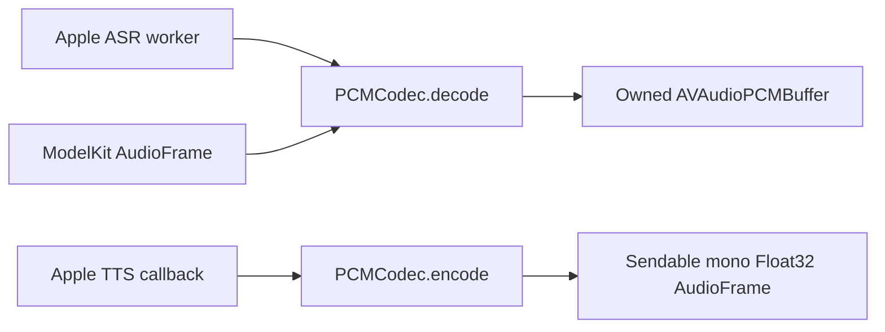

# Apple Speech Shared PCM Helpers

Purpose: share system audio-buffer conversion between the optional Apple ASR and TTS adapters. Design goals: owned Sendable PCM values across concurrency boundaries, explicit format validation and no device I/O or business policy.

This directory contains `PCMCodec.swift` and compiles into `ModelKitAppleSpeech` alongside [ASR/Apple](../../ASR/Apple/README.md) and [TTS/Apple](../../TTS/Apple/README.md). It is not a separate target. Root Package.swift defines this source selection; the adapter depends only on ModelKit and system frameworks.

- ✅ Copies supported Float32/Int16 system buffers into mono Float32 data; validates frame count and unsupported encodings.
- ✅ Converts mono Float32 AudioFrame input into a new system buffer for recognition. Mutable framework buffers remain worker-owned.
- ✅ No additional queue, session, inference registration or microphone/speaker ownership. Adapter READMEs own admission, timeout and cancellation contracts.
- ❌ General-purpose resampling, arbitrary multichannel preservation and device capture/playback. PlatformKit owns device I/O.

Production conversation uses Nemotron ASR and MOSS TTS. These Apple adapters remain optional capabilities. SpeechSynthesisAgent owns production synthesis and StorageAudio handoff; Actions/Speech only consumes prepared audio IDs and awaits playback.
