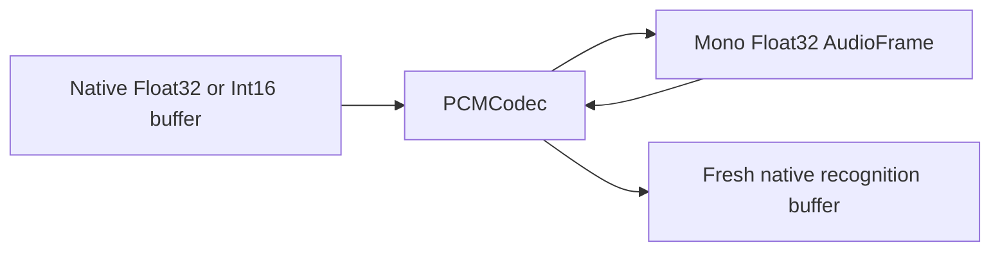

# Apple PCM Conversion

## Summary

PCMCodec converts native Speech buffers to/from ModelKit mono Float32 values.

## Ownership and boundaries

Compiles into ModelKitAppleSpeech and depends on ModelKit/system audio frameworks. Caller owns mutable buffers and serial callbacks; this helper has no independent session, inference lease or worker.

## External relationships and data flow

Runtime arrows show data or capability calls; dashed arrows show injection.

## Encoding rules

Copy supported Float32/Int16 frames into validated mono Float32 data; reject unsupported encoding or invalid frame count. Convert ordered mono model input into a newly allocated system buffer for analyzer use. Do not mutate caller-retained model payloads or claim arbitrary multichannel preservation.

Native/system providers are selected by current Defaults, not fixed production model names. SpeechSynthesisAgent adapts model PCM to StorageAudio; prepared audio playback stays outside ModelKit.

✅ Explicit native/model PCM copying is implemented.

❌ General-purpose resampling and arbitrary multichannel conversion are not implemented here.

## Related design

[Parent design](../README.md)
