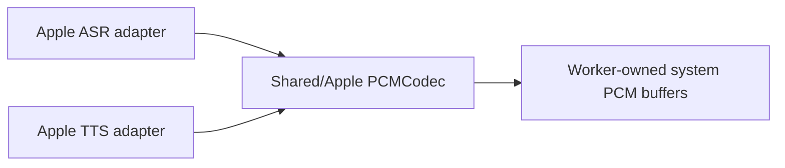

# Shared Speech Codec Utilities

## Summary

PCM helpers shared by native speech adapters without introducing another runtime or provider target.

## Ownership and boundaries

Apple helpers compile in ModelKitAppleSpeech alongside ASR/Apple and TTS/Apple. They translate validated model/system PCM; PlatformKit owns general resampling and native I/O.

## External relationships and data flow

Runtime arrows show data or capability calls; dashed arrows show injection.

## Boundary

Helpers own copying/encoding validation only. Mutable buffers stay with the native worker; no queue, registration, model resource, microphone or playback lifetime is created. Parent/provider READMEs own operation bounds and cancellation.

✅ Shared native PCM conversion is implemented.

## Related design

[Parent design](../README.md) · [Apple](Apple/README.md)
