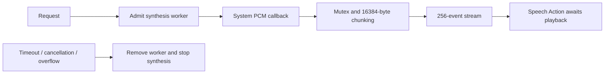

# Apple Speech Synthesis

Purpose: document the implemented concurrency contracts and their limits. Design goal: explicit ownership, bounded work and observable termination.

## Queue and asynchronous processing contract

One synthesis worker is admitted; further requests fail. Each request is limited to 2048 UTF-8 bytes. AVSpeechSynthesizer callbacks produce PCM, serialized with a mutex around accumulation and emission. SynthesisPCMAccumulator emits 16,384-byte chunks and retains a smaller remainder after append; the zero-length terminal callback flushes that tail, emits finished and closes the stream. Format changes fail. The accumulator does not independently bound the incoming callback allocation.

Speech Actions consume a 256-event stream, each event at most 16,448 estimated bytes. A full stream fails rather than blocking the framework callback. A 30 s timer terminates stalled synthesis. Termination schedules MainActor worker removal and immediate speech stop. Actual speaker playback is downstream and must be awaited separately; synthesis completion is not playback completion. There is no application FIFO of waiting synthesis requests.

✅ The algorithm above describes the current implementation.

Maintenance: update this contract when changing producers, consumers, limits, ordering, cancellation or completion semantics.

❌ A waiting synthesis-request queue, control of framework callback allocation, and audio mixing.

## Active worker ownership

✅ One optional (request ID, worker) record represents active work. Termination stops and clears only the matching worker, then releases that request's resource lease. A delayed callback cannot stop a newer worker or release its admission. Cleanup remains on MainActor; no request queue is maintained.

## Managed lifecycle

✅ The factory receives ModelContext from the shared ModelManager. The adapter registers its resource and retains only a managed handle. Load/unload decisions belong to the manager; request completion releases usage without unloading. Shutdown cancellation is connected to the active session; resource release follows worker cleanup. Consumers keep their capability interface across weight unload/reload.

✅ Overlap fails with inputBusy. Cancellation stops the worker before releasing its exclusive model lease; no request queue or automatic preemption is provided.
