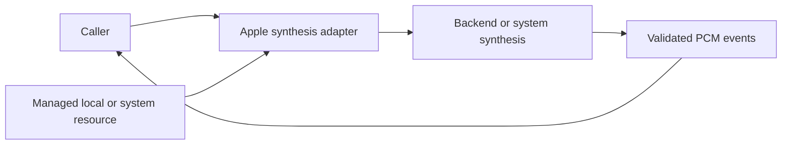

# Apple PCM Speech Synthesis

## Summary

System AVSpeechSynthesizer output as managed cancellable PCM, selected when custom synthesis is disabled/unavailable.

## Ownership and boundaries

The adapter owns request admission/format and a ModelResource lease. Backend/native framework owns prediction; caller owns synthesis segmentation/cache/playback. No native capture, speaker, business or transport dependency exists.

## External relationships and data flow

Runtime arrows show data or capability calls; dashed arrows show injection.

## Callback and admission contract

One worker rejects overlap; text ≤2048 UTF-8 bytes. A mutex serializes native callback accumulation/emission. SynthesisPCMAccumulator emits 16,384-byte chunks and keeps smaller remainder; zero-length terminal callback flushes tail, emits finished and closes. Format changes fail; native incoming callback allocation is not independently bounded.

Stream retains 256 events of ≤16,448 estimated bytes; full buffer fails without blocking native callback. A 30-second stall timer ends synthesis. Termination schedules MainActor immediate speech stop/removal, matches request ID before releasing the lease and cannot retire a newer worker. No application FIFO exists.

Auto locale resolves Han text to zh-CN, otherwise en-US; explicit locales preserve region with normalized script aliases. Missing voice reports the resolved language. Physical playback and its deadline remain downstream. Manager resource owns usage/cleanup without claiming ownership of Apple's system voice files.

✅ Bounded callback PCM, native worker fencing and system locale selection are implemented.

## Related design

[Parent design](../README.md)
