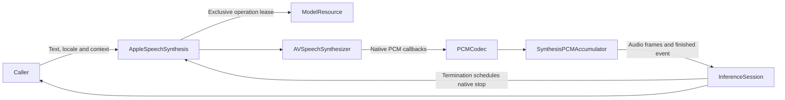

# Apple PCM Speech Synthesis

## Summary

System AVSpeechSynthesizer output as managed cancellable PCM, selected when custom synthesis is disabled/unavailable.

## Ownership and boundaries

The adapter owns request admission/format and a ModelResource lease. The directory-owned native engine/framework integration produces PCM; the consumer owns synthesis segmentation, caching and playback. No native capture, speaker, business or transport dependency exists.

## External relationships and data flow

The diagram shows runtime calls and data flow, not compilation dependencies.

## Callback and admission contract

One worker rejects overlap; text ≤2048 UTF-8 bytes. A mutex serializes native callback accumulation/emission. SynthesisPCMAccumulator emits the first nonempty PCM portion immediately (at most 16,384 bytes), then coalesces subsequent callbacks into 16,384-byte chunks and keeps smaller remainder; zero-length terminal callback flushes tail, emits finished and closes. Format changes fail; native incoming callback allocation is not independently bounded.

Stream retains 256 events of ≤16,448 estimated bytes; full buffer fails without blocking native callback. No adapter timer ends synthesis. One capability retains one AVSpeechSynthesizer. Termination marks request completion synchronously and schedules MainActor retirement; the next request can join retirement directly. Cancellation/failure stops only the matching native worker, normal completion preserves the synthesizer, and old cleanup cannot retire a newer worker. No application FIFO exists.

Auto locale resolves Han text to zh-CN, otherwise en-US; explicit locales preserve region with normalized script aliases. Missing voice reports the resolved language. Physical playback and its deadline remain downstream. Manager resource owns usage/cleanup without claiming ownership of Apple's system voice files.

✅ Bounded callback PCM, native worker fencing and system locale selection are implemented.

## Outstanding work

❌ Physical-device voice availability and sustained native synthesis/playback coexistence acceptance remains outstanding. [Voice acceptance](../../../../../docs/validation/Voice.md) defines host-level trials.

## Related design

[Parent design](../README.md)

## Streaming TTS latency

✅ SynthesisPCMAccumulator emits up to 16,384 bytes on the first nonempty callback immediately, then coalesces subsequent PCM to 16,384-byte chunks and flushes the tail on completion. AppleSpeechSynthesis reuses one native synthesizer; terminal-state/request-ID fencing joins retirement before reuse and prevents old cleanup from stopping a newer request. Existing 256-event bounds, overflow errors, mono Float32 and default speaking rate remain.
