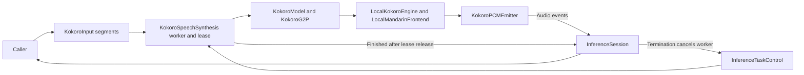

# Optional Kokoro Bilingual Synthesis

## Summary

Unregistered Mandarin/US English adapter for explicitly provisioned isolated tests.

## Ownership and boundaries

LocalKokoroEngine and LocalMandarinFrontend are owned here and compiled with the adapter in ModelKitKokoro, which depends on ModelKit and FluidAudio.

The adapter owns request admission/format and a ModelResource lease. The directory-owned native engine/framework integration produces PCM; the consumer owns synthesis segmentation, caching and playback. No native capture, speaker, business or transport dependency exists.

## External relationships and data flow

The diagram shows runtime calls and data flow, not compilation dependencies.

## Pipeline and bounds

KokoroInput validates language/text; KokoroG2P owns frontend adaptation; KokoroModel loads local resource; KokoroSpeechSynthesis owns admission/output. No production downloader or Defaults registration exists. Resource root is supplied explicitly; no MOSS/system fallback is attempted.

One detached worker holds a model lease, emits 4096-sample PCM frames and retains eight events of ≤16,448 bytes. Serialized yieldSuspending propagates consumer backpressure through subsegments, while each subsegment waveform is still computed completely first. Total generated audio ≤60 seconds; overlap rejects.

Core InferenceTaskControl handles installation/cancellation races and releases the worker reference on finish. A cancelled predecessor is joined before reuse; active native graph/classifier calls may delay release. Completed handles clear retained task. It does not implement token-level waveform streaming or parallel inference.

Optional local bilingual synthesis and bounded backpressure are implemented.

## Related design

[Parent design](../README.md)

## Local Kokoro and Mandarin engines

LocalMandarinFrontend bridges published six-input g2pW and already-numbered tone labels, preserving phrase dictionary priority. At most 510 normalized characters/phoneme scalars; ambiguous single characters classify sequentially after dictionary matching. Kokoro stages retain the SDK's 2000 acoustic-frame bound. Contextual inference errors propagate.

Cancellation checks between graph/classifier calls; synchronous Core ML work finishes before lease release. Backend methods never download or supply fallback audio.

## 待实现

- Production registration is outside this directory's current scope. Isolated real-model evidence and remaining experiments belong in [Kokoro validation](../../../../../docs/validation/Kokoro-Validation.md).
