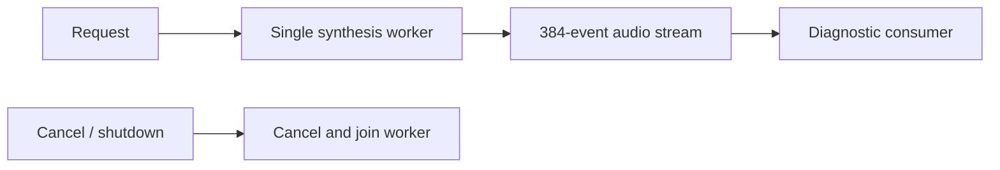

# Kokoro CoreAI Validation Adapter

Purpose: provide local English synthesis for explicit diagnostics. Design goals: bounded generation, checked artifacts and managed cancellation; this is not the normal conversation TTS binding.

- ✅ Models/Kokoro contains the fixed CoreAI export selected by the development download profile. Backend files load directly. Source attribution and redistribution licenses remain in docs/licenses.
- ✅ ModelKitKokoro depends only on ModelKit/CoreAI. Three CPU-only graphs with host alignment and harmonic STFT; OS 27 Apple Silicon, explicitly unavailable on Simulator.
- ✅ en/en-US and af_heart only. Unknown English words use letter spelling; non-English input is rejected. Express decimal numbers as English words.
- ✅ Input ≤2048 UTF-8 bytes, ≤32 segments, ≤60 s PCM. 128-token/512-frame bucket overflow fails without truncation.
- ✅ App registers the context-bound adapter with ModelManager. The manager owns load/unload; cancellation stops future stages and joins current graph work before releasing the lease.
- ❌ Chinese/Japanese preprocessing, universal device compatibility and production multilingual acceptance.

## Queue and asynchronous processing contract

Kokoro admits one request with no waiting request queue. Its generation worker produces bounded audio into an InferenceSession: 384 events, at most 16,448 estimated bytes per event, and at most 60 s of generated audio per request. The consumer must drain output while generation proceeds; full output fails rather than silently dropping PCM. Cancellation stops the worker cooperatively; manager unload waits for the active lease, while shutdown requests cancellation and joins cleanup. This diagnostic provider is not the normal conversation TTS binding. Playback/mixing scheduling and automatic retry are not implemented here.

✅ The algorithm above describes the current implementation.

Maintenance: update this contract when changing producers, consumers, limits, ordering, cancellation or completion semantics.
