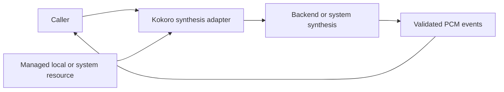

# Optional Kokoro Bilingual Synthesis

## Summary

Unregistered Mandarin/US English adapter for explicitly provisioned isolated tests.

## Ownership and boundaries

The adapter owns request admission/format and a ModelResource lease. Backend/native framework owns prediction; caller owns synthesis segmentation/cache/playback. No native capture, speaker, business or transport dependency exists.

## External relationships and data flow

Runtime arrows show data or capability calls; dashed arrows show injection.

## Pipeline and bounds

KokoroInput validates language/text; KokoroG2P owns frontend adaptation; KokoroModel loads local resource; KokoroSpeechSynthesis owns admission/output. No production downloader or Defaults registration exists. Resource root is supplied explicitly; no MOSS/system fallback is attempted.

One detached worker holds a model lease, emits 4096-sample PCM frames and retains eight events of ≤16,448 bytes. Serialized yieldSuspending propagates consumer backpressure through subsegments, while each subsegment waveform is still computed completely first. Total generated audio ≤60 seconds; overlap rejects.

Synchronized cancellation handles installation races. A cancelled predecessor is joined before reuse; active native graph/classifier calls may delay release. Completed handles clear retained task. It does not implement token-level waveform streaming or parallel inference.

✅ Optional local bilingual synthesis and bounded backpressure are implemented.

## Related design

[Parent design](../README.md)
