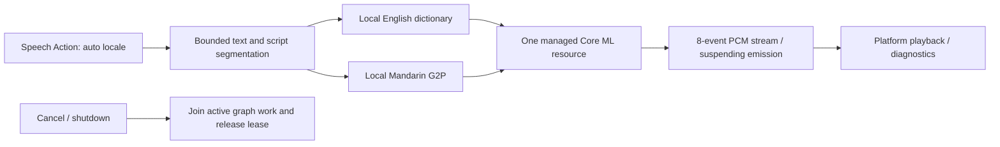

# Kokoro Core ML bilingual synthesis

Purpose: retain an optional, unregistered Mandarin and US English text-to-PCM adapter for explicit isolated tests. Production conversation and diagnostics use MOSS. Design goals: ModelKit-only capability contracts, context-owned weights, bounded output, explicit language errors and no runtime download/system fallback.

- ✅ ModelKitKokoro → ModelKitFluidAudio → pinned FluidAudio / Core ML. Replaces the old three-graph CoreAI adapter with seven-stage English v1.0 / Mandarin v1.1 graphs; 24 kHz mono PCM.
- ✅ No App binding or repository-provisioned weights are retained. An explicit test caller supplies a resource root. All graphs, voices, vocabulary, English dictionary and Mandarin pronunciation resources must exist locally before SDK loading. Only fixed local voice packs are requested; the SDK's high-level downloader/global G2P manager is not used.
- ✅ auto selects Mandarin/English script runs in their original order; en/en-US and zh/zh-CN/zh-Hans/zh-TW/zh-Hant are accepted explicitly. Mixed runs use af_heart and zf_001 respectively; a voice change at language boundaries is expected. Unsupported scripts throw.
- ✅ Mandarin uses number/date normalization, phrase dictionaries, jieba HMM, tone sandhi and g2pW polyphone disambiguation. The published g2pW six-input/probs contract is bridged locally; inference failure propagates instead of silently falling back to a dictionary reading. English uses a local Misaki dictionary with letter spelling for unknown words; decimals/currency should be expressed as English words. No network G2P model is invoked.
- ✅ Text ≤2048 UTF-8 bytes, ≤32 text segments, ≤510 phoneme scalars per graph call, ≤60 s generated PCM. English splits at word boundaries; Mandarin segments at punctuation or 60 characters. Unknown phonemes fail instead of being silently dropped by the SDK tokenizer.
- ✅ ModelManager owns one resource containing the two language stores and frontends. Unload/memory pressure releases the enclosing resource; cancellation holds admission until current graph work and cleanup finish.
- ❌ Japanese/French/Spanish frontends, a unified mixed-language voice, English neural G2P and full linguistic accuracy acceptance are not implemented.
- ❌ iOS 27 long-run stability is not established: upstream #889 reports uncatchable BNNS/MPSGraph crashes. This pin includes the padded-input mitigation tested upstream on macOS; .aneTailCpu avoids the documented OS 27 Metal route. Neither this choice nor a short Mac test proves an iPhone fix.

## Queue and processing contract

One active request, no pending request queue. A detached worker holds the managed resource lease and emits PCM in 4096-sample frames. InferenceSession holds at most eight events of ≤16,448 estimated bytes each; the serialized producer suspends when full. SpeechSynthesisAgent drains into bounded PCM while SpeechPlayback consumes cached audio when scheduled. Total audio remains capped at 60 seconds. Session cancellation/shutdown cooperatively stops future graph stages; backend calls already running may delay completion.

✅ Tests cover routing, input limits, missing resources and opt-in real bilingual PCM. ❌ Manual iPhone listening, sustained thermal/memory behavior and complete Agent end-to-end acceptance remain outstanding. See docs/Kokoro-Validation.md.

✅ Kokoro now emits PCM and completion with yieldSuspending into an eight-event buffer, propagating downstream backpressure through internal subsegments. It still computes one complete subsegment waveform before PCM emission and keeps the total 60-second request limit. A cancelled predecessor worker is joined before reuse; normal overlapping requests still fail inputBusy. ❌ This does not add token-level waveform generation or parallel inference.

✅ A synchronized cancellation handle cancels the worker without an actor-hop race, including termination before task installation. A subsequent request joins a cancelled predecessor; completed handles release their retained task.
