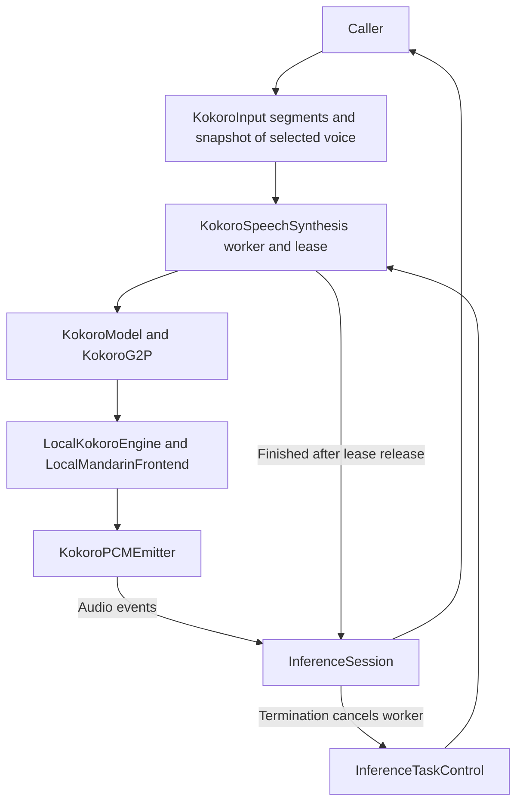

# Kokoro Bilingual Synthesis

## Summary

Local Mandarin and English synthesis, selectable by model ID `kokoro-82m`.

## Ownership and boundaries

LocalKokoroEngine and LocalMandarinFrontend are owned here and compiled with the adapter in ModelKitKokoro, which depends on ModelKit and FluidAudio.

The adapter owns request admission/format and a ModelResource lease. The directory-owned native engine/framework integration produces PCM; the consumer owns synthesis segmentation, caching and playback. No native capture, speaker, business or transport dependency exists.

## External relationships and data flow

The diagram shows runtime calls and data flow, not compilation dependencies.

## Pipeline and bounds

KokoroInput validates language/text; KokoroG2P owns frontend adaptation; KokoroModel loads local resource; KokoroSpeechSynthesis owns admission/output. ModelKitDefaults registers Kokoro with `releaseWhenIdle` residency. ModelKit’s [artifact catalog](../../../Support/Config/model-catalog.json) pins the FluidInference Core ML release and installs its files in `kokoro-82m-coreml` under the managed model root. Inference uses the installed files.

One detached worker holds a model lease, emits 4096-sample PCM frames and retains eight events of ≤16,448 bytes. Serialized yieldSuspending propagates consumer backpressure through subsegments, while each subsegment waveform is still computed completely first. Total generated audio ≤60 seconds; overlap rejects.

Core InferenceTaskControl handles installation/cancellation races and releases the worker reference on finish. A cancelled predecessor is joined before reuse; active native graph/classifier calls may delay release. Completed handles clear retained task. It does not implement token-level waveform streaming or parallel inference.

## Related design

[Parent design](../README.md)

## Languages and voice packs

The voice catalog publishes all 28 American and British English voices and all 103 voice packs in the Mandarin Core ML variant. It uses the language-specific graph and pronunciation frontend. British voices use the British lexicon. With automatic locale, script determines the language of each segment and the selected language governs neutral input such as numbers. Segments in the selected language use its chosen voice, and other segments use the corresponding default (`af_heart` or `zf_001`).

The engine reads the English default and Mandarin packs as local binary data, and reads the remaining English packs from local repository JSON via the SDK's decoder. It retains at most the most recently used pack per language in the resource. Missing or malformed packs fail the request.

## Local Kokoro and Mandarin engines

LocalMandarinFrontend bridges published six-input g2pW and already-numbered tone labels, preserving phrase dictionary priority. At most 510 normalized characters/phoneme scalars; ambiguous single characters classify sequentially after dictionary matching. Kokoro stages retain the SDK's 2000 acoustic-frame bound. Contextual inference errors propagate.

Cancellation checks between graph/classifier calls; synchronous Core ML work finishes before lease release. Backend methods never download or supply fallback audio.
