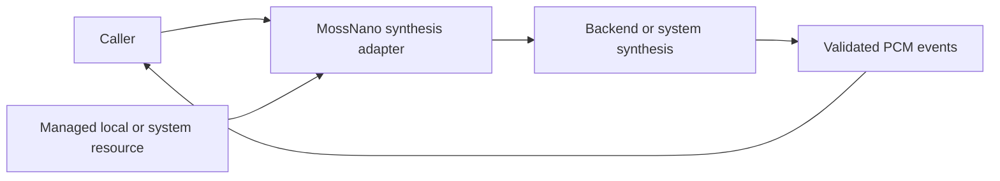

# MOSS-TTS-Nano Synthesis Adapter

## Summary

Managed local Chinese/English neural PCM with strict output validation and explicit EOS failure.

## Ownership and boundaries

The adapter owns request admission/format and a ModelResource lease. Backend/native framework owns prediction; caller owns synthesis segmentation/cache/playback. No native capture, speaker, business or transport dependency exists.

## External relationships and data flow

Runtime arrows show data or capability calls; dashed arrows show injection.

## PCM and worker contract

MossInput owns request adaptation; MossPCMEncoder downmixes native 48 kHz stereo to mono Float32, splits ≤4096 samples/event and assigns continuous sequence/time. One detached worker rejects overlap. Stream retains 256 events of ≤16,448 bytes, failing explicitly on full rather than dropping speech. Per native callback ≤400 ms; generated request audio ≤60 seconds including pauses.

Callbacks are serial/synchronous and mutex-protected; no upstream unbounded stream exists. Cancel synchronously marks worker, checked between predictions/frames. Lease releases only after inference exits; shutdown joins. Success requires stop tokens; exhausted frame budget fails. Missing artifacts do not trigger download/provider fallback.

Explicit voice/diagnostic warmup drains synthetic real PCM without playback. Adapter's 60-second audio-duration limit differs from Agent's 60-second execution timer and StorageAudio's eight MiB bound (about 43.7 seconds at this rate). Synthesis completion is not playback completion.

✅ Managed MOSS output, EOS enforcement and bounded PCM conversion are implemented.

❌ Additional languages and custom voice registration are not implemented.

## Related design

[Parent design](../README.md)
