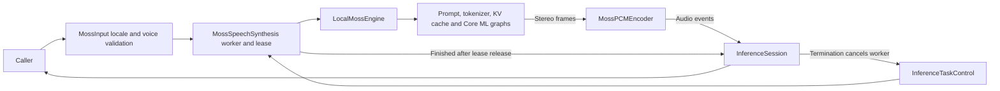

# MOSS-TTS-Nano Synthesis Adapter

## Summary

Managed local Chinese/English neural PCM with strict output validation and explicit EOS failure.

## Ownership and boundaries

The complete LocalMossEngine, tokenizer, prompt, tensor and graph pipeline is owned here and compiled with the adapter in ModelKitMossNano, which depends only on ModelKit and native frameworks.

The adapter owns request admission/format and a ModelResource lease. The directory-owned native engine/framework integration produces PCM; the consumer owns synthesis segmentation, caching and playback. No native capture, speaker, business or transport dependency exists.

## External relationships and data flow

The diagram shows runtime calls and data flow, not compilation dependencies.

## PCM and worker contract

MossInput owns request adaptation; MossPCMEncoder downmixes native 48 kHz stereo to mono Float32, splits ≤4096 samples/event and assigns continuous sequence/time. One detached worker rejects overlap. Stream retains 256 events of ≤16,448 bytes. Audio emission rejects a full buffer; the terminal finished event uses suspending delivery. Neither path drops speech silently. Per native callback ≤400 ms; generated request audio ≤60 seconds including pauses.

Callbacks are serial/synchronous and mutex-protected; no upstream unbounded stream exists. Core InferenceTaskControl synchronously cancels the installed or later-installed worker; native generation checks cancellation between predictions/frames and finish releases the worker reference. The lease releases after native generation exits; shutdown drains that lease. Terminal event delivery follows lease release and still responds to session cancellation. Success requires stop tokens; exhausted frame budget fails. Missing artifacts do not trigger download/provider fallback.

Explicit warmup drains PCM from real model execution without playback. The 60-second generated-audio bound is a provider output limit; caller deadlines, storage budgets and playback completion are separate contracts.

Managed MOSS output, EOS enforcement and bounded PCM conversion are implemented.

## Related design

[Parent design](../README.md)

## Local MOSS graph pipeline

Load four compiled graphs plus config, SentencePiece tokenizer and two preset voice-code files. CPU+GPU is required by Prefill/Step compatibility. Prompt builder/tokenizer/tensor code validates graph shapes, lengths and matching configuration.

Plan at most 32 text chunks. Each chunk has at most 512 prompt rows, 1024-position KV cache and 375 generated frames (30 seconds). Emit decoded 80 ms stereo frames synchronously; inter-chunk silence ≤400 ms. Consumer failure stops generation. Check cancellation before predictions and emission; already-running Core ML work must finish. Frame budget exhaustion without EOS is an error, not truncated success.

Source is adapted from FluidAudio PR 917 commit abbde6b9b80c0e7c2c488f35b0b225c0e8cab08f under [Apache notice](../../../../../docs/licenses/FluidAudio-Apache-2.0.txt); attribution remains in source. The request-level PCM limits above apply across all generated chunks.

## 待实现

- Additional languages and custom voice registration are not implemented.
