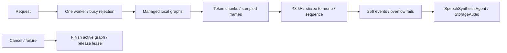

# MOSS-TTS-Nano synthesis

Purpose: the default Chinese/English synthesis capability. Design goals: local-only resources, managed ownership, bounded PCM and explicit failure instead of Kokoro fallback.

✅ ModelKitDefaults binds `moss-tts-nano` to this actor; normal App startup and the MossValidation scheme use the same provider. Chinese or mixed-script `auto` input uses zh_1; English uses en_2. Explicit zh/en locales choose the corresponding voice. Other locales fail. Text is limited to 2048 UTF-8 bytes; the backend tokenizes and splits at 50 tokens with at most 32 chunks.

One active detached worker holds a ModelResource lease; overlap fails with inputBusy, no pending request queue. Native 48 kHz stereo frames are downmixed to mono Float32, split into at most 4096 samples/event, and assigned continuous sequence/timestamps. At most 256 events of 16,448 estimated bytes are buffered; a full queue fails explicitly rather than dropping speech. Per-callback audio is at most 400 ms and total audio is capped at 60 seconds, including pauses. The callback is serial and synchronous, protected by a mutex for PCM state; no upstream AsyncThrowingStream is used.

Cancellation synchronously cancels the worker, checked between every Core ML prediction and emitted frame. The worker releases the lease after inference exits and then clears its admission; shutdown joins through the resource. A running system prediction cannot be forcibly interrupted. Success requires backend stop tokens; frame-limit exhaustion fails. Playback completion remains downstream of synthesis.

❌ iPhone sustained stability, numeric/date normalization parity, other languages and custom voice registration remain unverified or unimplemented. This is a real beta neural model, not demo audio. Missing artifacts never trigger downloads or another provider.

✅ Startup/diagnostics now perform real in-memory synthesis warmup before conversation admission or measured speech. It exercises lazy kernels using synthetic Chinese text, drains PCM without playback and propagates failures. The first device run took 10.63 s to first PCM without warmup; startup must absorb that compilation cost instead of extending StorageAudio timeouts. ❌ Warmup does not prove sustained runtime stability.
