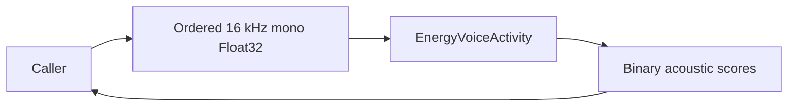

# Energy Activity Detection

## Summary

Weight-free adaptive RMS windows and hysteresis behind VoiceActivityCapability.

## Ownership and boundaries

ModelKitEnergy depends only on ModelKit. Request-local detector state supplies acoustic scores; The consumer owns speech/endpoint interpretation. Managed session owns exclusive operation lease.

## External relationships and data flow

The diagram shows runtime calls and data flow, not compilation dependencies.

## Algorithm and lifecycle

Per process ≤16,000 samples; consume 512-sample RMS windows and retain fewer than 512 residual samples, returning at most 32 scores. Adaptive quiet-noise floor and separate start/end energy thresholds provide hysteresis. reset clears state/sample position; finish flushes actual remainder; cancellation releases lease exactly once.

No weights, request queue or voice/noise identity model exists. An active score cannot distinguish user speech from TV/noise. Overlap and invalid format/order fail explicitly.

Bounded adaptive RMS detection is implemented.

## Related design

[Parent design](../README.md)

## 待实现

- No additional implementation work is declared for the documented RMS/hysteresis algorithm. It provides activity estimates; speech/noise discrimination is not an implemented classifier guarantee.
