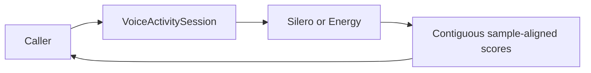

# Sample-Aligned Voice Activity Contract

## Summary

Ordered request-local acoustic activity scoring with explicit process/finish/reset/cancel semantics.

## Ownership and boundaries

Capability scores are model/acoustic estimates. Consumers own onset, pre-roll and silence endpoint decisions. This contract does not create a microphone, conversation or shared frame queue.

## External relationships and data flow

The diagram shows runtime calls and data flow, not compilation dependencies.

## Score and session interfaces

VoiceActivityScore validates nonnegative startSample, 1–16,000 sampleCount and finite probability in 0–1. Sessions accept ≤16,000 samples per process and return ≤64 scores. finish flushes residual input and releases; reset clears recurrent/sample position; cancel discards and joins.

Defaults independently selects installed available Silero or Energy. Energy's binary hysteresis is not a learned speech probability; loud background media/noise can be active. Native Apple detector is internal to ASR and supplies no assumed normal endpoint callback.

## Related design

[Parent design](../README.md) · [Energy](#energy) · [Silero](Silero/README.md)

## Energy

[`Energy/`](Energy/)

[EnergyVoiceActivity.swift](Energy/EnergyVoiceActivity.swift) scores 16 kHz mono Float32 PCM with 512-sample RMS windows, an adaptive quiet-noise floor and separate start/end thresholds. Each call accepts at most 16,000 samples, produces at most 32 scores and retains fewer than 512 residual samples. Reset clears the floor and position, finish scores the remainder, and cancellation releases the operation lease. Scores indicate acoustic activity. The caller interprets speech and endpointing.
