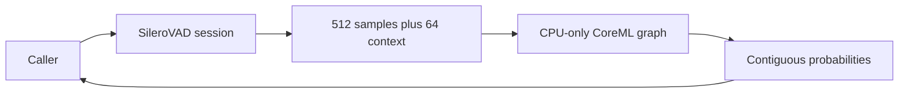

# Silero Streaming VAD

## Summary

Packet-independent 512-sample neural activity windows with request-local recurrent state.

## Ownership and boundaries

ModelKitSilero depends on ModelKit/ModelKitCoreML. SpeechPerception, rather than Gateway, owns onset/pre-roll/silence/turn policy. The adapter owns only scores and managed graph lifetime.

## External relationships and data flow

Runtime arrows show data or capability calls; dashed arrows show injection.

## Processing and cancellation

One actor operation rejects reentrant process/reset/finish overlap. Ordered 16 kHz mono process accepts ≤16,000 samples, retains <512 remainder and recurrent state after success, and returns scores directly without event queue. finish zero-pads tail but reports only actual samples. reset clears state. Failure cancels the session.

Cancel waits for active graph work before lease release; it cannot interrupt a running kernel. Local files are supplied by installed resource root; no runtime download or endpoint timer exists. HARNESS_TEST_SILERO=1 opts isolated tests into real artifacts, not production registration.

✅ Bounded window/recurrent scoring and joined cancellation are implemented.

## Related design

[Parent design](../README.md)
