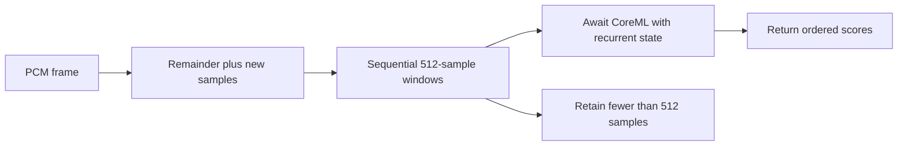

# Silero VAD

Purpose: implement VoiceActivityCapability in ModelKitSilero, depending only on ModelKit and ModelKitCoreML. Design goals: packet-independent windows, request-local recurrent state, bounded processing and managed lifetime.

- ✅ Silero VAD v6.2.1 CoreML, revision 523876545a57961474fee9df913e833e130560b8; 32 ms windows. Local artifacts and MIT license are recorded in Resources/Models and docs/licenses.
- ✅ Adaptation follows hugging-mac revision 60b176843703fd730a04e2b537212fba92b399a3; no Python runtime or additional Swift dependency.
- ✅ 16 kHz mono Float32 input; 512 new samples plus 64 context samples, audio[1,1,576], h/c[1,1,128]. Graph IO is Float16. Each output contains probability and the actual sample range.
- ✅ Reset clears recurrent state, remainder and positions. Finish pads the last window but counts only real input; cancel discards the remainder and joins active graph work.
- ✅ One session per manager-owned resource; ModelKitDefaults registers the factory; App injects the returned capability. No microphone, segmentation policy or Agent dependency belongs here.
- ❌ Background-noise quality, sustained iPhone use and false-positive/negative rates require device acceptance.

Gateway owns onset/endpoint policy: 96 ms onset, approximately 256 ms pre-roll, 800 ms silence, approximately 12 s internal chunks and 60 s turns. PlatformKit resamples; the model emits probabilities only. HARNESS_TEST_SILERO=1 enables real artifact tests for packet parity, reset, tails and cancellation.

## Queue and asynchronous processing contract

The actor-owned session accepts one operation at a time and rejects reentrant process/reset/finish calls while busy. Each process input is at most 16,000 samples. PCM is appended to a remainder buffer and consumed in 512-sample windows, carrying 64 context samples and recurrent state. After successful processing the remainder is shorter than 512 samples; returned scores are consumed directly, with no AsyncStream queue. Finish zero-pads the final window while reporting only its actual sample count. Failure cancels the session. Cancellation waits for the active operation before releasing the graph lease; it does not interrupt an executing CoreML kernel. No queued VAD requests are supported.

✅ The algorithm above describes the current implementation.

Maintenance: update this contract when changing producers, consumers, limits, ordering, cancellation or completion semantics.

✅ Local model fixtures use flat Models directories: Silero. Required backend files are loaded directly; download profiles are development-only configuration.
