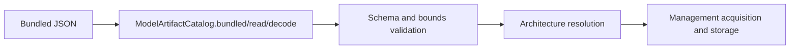

# ModelKit Artifact Configuration

Config owns the single bundled [model-catalog.json](model-catalog.json) and [ModelArtifactCatalog.swift](ModelArtifactCatalog.swift): source/package/architecture declarations, bounded parsing, validation and architecture resolution. Both compile into ModelKitRuntime; this directory introduces no target or external project dependency.

## Interfaces and flow

The schema-v2 catalog is one file so duplicate IDs/directories and whole-catalog bounds are checked together. Reads accept at most 1 MiB; catalogs allow up to 32 packages, 128 source patterns, 4096 required files per package and 16 architecture keys. Validation rejects unsafe paths, invalid HTTPS sources and incompatible file declarations. Architecture resolution replaces source, required files and estimated size together and validates the resolved catalog. Missing bundled resources and invalid declarations throw; there is no fallback catalog. Public API and resource basename remain stable.

Kokoro’s entry pins the English and Mandarin Core ML variants, both English pronunciation caches, Mandarin front-end data and the corresponding voice packs. Its required files cover the complete selected package.

Config is synchronous and has no tasks, mutable global state or persistence lifecycle. [Management](../Management/README.md) owns installed files, transfers, custom declaration persistence and immutable bundled-entry policy; it reuses this validation for custom declarations. Host business configuration owns active/default model choices, inference parameters and preferences. These are not bundled catalog fields.

[Parent design](../README.md)

The `smart-turn` record owns the pinned Smart Turn v3.2 compiled Core ML download, including its configuration and BSD-2-Clause notice. It is installed under `SmartTurn/` and exposed as `endpointConfirmation`.
