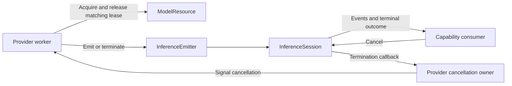

# Inference Data, Sessions and Resource Admission

✅ 统一异常封装 ModelFailure.swift 移到 ../../ModelFailure.swift，基础 ModelKit 编译归属保持；本目录不保留重复定义。

✅ InferenceAdmission 同步关闭接纳并更新代际，旧加载等待与迟到结果不能越过暂停；ModelResource.suspend 取消并加入活动租约／加载、保留已加载权重。终止关闭不可恢复。InferenceSession 允许唯一故障观察者，迟安装仍收到一次真实失败；不增加消费任务或事件队列。

## Summary

Model-neutral media/request identity, single-consumer streams and adapter-facing managed resource handles.

## Ownership and boundaries

Core owns no capture, files/network, provider selection or business state. ModelContext is defined here and controlled by Management through its narrow SPI; adapters acquire/release leases and implement finite cooperative native work.

## External relationships and data flow

The diagram shows runtime calls and data flow, not compilation dependencies.

## Stream admission

InferenceContext carries opaque requestID/scopeID values. Core never interprets an application scope or selects a provider.

StreamLimits defaults to capacity 64/maximumEventBytes 4096. Positive finite capacity×bytes is overflow-checked; nil permits unbounded event count but retains per-event validation. InferenceEmitter.yield rejects a full buffer; it never silently drops. yieldSuspending lets one serialized producer wait for capacity and wakes on consume/cancel/termination; it does not wait when capacity is nil. A second producer capacity waiter fails.

InferenceEvents permits one iterator. Check failure/cancellation before and after awaiting next; terminal error prevents delivery of buffered events. Normal finish drains accepted events. Cancel, consumer cancellation or handle destruction triggers a fast nonblocking adapter termination callback; consumers breaking early must cancel explicitly. Byte estimates are payload accounting, not measured total process memory.

## Managed resource lifetime

A ModelContext owns at most one ModelResource. Coalesce load within the injected maximumLoadWaiters; ModelLoadGate enforces injected maximumConcurrentLoads without a pending loader queue. Core declares no registration/construction state or runtime limit defaults. 资源默认只允许一个活动租约；显式 concurrent 资源支持多个独立租约，取消按 ID 关联，卸载等待所有活动请求退出。Chat FIFO 由 Management 拥有，Core 不维护 Agent 或本地任务队列。 Cancelled waiters do not cancel other loads. Lease IDs fence late release/callback registration. OperationAdmission separately rejects overlapping backend operations.

Unload gates new load/acquire and waits for active lease cleanup; completion releases usage, not weights. Shutdown additionally cancels registered active work and is terminal. Atomic memory pressure eviction skips loading/active/closing resources. Maintenance SPI gates retained handles through unload/disk removal; partial barriers release on failure.

## Data and error contracts

AudioFormat/AudioFrame validates model PCM and metadata, separate from PlatformKit/Storage values. ImageFrame accepts tightly packed upright RGB8 or retained read-only BGRA NativeImageBuffer with quarter-turn orientation, at most 4096 per dimension/4,194,304 pixels. The producer must not mutate retained storage. Encoded-image decoding/model tensors remain outside Core.

ModelResourceState is residency (unloaded/loading/ready/unloading/closed or unmanaged), not availability. CapabilityError/Availability provide neutral typed diagnostics; consumers localize and choose recovery.

Explicit session backpressure, media boundaries and matching-ID resource admission are implemented.

## Shared worker cancellation

InferenceTaskControl provides install/cancel/finish for one worker per request across Gemma, MOSS, Kokoro and OpenAI. Duplicate installation cancels the rejected worker and throws CapabilityError.inputBusy. Cancellation is idempotent, reaches late installation and runs outside the mutex. Finish releases the task reference and prevents a fast worker's late installation from retaining it again. Providers own joined cleanup and lease release; HTTP registration/cancellation remains OpenAI-owned. No worker queue or forced native interruption is introduced.

## Initialization and layer isolation

ModelLoadGate requires an explicit positive maximumConcurrentLoads. ModelContext requires an injected gate and positive maximumLoadWaiters; invalid configuration throws CapabilityError.invalidRequest. Context creation and resource acquisition do not choose production defaults. Owning runtimes share a gate when cross-resource admission is needed. Core sources typecheck together independently of the Language/Speech/Vision contract sources, Management and provider implementations.

## Related design

[Parent design](../README.md)

## 待实现

- Durable event replay, inference waiting queues and forced native interruption are not implemented.

✅ 模块根目录 [ModelFailure](../../ModelFailure.swift) 为只依赖Foundation的中立错误封装，仍编译于基础 ModelKit，结构同其他基础根；Source只记录包装处源码位置，不承诺异步调用堆栈。InferenceAdmissionError分类为unavailable／stopped，未知提供者错误为execution.failed并完整保留underlying，不在Core依赖领域能力或业务模块。

✅ 已实现：ModelResource 在 actor 内通过实际无缓存资源加载分支报告 loading；已有缓存直接返回，不发送事件；共享任务的等待方按真实等待结束报告退出，错误仍传播，不新增线程或订阅队列。

## Passive inference activity

ModelContext's management SPI reads an existing resource's inferenceActive flag. The flag follows its authoritative active lease, including acquire/cleanup barriers; it creates no resource and performs no load. Resource phase and lease activity are separate observations.

InferenceSession.phase exposes queued/running/finished/failed/cancelled; emitter marks execution start. Chat adapters bind waitForCompletion to their native worker cleanup. Cancelling a stream suppresses delivery immediately, while its owner can join actual provider exit before releasing serial execution.

InferenceSession.withCleanup scopes event consumption and joins native cleanup on success, parse/storage errors, early return and cancellation. An already drained normal terminal remains finished; cancelling unconsumed buffered output still suppresses its delivery.
