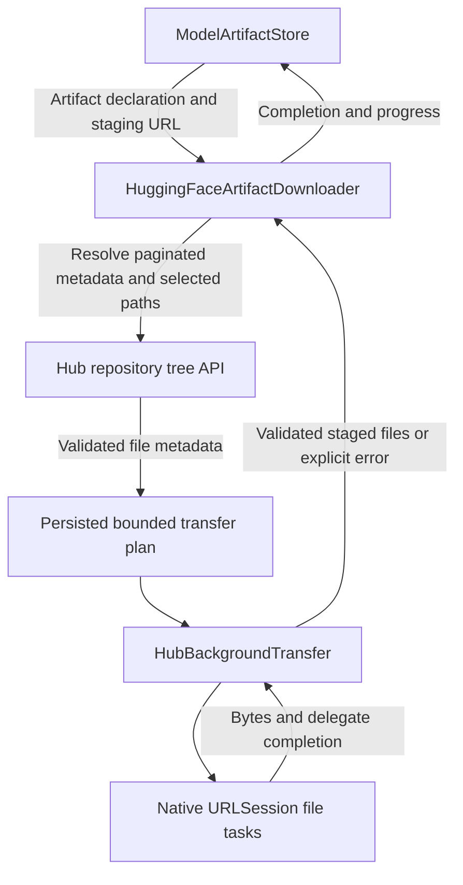

# Hugging Face Artifact Transfer

## Summary

Concrete ModelArtifactDownloader using swift-huggingface 0.9.0 metadata and native persisted background file transfer.

## Ownership and boundaries

ModelKitHub depends on ModelKitRuntime contracts and HuggingFace; Management remains ModelKit-only. The host supplies endpoint/cellular configuration and background completion. ModelKit disk storage publishes one installed tree; there is no permanent SDK weight cache.

## External relationships and data flow

The diagram shows runtime calls and data flow, not compilation dependencies.

## Planning and transfer

The downloader reads the repository tree at the pinned revision through the Hub API, decoding the SDK’s tree metadata. Pagination follows links on the same origin and revision path, rejects repeats, and admits up to 64 pages and 16,384 entries. Patterns select regular files; optional stripPrefix maps them to installed paths. The selected set must cover every required file before any transfer begins. Apply custom HTTPS endpoint/cellular per operation, without environment credentials. Persist plan ≤16,384 files/32 GiB/8 MiB JSON. Unsafe/reserved paths and length mismatches fail. Management owns two active/eight pending packages; HubBackgroundTransfer owns three active file tasks per package.

iOS uses stable generation-based background URLSession; macOS uses default session. Delegate completion moves files/submits next work independently of foreground/page tasks. isDiscretionary=false requests timely user-initiated transfers, not an OS guarantee. Relaunch reattaches tasks; completed files are validated before reuse.

Transient file errors retry at most three times. Available system resume data ≤8 MiB/file is persisted; server support/validity determines resume versus affected-file restart. Failure retains plan/generation/completed files; explicit retry/endpoint refresh reuses compatible files. Explicit cancel/delete joins tasks before discarding staging. Successful publication removes bookkeeping.

Progress is actual byte-weighted delegate state including reused files. The host supplies background event completion; any foreground preparation deadline belongs to that host, not this downloader. User force-quit may cancel OS transfers; no durable uninterrupted network guarantee is claimed.

## Related design

[Parent design](../README.md)

单次读取／解码 .hub-plan.json，基于同一 ID/revision/endpoint 快照决定复用；计划不匹配时按原下载流程重新获取元数据，不二次读取本地计划。只复用当前 .hub-plan/.hub-resume 所属且校验通过的文件，不导入旧 .hub-snapshot。
