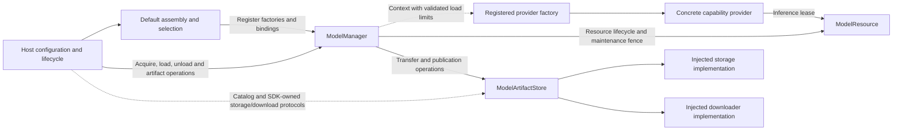

# Model Management and Default Assembly

## Summary

Shared directory for independent lifecycle, artifact acquisition and default-provider assembly targets.

## Ownership and boundaries

ModelKitRuntime depends only on ModelKit. Management owns ModelState (including registered/constructing), maps Core ModelResourceState exhaustively, and injects loading limits. Its throwing ModelManager initializer defaults to four concurrent loaders and 32 waiters per resource; positive custom limits are permitted and invalid values fail before registrations are created. ModelKitDefaults uses ModelAssembly SPI for production registration/replacement and depends on Runtime/concrete providers. ModelKitHub separately depends on Runtime/HuggingFace. The host injects storage, downloader and native quiescence; Runtime imports no concrete provider or Storage. Directory grouping does not permit reverse dependencies.

| Target | Explicit root source ownership |
| --- | --- |
| ModelKitRuntime | ModelManager.swift, ModelRegistration.swift, ModelArtifactContracts.swift, ModelArtifactStore.swift, ArtifactDownloadTransport.swift |
| ModelKitDefaults | ModelKitDefaults.swift, ChatDefaults.swift, SpeechDefaults.swift, VisionDefaults.swift, SpeechProviderSelection.swift |
| ModelKitHub | HuggingFace/ source files |

The two root targets use explicit disjoint sources/excludes. Registration and artifact contracts are separated by file; native archive transfer remains Runtime-owned. Default assembly owns the process manager/configuration; Chat, Speech and Vision register their own providers. SpeechProviderSelection chooses once before admission; it never retries failed active inference on another provider.

## External relationships and data flow

The diagram shows runtime calls and data flow, not compilation dependencies.

## Public lifecycle

get by capability or ModelID preserves provider identity. Deferred get constructs only the lightweight provider; default get/load/warmup loads resources. Unload releases weights and retained handles reload later. Availability checks lightweight capability state, independently of residency. Shutdown is a terminal owner operation.

| Boundary | Limit / policy |
| --- | --- |
| Registrations / default bindings | 32 / six; atomic collision rejection |
| Concurrent factories | Four; excess construction rejects |
| Concurrent loaders | Configurable positive limit, default four; no loader queue |
| Construction waiters | 32 per model |
| Resource load waiters | Configurable positive limit, default 32 per resource |
| Active inference | Exactly one per model |
| Unload / replacement | One transition per entry; overlap rejects |
| Shutdown | One shared joined task |

Concurrent gets coalesce construction. Factory failure cleans its context and permits explicit future acquisition; failed load retains provider for explicit retry. Cancelled waiters do not cancel shared work. Unload gates and drains without cancelling admitted sessions; shutdown cancels/joins construction/load/inference, including pending replacement candidates. Generations prevent late load restoring retired resources.

Explicit SPI replacement constructs candidate before retiring old resource, validates identical capabilities and cancels/joins old handles. Candidate failure retains old provider. Consumers must resolve the new binding. releaseWhenIdle memory pressure skips busy/loading/unconstructed entries and drops idle weights atomically, without timed eviction or byte promises.

## Artifact contracts and operations

ModelRegistration associates providers with artifact IDs. Schema v2 declares HF repository/revision/patterns/stripPrefix or HTTPS ZIP URL/optional archive SHA-256 plus license/compatibility/required files. Bounds: 1 MiB catalog, 32 packages, 128 patterns and 4096 required files. Malformed/traversing sources reject; estimatedBytes is display/storage estimate, not integrity evidence.

ModelArtifactStore owns two active package slots and eight FIFO pending requests; overflow rejects. Persist generations before admission, validate a symlink-free installed tree (16,384 entries/32 GiB) and required files, then atomically publish through injected storage with actual path/size receipt. ZIP bounds are 64 MiB compressed/256 MiB expanded with safe extraction and optional archive trust anchor. No duplicate permanent SDK cache exists.

Valid settled receipts determine installed state. Identity/revision/path/actual size failures remain observable, with explicit delete available. A valid published installation survives later transfer-index write failure as a bookkeeping warning. Cancel after installation is a no-op; explicit active cancel joins and discards staging. HF transient failure retains compatible generation/completed files for explicit retry/relaunch; network codes remain explicit.

## Maintenance and background separation

Delete gates every referencing resource before host quiescence, drains/unloads, joins transfer cancellation, removes files, then reopens admission. Retained handles cannot reload mid-delete. Installing never starts inference. Background native transfer/OS reattachment belongs to the injected downloader; Manager retains package state independently of pages. Force-quit/server resume behavior remains conditional rather than guaranteed.

✅ Shared providers, bounded lifecycle/replace and receipt-based artifact management are implemented.

❌ Timed eviction, global inference scheduling, general orphan-stage collection and batch acquisition are not implemented.

## Default assembly and provider selection

| Capability | Binding |
| --- | --- |
| Chat | Gemma 4 E2B QAT; explicit cloud configuration replaces chat only |
| Recognition | Enabled installed available Nemotron, else modern Apple |
| Synthesis | Enabled installed available MOSS, else Apple |
| VAD | Installed available Silero, else Energy, independent of ASR preference |
| Pose | yolo26n-pose only |
| Judgment | No default; missingDefault |

Stable speech facades select before an operation; active inference failure does not switch provider. Custom recognition/synthesis default off. Local adapters never auto-download. Kokoro is not registered. Apple recognition combines transcriber/detector; ordinary silence timing uses external Silero/Energy rather than assumed native activity callbacks.

## Singleton and replacement

The first manager call fixes canonical root/initial configuration and stores one assembly task before suspension. At most 32 callers join; different roots or explicit conflicting initial cloud configuration fail. Caller cancellation does not cancel assembly. Failure is retained without an alternate manager; shutdown stays terminal.

configureChat constructs/replaces only the chat binding through existing manager SPI; nil restores Gemma. Other resources/defaults remain. Consumers resolve current binding each request; configured does not mean network reachable/authenticated. configureArtifacts validates matching identities/revisions/directories and injects protocols without importing Storage. JSON defines files, never executable factories.

## Preparation and residency

Registration is lazy. Explicit voice admission/diagnostics prepares selected capabilities and drains real synthetic TTS warmup without playback; initialization does not warm. Failure propagates. Independent per-model leases let ASR/VAD cooperate but reject overlap on the same model.

Large local Gemma/Nemotron/MOSS and pose releaseWhenIdle opt into memory-pressure policy; Silero/system speech retain. Local Gemma requires supported OS/hardware/artifacts; explicit cloud works without Gemma artifacts. Native simulator CoreAI support is a separate backend constraint.

✅ Lazy process assembly, independent speech switches and explicit current-binding replacement are implemented.

❌ Active-inference provider fallback, automatic variant/quantization selection and judgment provider are not implemented.

[HuggingFace transfer](HuggingFace/README.md) · [Core lifecycle mechanisms](../Core/README.md)

[Parent design](../README.md)
