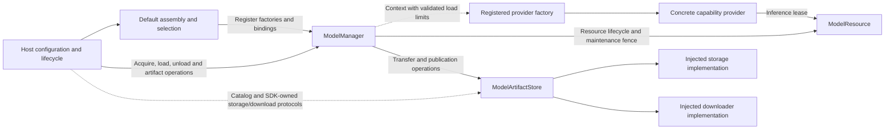

# Model Management and Default Assembly

✅ ModelContainer.swift 移至 ../../ModelContainer.swift；本目录保留默认注册／选择辅助及运行机制，仍使用显式、互斥源码清单。

✅ 模块根目录 [ModelContainer.swift](../../ModelContainer.swift) 拥有根、四子能力及私有默认装配；ModelScope 合并一个准备任务，最多32个等待者，配置替换拒绝重叠。ModelManager 仍是私有注册与资源机制，消费者通过公开子能力协议访问。

## Summary

Shared directory for independent lifecycle, artifact acquisition and default-provider assembly targets.

## Ownership and boundaries

ModelKitRuntime depends only on ModelKit. Management owns ModelState (including registered/constructing), maps Core ModelResourceState exhaustively, and injects loading limits. Its throwing ModelManager initializer defaults to four concurrent loaders and 32 waiters per resource; positive custom limits are permitted and invalid values fail before registrations are created. ModelKitDefaults uses ModelAssembly SPI for production registration/replacement and depends on Runtime/concrete providers. ModelKitHub separately depends on Runtime/HuggingFace. The host injects storage, downloader and native quiescence; Runtime imports no concrete provider or Storage. Directory grouping does not permit reverse dependencies.

| Target | Explicit root source ownership |
| --- | --- |
| ModelKitRuntime | ModelManager.swift, ModelRegistration.swift, ModelArtifactContracts.swift, ModelArtifactStore.swift, ArtifactDownloadTransport.swift |
| ModelKitDefaults | 模块根 ModelContainer.swift；本目录 ChatDefaults.swift, SpeechDefaults.swift, VisionDefaults.swift, SpeechProviderSelection.swift |
| ModelKitHub | HuggingFace/ source files |

The two targets use explicit disjoint sources/excludes; Defaults is rooted at ModelKit to include the public entry file, while Runtime remains rooted in this directory. Registration and artifact contracts are separated by file; native archive transfer remains Runtime-owned. Each ModelContainer owns its manager/configuration; Chat, Speech and Vision register their own providers. SpeechProviderSelection chooses once before admission; it never retries failed active inference on another provider.

## External relationships and data flow

The diagram shows runtime calls and data flow, not compilation dependencies.

## Public lifecycle

get by capability or ModelID preserves provider identity. Deferred get constructs only the lightweight provider; default get/load/warmup loads resources. Unload releases weights and retained handles reload later. Availability checks lightweight capability state, independently of residency. Shutdown is a terminal owner operation.

| Boundary | Limit / policy |
| --- | --- |
| Registrations / default bindings | 32 / six; atomic collision rejection |
| Concurrent factories | Four; excess construction rejects |
| Concurrent loaders | Configurable positive limit, default four; no loader queue |
| Construction waiters | 32 per model |
| Resource load waiters | Configurable positive limit, default 32 per resource |
| Active inference | Exactly one per model |
| Unload / replacement | One transition per entry; overlap rejects |
| Shutdown | One shared joined task |

Concurrent gets coalesce construction. Factory failure cleans its context and permits explicit future acquisition; failed load retains provider for explicit retry. Cancelled waiters do not cancel shared work. Unload gates and drains without cancelling admitted sessions; shutdown cancels/joins construction/load/inference, including pending replacement candidates. Generations prevent late load restoring retired resources.

Explicit SPI replacement constructs candidate before retiring old resource, validates identical capabilities and cancels/joins old handles. Candidate failure retains old provider. Consumers must resolve the new binding. releaseWhenIdle memory pressure skips busy/loading/unconstructed entries and drops idle weights atomically, without timed eviction or byte promises.

## Artifact contracts and operations

ModelRegistration associates providers with artifact IDs. Schema v2 declares HF repository/revision/patterns/stripPrefix or HTTPS ZIP URL/optional archive SHA-256 plus license/compatibility/required files. Bounds: 1 MiB catalog, 32 packages, 128 patterns and 4096 required files. Malformed/traversing sources reject; estimatedBytes is display/storage estimate, not integrity evidence.

ModelArtifactStore owns two active package slots and eight FIFO pending requests; overflow rejects. Persist generations before admission, validate a symlink-free installed tree (16,384 entries/32 GiB) and required files, then atomically publish through injected storage with actual path/size receipt. ZIP bounds are 64 MiB compressed/256 MiB expanded with safe extraction and optional archive trust anchor. No duplicate permanent SDK cache exists.

Valid settled receipts determine installed state. Identity/revision/path/actual size failures remain observable, with explicit delete available. A valid published installation survives later transfer-index write failure as a bookkeeping warning. Cancel after installation is a no-op; explicit active cancel joins and discards staging. HF transient failure retains compatible generation/completed files for explicit retry/relaunch; network codes remain explicit.

## Maintenance and background separation

Delete gates every referencing resource before host quiescence, drains/unloads, joins transfer cancellation, removes files, then reopens admission. Retained handles cannot reload mid-delete. Installing never starts inference. Background native transfer/OS reattachment belongs to the injected downloader; Manager retains package state independently of pages. Force-quit/server resume behavior remains conditional rather than guaranteed.

Shared providers, bounded lifecycle/replace and receipt-based artifact management are implemented.

## Default assembly and provider selection

| Capability | Binding |
| --- | --- |
| Chat | Gemma 4 E2B QAT; explicit cloud configuration replaces chat only |
| Recognition | Enabled installed available Nemotron, else modern Apple |
| Synthesis | Enabled installed available MOSS, else Apple |
| VAD | Installed available Silero, else Energy, independent of ASR preference |
| Pose | yolo26n-pose only |
| Judgment | No default; missingDefault |

Stable speech facades select before an operation; active inference failure does not switch provider. Custom recognition/synthesis default off. Local adapters never auto-download. Kokoro is not registered. Apple recognition combines transcriber/detector; ordinary silence timing uses external Silero/Energy rather than assumed native activity callbacks.

## Instance assembly and replacement

Each ModelContainer owns one assembly task and its resource root/configuration. At most 32 callers join that instance; distinct roots never share a manager. Caller cancellation does not cancel shared assembly. Failure is retained without an alternate manager; shutdown stays terminal.

configureChat constructs/replaces only the chat binding through existing manager SPI; nil restores Gemma. Other resources/defaults remain. Consumers resolve current binding each request; configured does not mean network reachable/authenticated. configureArtifacts validates matching identities/revisions/directories and injects protocols without importing Storage. JSON defines files, never executable factories.

## Preparation and residency

Registration is lazy. Explicit voice admission/diagnostics prepares selected capabilities and drains real synthetic TTS warmup without playback; initialization does not warm. Failure propagates. Independent per-model leases let ASR/VAD cooperate but reject overlap on the same model.

Large local Gemma/Nemotron/MOSS and pose releaseWhenIdle opt into memory-pressure policy; Silero/system speech retain. Local Gemma requires supported OS/hardware/artifacts; explicit cloud works without Gemma artifacts. Native simulator CoreAI support is a separate backend constraint.

Instance-local lazy assembly, independent speech switches and explicit current-binding replacement are implemented.

[HuggingFace transfer](HuggingFace/README.md) · [Core lifecycle mechanisms](../Core/README.md)

[Parent design](../README.md)

## 当前绑定代理

ModelLanguageContainer 属于默认装配目标，按每个请求解析当前 chat binding，并转交工具/图片支持和推理会话。它不认识 App、UI、设置 schema 或业务仓库；失败的 availability 返回不可用诊断，实际 chat 错误继续抛出。SDK 仍只依赖自身目标和批准的第三方 SDK。

## 待实现

- Timed eviction, global inference scheduling, general orphan-stage collection and batch acquisition are not implemented.

- Active-inference provider fallback, automatic variant/quantization selection and judgment provider are not implemented.

## Storage 文件作用域接入

✅ 模型制品适配器由 App 注入 Files；后台回调复用同一制品服务。制品绑定停止时关闭接纳、取消并加入下载并保留清理错误，释放配置后允许在新 Files 作用域重新绑定，不停止无关模型实例。App 只转交接口与调度启停。

✅ 默认装配根实例独立，制品协议及托管加载／卸载不依赖应用模块；消费者不获得管理器。

✅ 模块根目录的 ModelContainer.swift 统一模型根／子能力及实例私有默认装配；旧进程入口与 CurrentChatCapability 已移除。App 同根缓存、流式错误一次观察、停止和权重保留由自动化覆盖，真实模型／硬件证据独立记录。

✅ 语言／视觉使用同一 ModelResourceControlling 协议提供 load、warmup、unload、status；语音按 recognition／synthesis／voiceActivity 选择同样操作，卸载覆盖该类别的本地和系统后端，状态反映选中的实际后端。移除合成专用卸载命名，保持接口一致。

✅ 已实现：路径字符白名单缓存为不可变CharacterSet，避免资源轮询对每个路径字符重复构造集合；路径规则、安全边界及磁盘校验不变。

✅ 已实现：根生命周期、配置前置校验接入统一原生错误报告，取消与 admission 错误亦保留；原始 throw 类型由 underlying 保留，复合清理错误继续包含全部底层错误。

根启动／停止传播准备失败和全部清理错误；停止主动取消未完成装配时，原始 CancellationError 留在诊断，正常清理仍可完成。availability/support 的非抛错能力查询继续返回中立不可用值，原始失败同步走报告端口，不解释业务提示。

✅ ModelScope为全部原生异常报告包装ModelFailure，根生命周期使用throws(ModelFailure)。装配／制品释放的主错误和清理错误统一分开保留，不再声明专用清理聚合类型；availability／推理流仍遵循各自领域协议，不以根容器迁移冒充所有SDK抛错已替换。

✅ 已实现：warmup 提供模块自有 reportLoading(Bool) 回调；先构造后端，再由真实资源 load 区间报告开始／结束；ready／unmanaged 不报告，语音按当前选中后端统一准备。回调不包含 UI／Signal，失败结束后原样上抛。

## Artifact observation

The artifact capability exposes independent bounded newest-one revision observation. Changes wake consumers without JSON fingerprints or business polling. Native progress reports synchronously coalesce; cancellation detaches observers and shutdown ends streams.

## Direct container contract

Artifact revision observers are independently bounded to 16 newest-one streams. Native progress coalesces synchronously, changes wake consumers without JSON polling, and close ends observation. Current cross-module ownership is defined by the [overall design](../../../README.md).

## 直连链路当前契约

✅ 模拟器依赖闭包排除 CoreAI，真实设备保持现有模型绑定，不注入假模型。

## Passive state reads

ModelManager exposes registered resource state snapshots and inference-lease activity without constructing or loading providers. ModelArtifactStore.stateSnapshot reads only in-memory transfer/queue/delete/failure/restoration state, unlike snapshots() which can restore transfer records and inspect installation. SpeechSelection.stateSnapshot reads backend-routing preferences classified as Runtime; it does not resolve providers or probe artifacts. ModelScope retains the already-prepared manager as an owner alias for passive reads.

ModelState has stable raw values and finite cases for registration/resource State reflection. Container Runtime and resource child descriptors share that vocabulary; no debug description is used as the State wire value.

ModelManager.resourceIDs returns registry identities only. resourceStateSnapshot(id) reads one selected resource; module metadata catalogs never enumerate all resource state values. Capability parent State contains indices, with resource phase/lease reflection available only through the exact resource reader.

ChatDefaults 注册工厂接受中立 ModelID，ModelScope 按固定云端配置复用注册客户端；本地使用共享 chat 注册。SerialChat 拥有一运行、默认八等待的 FIFO，满时明确拒绝；取消运行加入底层清理后推进，停止清空等待并加入运行。模拟器本地明确不可用，不伪装原生工具支持。

HF 只使用当前传输计划和完成文件；不从 .hub-snapshot 搬迁旧 SDK 文件。安装收据失效应显式删除/重新下载，不自动修复旧路径。

SerialChat forwards full native calls through the existing 128-event queued session without a single-event byte ceiling. Local pending-request bounds and cancellation/cleanup FIFO are independent of argument size; backend capability and token-window errors remain explicit.
