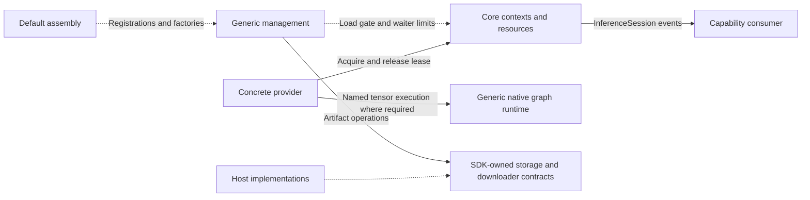

# ModelKit Shared Support

✅ Management 的 ModelContainer 组合实例级默认装配与四个子能力；Core 提供同步 InferenceAdmission、可恢复资源暂停和流式错误观察。Provider 和资源机制保持隔离。

## Purpose and boundaries

Support groups shared SDK code while preserving independent compilation and ownership. Core owns neutral data/concurrency mechanisms; Backends owns reusable native graph/tensor execution; Management owns lifecycle/artifacts and default assembly in separate targets; Speech owns helpers shared within its capability domain. Concrete providers remain in Language, Speech and Vision.

## Dependencies and ownership

| Directory | Compiled owner and relationships |
| --- | --- |
| Core | Base ModelKit; neutral mechanisms do not require capability-domain contracts, management or providers |
| Backends/CoreAI, CoreML | Independent ModelKitCoreAI/ModelKitCoreML; native frameworks only |
| Management | ModelKitRuntime → ModelKit; ModelKitDefaults → Runtime, ModelKit and registered concrete providers |
| Management/HuggingFace | ModelKitHub → Runtime and HuggingFace; implements Runtime's downloader protocol |
| Speech/Apple | PCMCodec in ModelKitAppleSpeech together with Apple ASR/TTS; ModelKit and native audio frameworks |

Directory grouping permits no reverse dependency. ModelKitRuntime does not select concrete providers; Defaults owns registration/selection. Provider algorithms own model-specific state and preprocessing. Sharing a native SDK alone does not make those algorithms shared infrastructure.

## Runtime flow

The diagram shows lifecycle/data relationships, not compilation dependencies. Solid arrows are calls/results; dashed arrows inject limits, implementations or factories.

Independent source ownership, neutral Core mechanisms, generic native execution, lifecycle/assembly boundaries and shared Apple PCM conversion are implemented.

[Core](Core/README.md) · [Backends](Backends/README.md) · [Management](Management/README.md) · [Speech](Speech/README.md) · [Parent design](../README.md)

## 待实现

- General engine interchange and cross-model scheduling are not implemented. Capability and platform-specific limits are documented by the owning directory.

## Storage 文件作用域接入

✅ 模型制品适配器由 App 注入 Files；后台回调复用同一制品服务。制品绑定停止时关闭接纳、取消并加入下载并保留清理错误，释放配置后允许在新 Files 作用域重新绑定，不停止无关模型实例。App 只转交接口与调度启停。
