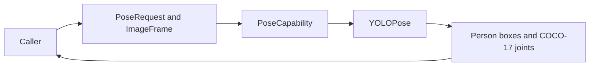

# Pose Inference Contract

## Summary

One-image model-independent pose requests/results with original upright pixel coordinates and request identity.

## Ownership and boundaries

Core owns ImageFrame/native buffers. PoseCapability owns inference contract; YOLO owns its image execution, preprocessing and decoding. Consumers own camera I/O, frame cadence, pose interpretation and motion decisions.

## External relationships and data flow

The diagram shows runtime calls and data flow, not compilation dependencies.

## Coordinate and lifetime contract

Input is unmirrored upright geometry in RGB or retained native BGRA with orientation. Result boxes/joints use original upright pixel dimensions, top-left origin, retained low-confidence scores and InferenceContext. Confidence is a model score, not identity or calibrated certainty. One image per call; no video frame queue exists.

Shared manager supplies .pose under one operation lease. Native scaleFit/end-to-end candidates are filtered/restored by the adapter without second NMS. Consumers independently choose presentation/semantic policies.

✅ Typed image pose inference and concrete YOLO provider are implemented.

❌ Temporal identity and general model video sessions are not implemented.

## Related design

[Parent design](../README.md) · [YOLO](YOLO/README.md)
