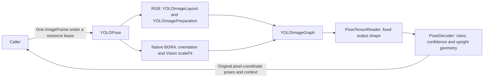

# YOLO26n-Pose Adapter

## Summary

Native/RGB pose inference over the pinned official end-to-end INT8 Core ML artifact.

## Ownership and boundaries

YOLOImageGraph, YOLOImageLayout/YOLOImagePreparation and PoseTensorReader belong here. ModelKitYOLOPose depends on ModelKit/ModelKitCoreML for capability and generic tensor/error values. The model owns 640-pixel geometry, 114 padding, scaleFit/direct execution and [1,300,57] validation.

ModelResource owns one preparation/prediction/decode lease. Management provisions files; adapter never downloads, tracks people or chooses presentation count.

## External relationships and data flow

The diagram shows runtime calls and data flow, not compilation dependencies.

## Resource and tensor contract

Defaults binds only yolo26n-pose; each reload resolves available .mlmodelc/.mlpackage afresh. Local package compilation is native preparation, not PyTorch conversion. Catalog pins release asset and archive SHA-256 a809a889f1d324299090c6d9f4211ddd3588cc525f5f78d79691de45bd12f042; required files/license remain metadata. Other model formats are not accepted.

Input is 640×640. Exactly one discovered Float32 output [1,300,57]: box x1/y1/x2/y2, score/class then 17 joint x/y/score triples. Class zero is person. Score threshold is 0.25; output uses stable score order. This end-to-end head requires no external NMS; overlapping detections are preserved. Reject malformed shapes/nonfinite invalid scores/classes/joints and skip degenerate boxes while preserving off-image coordinates.

## Preprocessing and cleanup

Native Vision retains BGRA and scaleFit with orientation, avoiding full-frame RGB conversion. Default cpuAndNeuralEngine is configuration, not hardware-placement guarantee. RGB/custom path uses vImage rounded dimensions and opaque 114 padding; native continuous offsets/framework padding are not assumed pixel-identical.

One lease spans preparation/prediction/decoding; cancel/unload/shutdown joins synchronous native work. Consumer display limits and geometric identity policy are outside this adapter. Artifact metadata declares AGPL-3.0; licensing notices remain with Resources/docs.

Native/RGB bounded end-to-end pose decoding and reload-aware resource selection are implemented.

## Related design

[Parent design](../README.md)

## 待实现

- Temporal tracking and additional model size variants are not implemented.
